# Ambarcı — 2. Hafta Raporu: Veritabanı ve kimlik

| | |
| --- | --- |
| Öğrenci | Yunus Emre ATMAZ |
| Öğrenci no | 221450018 |
| Danışman | Ali Osman Çıbıkdiken |
| Ders | Senior Design Project |
| Hafta | 2. hafta (12–22 Ekim 2026; 1. haftadan devredenlerle birlikte 17–21 Ekim'de yapıldı) |
| Proje | Ambarcı — Yapay Zekâ Destekli Saha Stok Asistanı |

## Proje bağlantıları

| | |
| --- | --- |
| GitHub deposu | [github.com/yunopo42/AmbarciApp](https://github.com/yunopo42/AmbarciApp) |
| 2. hafta sonu kod durumu (etiket) | [hafta-2](https://github.com/yunopo42/AmbarciApp/tree/hafta-2) |
| Commit geçmişi | [github.com/yunopo42/AmbarciApp/commits/main](https://github.com/yunopo42/AmbarciApp/commits/main) |
| 2. hafta issue'ları | [Hafta 2 milestone'u](https://github.com/yunopo42/AmbarciApp/milestone/2?closed=1) · [Pull requests](https://github.com/yunopo42/AmbarciApp/pulls?q=is%3Apr) |
| Web paneli (Vercel) | [ambarci-app.vercel.app](https://ambarci-app.vercel.app) |
| API sağlık kontrolü ve belgesi (Render) | [/v1/health](https://ambarci-api.onrender.com/v1/health) · [Swagger](https://ambarci-api.onrender.com/docs) |
| Veritabanı ve izolasyon belgesi | [docs/veritabani.md](https://github.com/yunopo42/AmbarciApp/blob/main/docs/veritabani.md) |
| Tasarım değerleri | [docs/tasarim.md](https://github.com/yunopo42/AmbarciApp/blob/main/docs/tasarim.md) |
| 8 haftalık plan | [docs/plan.md](https://github.com/yunopo42/AmbarciApp/blob/main/docs/plan.md) |
| Rapor ve belgeler (Drive) | [Proje klasörü](https://drive.google.com/drive/folders/1ON1zxHnz4k0fIdIXaCvwqlk0g4buD0_n?usp=sharing) |

API ücretsiz planda çalıştığı için 15 dakika istek almazsa uyur; ilk açılışta yaklaşık bir dakika beklemek gerekebilir. Bölüm 3'teki **Kod** bağlantıları `hafta-2` etiketini açar; kod sonraki haftalarda değişse de bu haftanın sonundaki hâli görünür.

## 1. Özet

Bu haftanın hedefi veritabanını ve kimlik doğrulamayı kurmak, 1. haftadan devreden işleri bitirmekti. Supabase projesi, 10 tablolu veritabanı şeması ve RLS politikaları, web ve mobilde e-posta + şifreyle giriş, API'de oturum, şirket, rol ve depo yetkisi kontrolleri, şirket kurma ve davet koduyla katılma (API ve web), demo verisi, Claude araç çağırma denemesi ve beş ekranın tasarımı tamamlandı. **Hafta kapısı geçildi:** iki şirket arasında veri sızıntısı olmadığı hem veritabanı (RLS, 22 test) hem API (3 test) düzeyinde gerçek veritabanında doğrulandı. Supabase güvenlik denetiminde tablo ve RLS uyarısı yok; tek uyarı, ücretsiz planda açılamayan sızdırılmış şifre kontrolüyle ilgili (bölüm 6).

## 2. Bu hafta yapılanlar

| İş | Durum | Not |
| --- | --- | --- |
| README ve 8 milestone (1. haftadan) | Tamamlandı | [#11](https://github.com/yunopo42/AmbarciApp/issues/11), [PR #21](https://github.com/yunopo42/AmbarciApp/pull/21); Hafta 2–8 milestone'ları plandaki tarihlerle açıldı |
| Supabase projesi (1. haftadan) | Tamamlandı | [#12](https://github.com/yunopo42/AmbarciApp/issues/12), [PR #22](https://github.com/yunopo42/AmbarciApp/pull/22); proje eu-west-1'de (bkz. bölüm 6) |
| Claude API anahtarı, harcama limiti, 20 mesajla araç çağırma (1. haftadan) | Tamamlandı | [#13](https://github.com/yunopo42/AmbarciApp/issues/13), [PR #25](https://github.com/yunopo42/AmbarciApp/pull/25); sohbet modeli Haiku 5.5 seçildi ([ADR-001](https://github.com/yunopo42/AmbarciApp/blob/main/docs/kararlar/ADR-001-sohbet-modeli.md)) |
| Demo verisi: ABC Elektrik (1. haftadan) | Tamamlandı | [#14](https://github.com/yunopo42/AmbarciApp/issues/14), [PR #26](https://github.com/yunopo42/AmbarciApp/pull/26); başlangıç stokları 3. haftaya bırakıldı |
| Drizzle şeması ve migration'lar | Tamamlandı (daraltılmış kapsam) | [#15](https://github.com/yunopo42/AmbarciApp/issues/15), [PR #24](https://github.com/yunopo42/AmbarciApp/pull/24); 2. ve 3. haftada gereken 10 tablo; hareket ve işlem tabloları 3. haftada |
| Supabase Auth: web ve mobilde giriş/çıkış | Tamamlandı | [#16](https://github.com/yunopo42/AmbarciApp/issues/16), [PR #27](https://github.com/yunopo42/AmbarciApp/pull/27); web (yerel ve Vercel) ve Android development build'de denendi |
| Backend'de JWT doğrulama ve yetki guard'ları | Tamamlandı | [#17](https://github.com/yunopo42/AmbarciApp/issues/17), [PR #23](https://github.com/yunopo42/AmbarciApp/pull/23), [PR #28](https://github.com/yunopo42/AmbarciApp/pull/28) |
| Şirket oluşturma, davet kodu, rol ve depo yetkisi | Tamamlandı | [#18](https://github.com/yunopo42/AmbarciApp/issues/18), [PR #28](https://github.com/yunopo42/AmbarciApp/pull/28) (API), [PR #29](https://github.com/yunopo42/AmbarciApp/pull/29) (web); iki hesapla uçtan uca denendi |
| RLS politikaları; iki şirketli izolasyon testi (kapı) | Tamamlandı | [#19](https://github.com/yunopo42/AmbarciApp/issues/19), [PR #24](https://github.com/yunopo42/AmbarciApp/pull/24), [PR #28](https://github.com/yunopo42/AmbarciApp/pull/28) |
| Ekran tasarımları ve `docs/tasarim.md` | Tamamlandı | [#20](https://github.com/yunopo42/AmbarciApp/issues/20), [PR #30](https://github.com/yunopo42/AmbarciApp/pull/30); Google Stitch ile beş ekran |

## 3. Teknik açıklama

### 3.1 Veritabanı şeması

**Ne yapıldı:** Drizzle ile 10 tablo yazıldı: şirket, üyelik, davet, depo, depo yetkisi, ürün, birim, alternatif ad, cari ve stok. Şirkete ait her tabloda `organization_id` var; bağlı kayıtlar bileşik yabancı anahtarla aynı şirkete bağlanıyor (örneğin bir şirketin stok satırı başka şirketin ürününe bağlanamaz). Miktar `NUMERIC(14,3)`, çevrim katsayısı `NUMERIC(14,6)`, ortalama maliyet `NUMERIC(14,4)`; stok için `CHECK (quantity >= 0)` kısıtı var. Kayıtlar silinmiyor, pasife alınıyor. Hareket, işlem, sayım, denetim ve outbox tabloları 3. haftaya bırakıldı, çünkü hareket kaydı işlem kaydına bağlı ve ikisi stok transaction'ıyla birlikte geliyor.

**Neden önemli:** Uygulamada bir hata olsa bile veritabanı eksi stoğu ve şirketler arası bağlantıyı reddediyor; veritabanı son savunma hattı. Ondalık tipler kayan nokta yuvarlama hatalarını önlüyor.

**Ne öğrenildi:** Supabase'in kendi kullanıcı tablosu (`auth.users`) varken ayrı kullanıcı tablosu açmaya gerek yok; üyelik tablosu oraya bağlanıyor. drizzle-kit şema dosyalarını kendi yükleyicisiyle okuduğu için göreli importların `.ts` uzantısıyla yazılması gerekti. Supabase'in performans denetimi, indekssiz üç yabancı anahtarı gösterdi; birincil anahtar sırası ve iki indeksle düzeltildi. Kararların gerekçeleri [docs/veritabani.md](https://github.com/yunopo42/AmbarciApp/blob/main/docs/veritabani.md) dosyasında.

**Kod:** [packages/db/schema](https://github.com/yunopo42/AmbarciApp/tree/hafta-2/packages/db/schema) (tablolar) · [0000_initial_schema.sql](https://github.com/yunopo42/AmbarciApp/blob/hafta-2/packages/db/migrations/0000_initial_schema.sql) (ilk migration)

### 3.2 Şirketler arası izolasyon ve RLS

**Ne yapıldı:** Supabase her tablo için otomatik bir REST arayüzü (Data API) yayınlıyor ve anon anahtarı web ve mobil paketinde herkese açık duruyor. Bu yolu kapatmak için her tabloda RLS açıldı. Oturum açmış kullanıcı yalnızca aktif üyesi olduğu şirketin satırlarını okuyabiliyor, davet kodlarını yalnızca o şirketin yöneticisi görüyor. İstemci rollerinin yazma yetkileri geri alındı; veri yalnızca API'den değişiyor. Politikalar, üyeliği okuyan iki `SECURITY DEFINER` yardımcı fonksiyonla yazıldı; fonksiyonlar Data API'nin yayınlamadığı ayrı bir şemada duruyor.

**Neden önemli:** Bu haftanın kapısı. İzolasyon dört katmanda kuruldu: API'deki şirket filtresi, RLS, rol yetkileri ve veritabanı kısıtları. Tek bir katmanın hatası veri sızıntısına dönüşmüyor.

**Ne öğrenildi:** API veritabanına tablo sahibi kullanıcıyla bağlandığı için RLS'ye takılmıyor; API'deki izolasyonu her sorgudaki `organization_id` filtresi sağlıyor, RLS ikinci kilit. `organization_users` tablosunun politikası yine aynı tabloya baktığı için yardımcı fonksiyon `SECURITY DEFINER` olmalı; aksi halde politika kendini sonsuz döngüyle çağırır. Testin gerçekten sızıntı yakaladığı da denendi: geçici olarak herkese açık bir politika eklendiğinde test başarısız oldu (görülen şirket sayısı 1'den 2'ye çıktı).

**Kod:** [0001_rls_helpers.sql](https://github.com/yunopo42/AmbarciApp/blob/hafta-2/packages/db/migrations/0001_rls_helpers.sql) (yardımcı fonksiyonlar) · [0002_read_policies.sql](https://github.com/yunopo42/AmbarciApp/blob/hafta-2/packages/db/migrations/0002_read_policies.sql) (politikalar) · [rls.spec.ts](https://github.com/yunopo42/AmbarciApp/blob/hafta-2/packages/db/test/rls.spec.ts) (RLS izolasyon testi) · [organizations.db.spec.ts](https://github.com/yunopo42/AmbarciApp/blob/hafta-2/apps/api/test-db/organizations.db.spec.ts) (API izolasyon testi)

### 3.3 Kimlik doğrulama

**Ne yapıldı:** Web panelinde ve mobil uygulamada Supabase Auth ile e-posta + şifreyle giriş, çıkış ve kayıt eklendi. Web'de her istekte oturumu doğrulayıp yenileyen bir `proxy.ts` var; oturum yoksa sayfalar girişe yönleniyor. Mobilde oturum telefonun güvenli deposunda (Android Keystore) tutuluyor ve korumalı ekranlar oturum yokken açılmıyor. API, her isteğin token'ını Supabase'in açık anahtarlarıyla (JWKS, ES256) doğruluyor; varsayılan olarak her uç nokta oturum istiyor. Hata cevapları tek biçimde (`{ error: { code, message } }`) dönüyor.

**Neden önemli:** Şirket bağlamı ve yetki kontrolleri kimliği doğrulanmış kullanıcıya dayanıyor. Token API içinde doğrulandığı için her istekte Supabase'e ek ağ çağrısı yapılmıyor.

**Ne öğrenildi:** Next.js 16'da `middleware` dosyası `proxy` adını aldı. Mobilde güvenli depo bazı cihazlarda büyük değerleri reddedebildiği için oturum küçük parçalara bölünerek saklandı. JWT doğrulaması için `jose` kütüphanesi seçildi ([ADR-002](https://github.com/yunopo42/AmbarciApp/blob/main/docs/kararlar/ADR-002-jwt-dogrulama-jose.md)).

**Kod:** [supabase-jwt.verifier.ts](https://github.com/yunopo42/AmbarciApp/blob/hafta-2/apps/api/src/modules/auth/supabase-jwt.verifier.ts) ve [auth.guard.ts](https://github.com/yunopo42/AmbarciApp/blob/hafta-2/apps/api/src/modules/auth/auth.guard.ts) (API) · [proxy.ts](https://github.com/yunopo42/AmbarciApp/blob/hafta-2/apps/web/proxy.ts) (web) · [auth-provider.tsx](https://github.com/yunopo42/AmbarciApp/blob/hafta-2/apps/mobile/src/auth/auth-provider.tsx) ve [chunked-storage.ts](https://github.com/yunopo42/AmbarciApp/blob/hafta-2/apps/mobile/src/lib/chunked-storage.ts) (mobil)

### 3.4 Şirket bağlamı, davet kodu ve depo yetkisi

**Ne yapıldı:** İstemci aktif şirketi `X-Organization-Id` başlığıyla gönderiyor; API bu değere güvenmiyor, kullanıcının o şirketteki aktif üyeliğini veritabanından doğruluyor. Rol (yönetici/çalışan) ve depo yetkisi kontrolleri bu bağlamın üzerine kuruldu. Uçlar: şirket kurma (kuran yönetici olur), davet kodu üretme, kodla katılma, üyeler, depo yetkisi verme/kaldırma, depolar. Davet kodu tek kullanımlık ve süreli; karıştırılabilecek karakterler (0/O, 1/I) kullanılmıyor. Web'e kayıt, şirket kurma, kodla katılma, aktif şirket seçimi, Depolar ve Üyeler ekranları eklendi.

**Neden önemli:** Bir kullanıcı birden fazla şirkete üye olabiliyor; her istekte hangi şirket adına işlem yapıldığı doğrulanmalı. Depo yetkisi, çalışanın yalnızca sorumlu olduğu depoda işlem yapmasını sağlıyor; 3. haftadaki stok işlemleri bu kontrolü kullanacak.

**Ne öğrenildi:** Aynı davet kodu aynı anda iki kez gönderilirse ikisi de "kullanılmamış" görebilir. Davet satırı `FOR UPDATE` ile kilitlendi ve gerçek veritabanında eşzamanlı iki istekle denendi: yalnızca biri üye oldu. Üye olunmayan şirket ile hiç var olmayan şirket aynı 403 cevabıyla reddediliyor; başka şirketlerin varlığı sızmıyor.

**Kod:** [organization.guards.ts](https://github.com/yunopo42/AmbarciApp/blob/hafta-2/apps/api/src/modules/organizations/organization.guards.ts) (şirket, rol ve depo yetkisi kontrolleri) · [organizations.service.ts](https://github.com/yunopo42/AmbarciApp/blob/hafta-2/apps/api/src/modules/organizations/organizations.service.ts) ve [organizations.repository.ts](https://github.com/yunopo42/AmbarciApp/blob/hafta-2/apps/api/src/modules/organizations/organizations.repository.ts) (davet kodu ve satır kilidi) · [apps/web/app/(app)](https://github.com/yunopo42/AmbarciApp/tree/hafta-2/apps/web/app/%28app%29) (web ekranları)

### 3.5 Claude araç çağırma denemesi

**Ne yapıldı:** 4. haftadaki asistan altyapısından önce, beklenen davranışı etiketlenmiş 20 Türkçe saha mesajı (stok sorgusu, giriş, çıkış, transfer, belirsiz mesaj) üç yapılandırmayla denendi: `claude-haiku-4-5`, `claude-haiku-5-5` (effort medium) ve `claude-haiku-5-5` (effort low). Sistem promptu `arac-denemesi-v1`; araçlar strict JSON şemalı okuma ve `propose_*` öneri araçları; stok yazan ya da onaylayan araç tanımlanmadı. Araç sonuçları kurgusal katalogdan sahte olarak döndü; her mesaj her yapılandırmada bir kez çalıştırıldı.

**Neden önemli:** Asistanın doğru aracı doğru parametrelerle çağırması ve belirsiz mesajda öneri yapmak yerine soru sorması, projenin temel güvenlik varsayımlarından biri. Model seçimi maliyeti ve yanıt süresini doğrudan belirliyor.

**Ne öğrenildi:** Üç yapılandırma da 20 / 20 doğru araç ve parametre verdi; hiçbir belirsiz mesajda öneri aracı çağrılmadı. Bu küme modelleri doğrulukta ayırt etmedi; fark süre, maliyet ve talimata uyumda çıktı (bölüm 4). Haiku 4.5, istenmediği hâlde 11 önerinin 6'sında not alanını kendisi doldurdu; Haiku 5.5 yalnızca kullanıcının verdiği notu yazdı. Bu sonuçla sohbet modeli olarak `effort: low` ile Haiku 5.5 seçildi. Sınırlamalar: küme küçük ve tek turluk; önbellek ve akış kapalıydı; asıl ölçüm 6. haftada 100 etiketli mesajla yapılacak. Ayrıntı: [eval/arac-cagirma-denemesi.md](https://github.com/yunopo42/AmbarciApp/blob/main/eval/arac-cagirma-denemesi.md).

**Kod:** [eval/tool-calling](https://github.com/yunopo42/AmbarciApp/tree/hafta-2/eval/tool-calling) (mesajlar, araçlar, çalıştırma ve puanlama betikleri) · [results](https://github.com/yunopo42/AmbarciApp/tree/hafta-2/eval/tool-calling/results) (üç yapılandırmanın ham sonuçları)

### 3.6 Demo verisi ve ekran tasarımları

**Ne yapıldı:** `pnpm db:seed`, kurgusal ABC Elektrik şirketini yüklüyor: 18 ürün (birimi, sahada kullanılan adları ve iç barkoduyla), 2 depo, 1 araç deposu ve 3 cari. İzolasyonu elle göstermek için ikinci bir şirket (Kuzey Tesisat) de var; seed tekrar çalıştırıldığında kayıt çoğalmıyor. Beş ana ekran (mobil sohbet ve işlem kartı, mobil stok listesi, web gösterge paneli, onay kuyruğu, belge inceleme) Google Stitch ile tasarlandı. Renk, yazı, boşluk ve köşe değerleri `docs/tasarim.md`'de tek kaynak olarak toplandı.

**Neden önemli:** Demo ve testler aynı gerçekçi veriyle yapılıyor. Ekranlar 3. haftadan itibaren aynı değerlerle yazılacak; tasarımdaki kapsam dışı ögeler (WhatsApp, ses kaydı saklama, çevrimdışı eşitleme, ölçülmemiş güven yüzdeleri) baştan ayıklandı.

**Ne öğrenildi:** Stok yalnızca hareket kaydıyla değişmeli; bu yüzden demo verisine başlangıç stoğu yazılmadı, 3. haftada açılış işlemiyle girilecek. Tasarım aracının çıktısında ekranlar arasında üç değer (ana renk, hata kırmızısı, zemin) farklıydı; tek bir değer seçildi. Figma'nın ücretsiz planında tasarımı doğrudan tuvale çizdirme özelliği kapalı olduğu için Stitch kullanıldı.

**Kod:** [demo-data.ts](https://github.com/yunopo42/AmbarciApp/blob/hafta-2/packages/db/seed/demo-data.ts) (demo verisi) · [seed-demo-data.ts](https://github.com/yunopo42/AmbarciApp/blob/hafta-2/packages/db/seed/seed-demo-data.ts) (yükleme) · [docs/tasarim](https://github.com/yunopo42/AmbarciApp/tree/hafta-2/docs/tasarim) (tasarım görselleri)

## 4. Görseller

### 4.1 Hafta kapısı: test sonuçları

| Test | Ortam | Sonuç |
| --- | --- | --- |
| RLS izolasyon testi | Gerçek Supabase veritabanı (`pnpm db:test`) | 22 / 22 geçti |
| Seed testi (tekrar çalıştırma, yönetici bağlama) | Gerçek Supabase veritabanı | 5 / 5 geçti |
| API izolasyon ve davet testi | Gerçek Supabase veritabanı | 3 / 3 geçti |
| API testleri (guard, rol, depo yetkisi, davet kuralları, JWT) | CI, veritabanı olmadan | 41 / 41 geçti |
| Supabase Security Advisor | Canlı proje | Tablo ve RLS uyarısı yok; 1 Auth uyarısı (sızdırılmış şifre kontrolü kapalı, bölüm 6) |

*Testler her çalıştırmada kendi verisini oluşturup geri alıyor ya da siliyor; veritabanında iz bırakmıyor.*

| İzolasyon testinin doğruladığı | Katman |
| --- | --- |
| Dokuz tabloda A şirketinin kullanıcısı yalnızca A'nın, B'ninki yalnızca B'nin satırlarını görür | RLS |
| Pasif üye ve hiçbir şirkete üye olmayan kullanıcı hiçbir satır görmez | RLS |
| Oturum açmamış istemci hiçbir tabloyu okuyamaz; oturum açmış kullanıcı hiçbir tabloya yazamaz | Rol yetkileri |
| A'nın stoğu B'nin ürününe bağlanamaz; stok eksiye düşemez | Veritabanı kısıtları |
| A'nın yöneticisi C şirketinin depolarına, üyelerine ve davetlerine erişemez | API |
| Aynı davet kodu aynı anda iki kez gönderilirse yalnızca biri üye olur | API + satır kilidi |

*2. hafta kapısının ("iki şirket arasında veri sızıntısı yok") kanıtı.*

### 4.2 Yayındaki ekranlar

Görüntüler bu hafta yayındaki sürümlerden alındı. Giriş yapılmış ekranlardaki e-posta adresleri gizlendi.

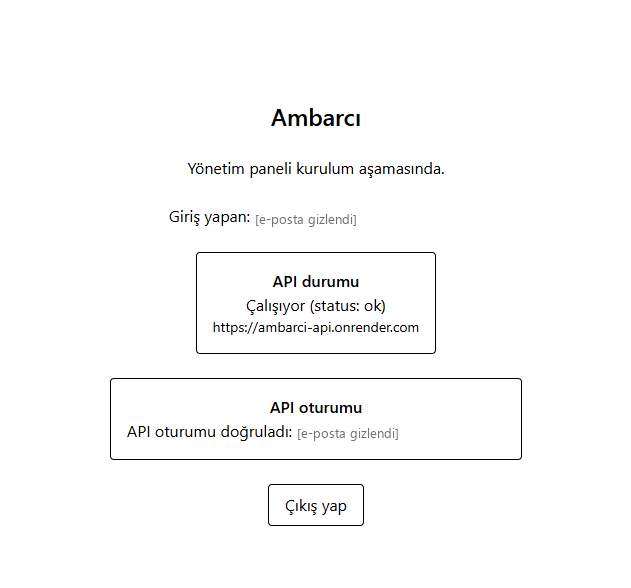

*Web panelinin Vercel'deki ilk sürümü ([#16](https://github.com/yunopo42/AmbarciApp/issues/16)): giriş yapan kullanıcının token'ı Render'daki API'ye gidiyor; "API oturumu doğruladı" satırı, API'nin token'ı Supabase'in açık anahtarlarıyla doğruladığını gösteriyor.*

| Giriş | Kayıt |
| --- | --- |
| 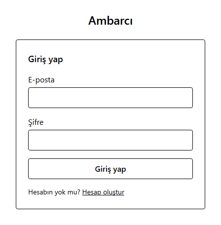 | 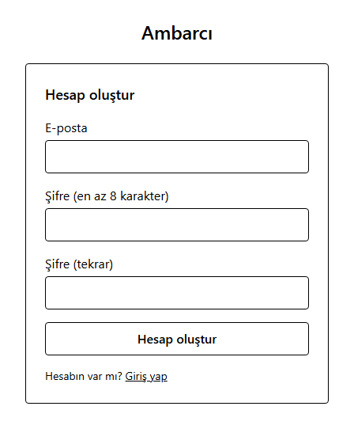 |

*Yayındaki web giriş ve kayıt ekranları ([ambarci-app.vercel.app](https://ambarci-app.vercel.app/login)). Kayıt herkese açık ve e-posta doğrulaması kapalı. Ekranlar henüz sade; 4.3'teki tasarım değerleri 3. haftada uygulanacak.*

| Giriş | Oturum açıkken ana ekran |
| --- | --- |
| 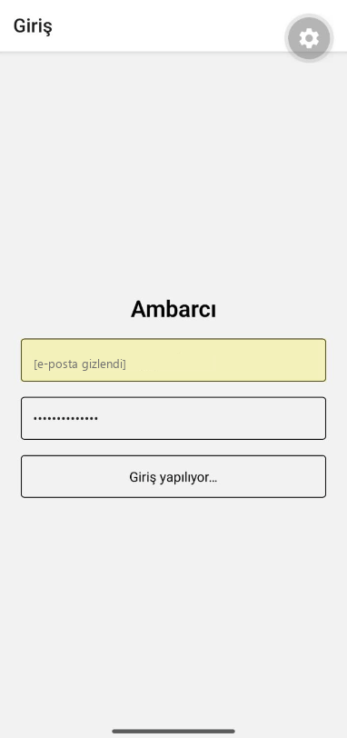 | 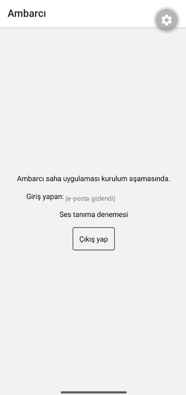 |

*Android development build'de giriş (butona basıldıktan hemen sonra) ve oturum açılmış ana ekran ([#16](https://github.com/yunopo42/AmbarciApp/issues/16)). Oturum telefonun güvenli deposunda tutuluyor.*

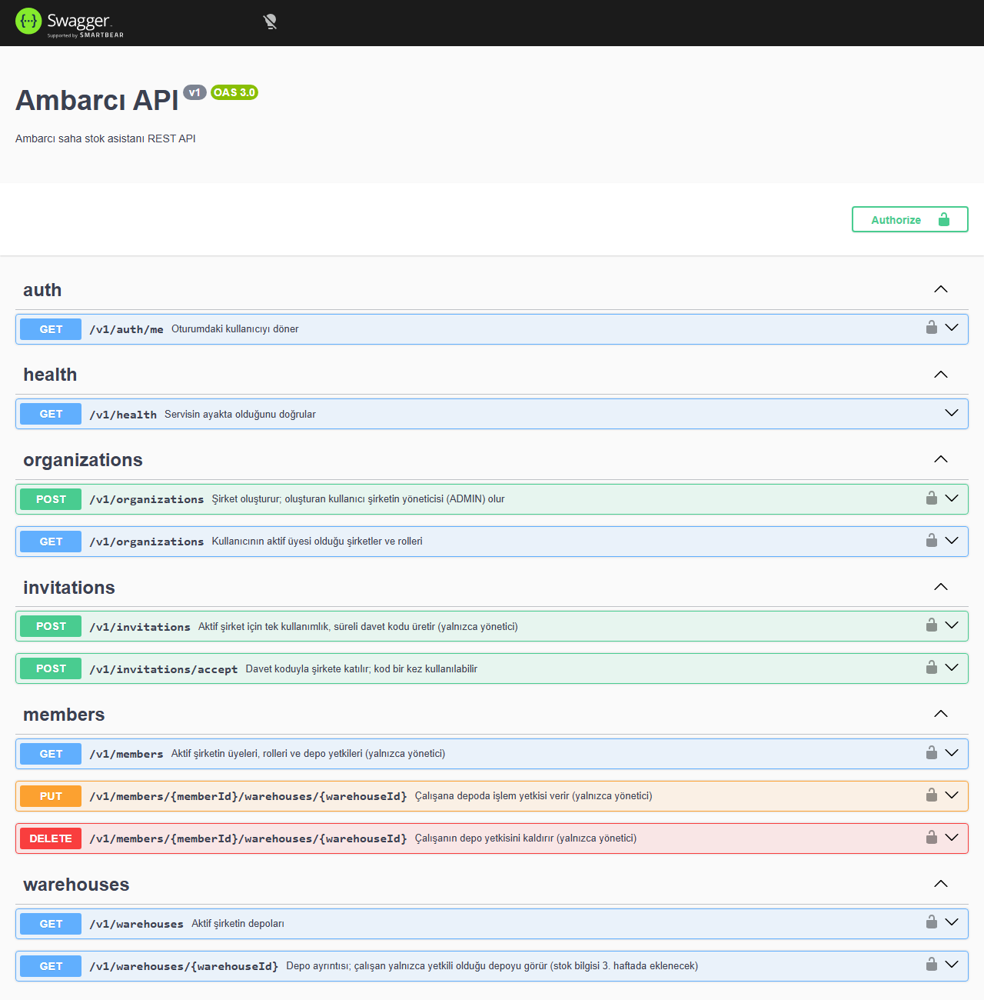

*Render'daki API'nin Swagger belgesi ([/docs](https://ambarci-api.onrender.com/docs)). `/v1/health` dışındaki 10 uç nokta bu hafta eklendi; kilit simgeli uçlar oturum istiyor.*

### 4.3 Ekran tasarımları (Google Stitch)

Tasarımlar yalnızca görsel referans; Stitch'in ürettiği kod kullanılmadı. Ekranlardaki kişi adları, sayılar ve belgeler örnektir. Uygulanmayacak ögelerin tam listesi ve yerine gelenler [docs/tasarim.md](https://github.com/yunopo42/AmbarciApp/blob/main/docs/tasarim.md) dosyasında.

| Mobil sohbet ve işlem kartı (4–5. hafta) | Mobil stok listesi (3. hafta) |
| --- | --- |
| 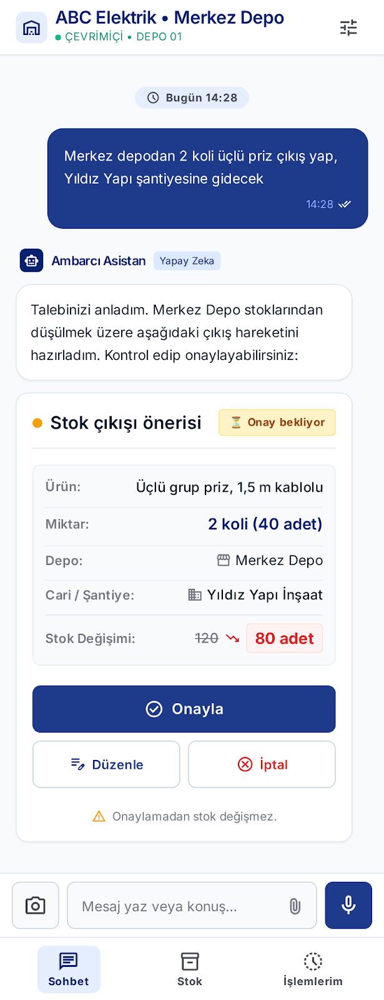 | 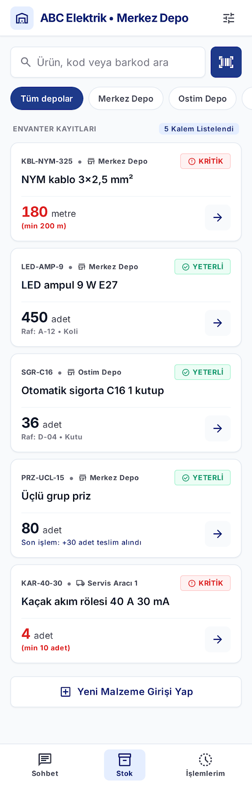 |

*Solda asistanın önerdiği stok çıkışı, onay bekleyen işlem kartı olarak gösteriliyor; onaylanmadan stok değişmiyor. Sağda depo filtresi, barkod okutma ve en az stok eşiğinin altındaki ürünler için "Kritik" etiketi.*

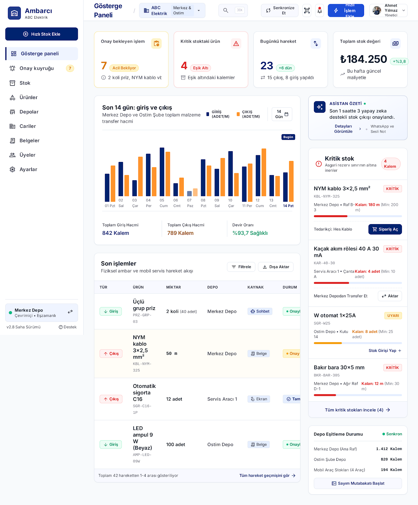

*Web gösterge paneli (6. hafta): onay bekleyen işlem, kritik stok ve günlük hareket kartları, son 14 günün giriş-çıkış grafiği ve son işlemler. "Sipariş Aç", WhatsApp ve senkronizasyon ögeleri kapsam dışı olduğu için uygulanmayacak.*

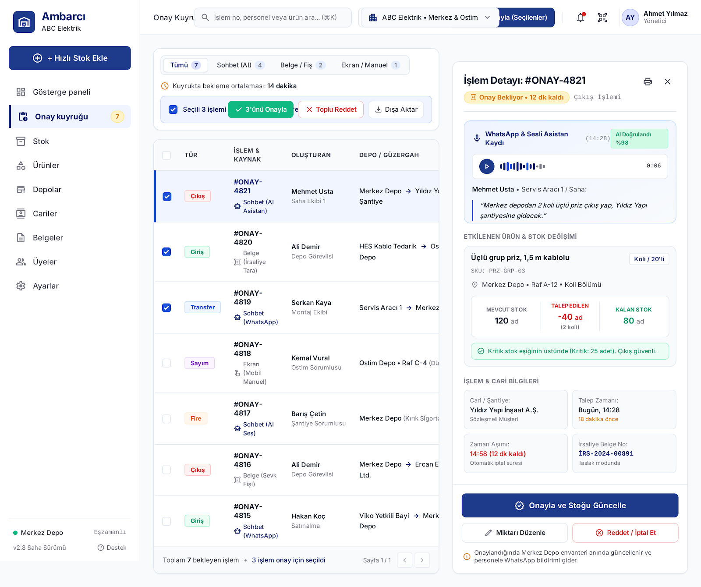

*Web onay kuyruğu (5–6. hafta). Tasarımdaki WhatsApp ve ses kaydı ögeleri kapsam dışı olduğu için uygulanmayacak.*

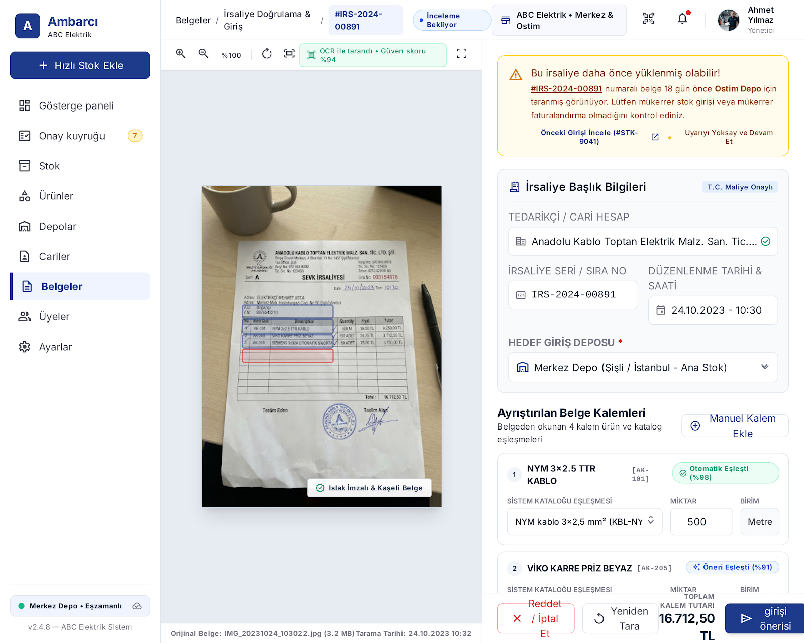

*Web irsaliye inceleme (7. hafta): fotoğraftan okunan kalemler katalogla eşleştirilip kullanıcının düzeltmesine sunuluyor; aynı belge ikinci kez yüklenirse uyarı çıkıyor. "T.C. Maliye Onaylı" rozeti ve ölçülmemiş güven yüzdeleri uygulanmayacak.*

### 4.4 Claude araç çağırma denemesi

| Ölçüm (20 mesaj) | Haiku 4.5 | Haiku 5.5 (medium) | Haiku 5.5 (low) |
| --- | --- | --- | --- |
| Doğru araç ve parametre | 20 / 20 | 20 / 20 | 20 / 20 |
| Belirsiz mesajda öneri aracı çağrısı | 0 | 0 | 0 |
| Süre / mesaj, medyan | 6,70 sn | 5,04 sn | 4,13 sn |
| Maliyet / mesaj (önbelleksiz) | 0,01116 $ | 0,00102 $ | 0,00100 $ |

*Claude araç çağırma denemesinin özeti: 20 Ekim 2026, sistem promptu `arac-denemesi-v1`, her mesaj bir kez, ağ gecikmesi dahil istemci tarafında ölçüldü. Fiyatlar milyon token başına liste fiyatlarından hesaplandı.*

## 5. Tamamlanan görevler

- [x] README ve proje tanıtımı — [#11](https://github.com/yunopo42/AmbarciApp/issues/11), [89fc8c9](https://github.com/yunopo42/AmbarciApp/commit/89fc8c9)
- [x] Hafta 2–8 milestone'ları — 17 Ekim'de GitHub'da açıldı
- [x] Supabase projesi ve ortam değişkenleri — [#12](https://github.com/yunopo42/AmbarciApp/issues/12), [f3af213](https://github.com/yunopo42/AmbarciApp/commit/f3af213)
- [x] Claude API denemesi: 20 mesajla araç çağırma, Haiku 4.5 ile Haiku 5.5 — [#13](https://github.com/yunopo42/AmbarciApp/issues/13), [4da5a4d](https://github.com/yunopo42/AmbarciApp/commit/4da5a4d)
- [x] Demo verisi: ABC Elektrik seed — [#14](https://github.com/yunopo42/AmbarciApp/issues/14), [1ef0c17](https://github.com/yunopo42/AmbarciApp/commit/1ef0c17)
- [x] Drizzle şeması ve ilk migration — [#15](https://github.com/yunopo42/AmbarciApp/issues/15), [f474487](https://github.com/yunopo42/AmbarciApp/commit/f474487)
- [x] Supabase Auth: web ve mobilde giriş/çıkış — [#16](https://github.com/yunopo42/AmbarciApp/issues/16), [38f55a0](https://github.com/yunopo42/AmbarciApp/commit/38f55a0), [55b4973](https://github.com/yunopo42/AmbarciApp/commit/55b4973)
- [x] Backend JWT doğrulama, şirket bağlamı ve rol guard'ları — [#17](https://github.com/yunopo42/AmbarciApp/issues/17), [4a28dbe](https://github.com/yunopo42/AmbarciApp/commit/4a28dbe), [c4221d0](https://github.com/yunopo42/AmbarciApp/commit/c4221d0)
- [x] Şirket oluşturma, davet kodu, rol ve depo yetkisi — [#18](https://github.com/yunopo42/AmbarciApp/issues/18), [c4221d0](https://github.com/yunopo42/AmbarciApp/commit/c4221d0), [1eb6c63](https://github.com/yunopo42/AmbarciApp/commit/1eb6c63)
- [x] RLS politikaları ve iki şirketli izolasyon testi — [#19](https://github.com/yunopo42/AmbarciApp/issues/19), [f474487](https://github.com/yunopo42/AmbarciApp/commit/f474487), [c4221d0](https://github.com/yunopo42/AmbarciApp/commit/c4221d0)
- [x] Ekran tasarımları ve `docs/tasarim.md` — [#20](https://github.com/yunopo42/AmbarciApp/issues/20), [b3b9fc3](https://github.com/yunopo42/AmbarciApp/commit/b3b9fc3)
- [ ] Hareket, işlem, sayım, denetim ve outbox tabloları — 3. haftaya bırakıldı, nedeni: hareket kaydı işlem kaydına bağlı; ikisi stok transaction'ıyla birlikte tasarlanacak
- [ ] Demo verisinin başlangıç stokları — 3. haftaya bırakıldı, nedeni: stok yalnızca hareket kaydıyla değişmeli; hareket tabloları 3. haftada geliyor

## 6. Karşılaşılan sorunlar ve çözümler

| Sorun | Çözüm / durum |
| --- | --- |
| JWT doğrulaması birleştikten sonra Render'daki yeni sürüm açılmadı; API açılışta `SUPABASE_URL` istiyor ama değişken Render'da yoktu | Değişken eklenip yeniden deploy edildi. Render bu sürede eski sürümü yayında tuttu. Sonraki işte (`DATABASE_URL`) değişken birleştirmeden önce eklendi; sıra `docs/yayin.md`'ye yazıldı |
| Supabase projesi eu-west-1 (İrlanda) bölgesinde, API Render'da Frankfurt'ta; Render'da İrlanda bölgesi yok | Proje İrlanda'da bırakıldı. Bölgeler arası gecikme 3. haftadaki transaction testlerinde ölçülecek |
| Bilgisayardaki pnpm önbelleğinin dizin dosyası bozuldu ("database disk image is malformed"); yeni kurulumlar durdu | Bozuk dosya kenara alındı; pnpm dizini yeniden kurdu ve temiz kurulum çalıştı |
| CI'da lint, ortak paket derlenmeden çalıştı; mobil kod ortak paketi ilk kez kullanınca lint hata verdi | Kök `lint` komutu da `typecheck` ve `test` gibi önce ortak paketleri derliyor |
| Mobil development build depo kökünden başlatılınca EAS kökte yanlış bir `eas.json` oluşturdu | Yanlış dosya silindi; build `apps/mobile` klasöründen alındı |
| drizzle-kit, şema dosyalarındaki `.js` uzantılı göreli importları çözemedi | Importlar `.ts` uzantılı yazıldı; derlemede `.js`'e çevriliyor |
| Supabase performans denetimi indekssiz üç yabancı anahtar buldu | Migration'lar birleştirilmeden önce birincil anahtar sırası ve iki indeksle düzeltildi |
| Şirket kurma formu, kullanıcının zaten bir şirketi varken başarıdan sonra "Kuruluyor…" hâlinde kalıyordu | İki hesapla yapılan denemede bulundu ve düzeltildi |
| Figma'nın ücretsiz planında tasarımı tuvale çizdirme özelliği kapalı | Ekranlar Google Stitch ile üretildi; Figma eğitim planı başvurusu sonraki haftalar için seçenek olarak duruyor |
| Şifreyle kayıt açılınca Supabase güvenlik denetimi "sızdırılmış şifre kontrolü kapalı" uyarısı verdi (HaveIBeenPwned listesindeki şifreleri reddeden özellik) | Bu özellik Supabase'in ücretsiz planında yok (Pro plan). Telafi olarak Supabase Auth'taki en az şifre uzunluğu 8'e çıkarılacak; web kayıt formu zaten en az 8 karakter istiyor |

## 7. Sonraki hafta planı

**Hafta 3 — Manuel stok (23–25 Ekim).** Kapı yok; 4. haftanın kapısı (telefonda canlı stok sorgusu) değişmedi. Hafta üç güne sıkıştığı için öncelik stok transaction'ında; yetişmeyen ekranlar 4. haftanın başına alınır.

1. Hareket, işlem, sayım, denetim ve outbox tabloları; demo verisine açılış stokları.
2. Giriş, çıkış, transfer, sayım ve fire için stok transaction'ı ve hareketli ortalama maliyet.
3. Eşzamanlı çıkış ve geri alma (rollback) testleri: çok kalemli işlemde bir kalem başarısız olursa hiçbir şey yazılmaz.
4. Ürün, birim, alternatif ad, depo ve cari yönetimi (web); Excel/CSV ile ürün içe aktarma.
5. OpenAPI'den üretilen istemci (`packages/api-client`); mobilde stok listesi ve ürün detayı; ekranların `docs/tasarim.md` değerlerine geçirilmesi.

## 8. Kaynaklar

- [Ambarcı — Veritabanı şeması ve şirketler arası izolasyon](https://github.com/yunopo42/AmbarciApp/blob/main/docs/veritabani.md)
- [Ambarcı — Claude araç çağırma denemesi](https://github.com/yunopo42/AmbarciApp/blob/main/eval/arac-cagirma-denemesi.md)
- [Ambarcı — ADR-001: Sohbet modeli](https://github.com/yunopo42/AmbarciApp/blob/main/docs/kararlar/ADR-001-sohbet-modeli.md)
- [Ambarcı — ADR-002: JWT doğrulaması için jose](https://github.com/yunopo42/AmbarciApp/blob/main/docs/kararlar/ADR-002-jwt-dogrulama-jose.md)
- [Ambarcı — Tasarım değerleri](https://github.com/yunopo42/AmbarciApp/blob/main/docs/tasarim.md)
- [Supabase — Row Level Security](https://supabase.com/docs/guides/database/postgres/row-level-security)
- [Supabase — JWT Signing Keys](https://supabase.com/docs/guides/auth/signing-keys)
- [Supabase — Server-side auth (Next.js)](https://supabase.com/docs/guides/auth/server-side/nextjs)
- [Drizzle ORM — Row-Level Security](https://orm.drizzle.team/docs/rls)
- [Next.js — proxy.js](https://nextjs.org/docs/app/api-reference/file-conventions/proxy)
- [Expo — SecureStore](https://docs.expo.dev/versions/latest/sdk/securestore/)
- [Expo Router — Protected routes](https://docs.expo.dev/router/advanced/protected/)
- [jose](https://github.com/panva/jose)
- [Google Stitch](https://stitch.withgoogle.com/)
