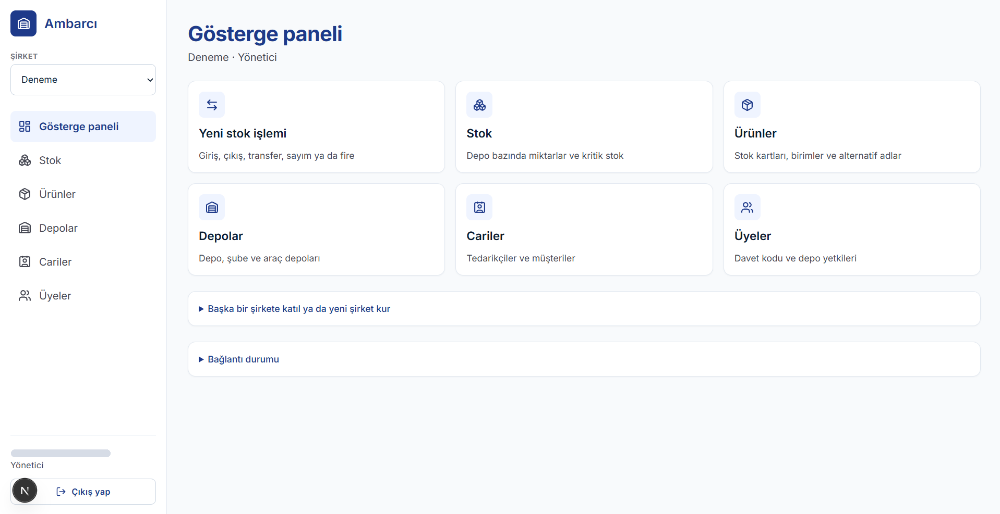
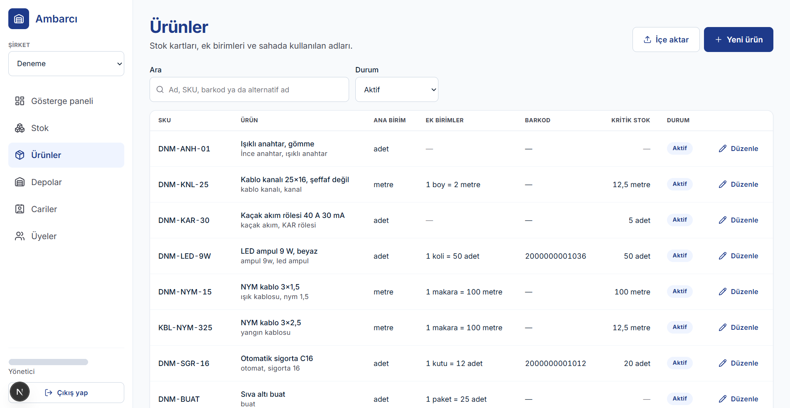
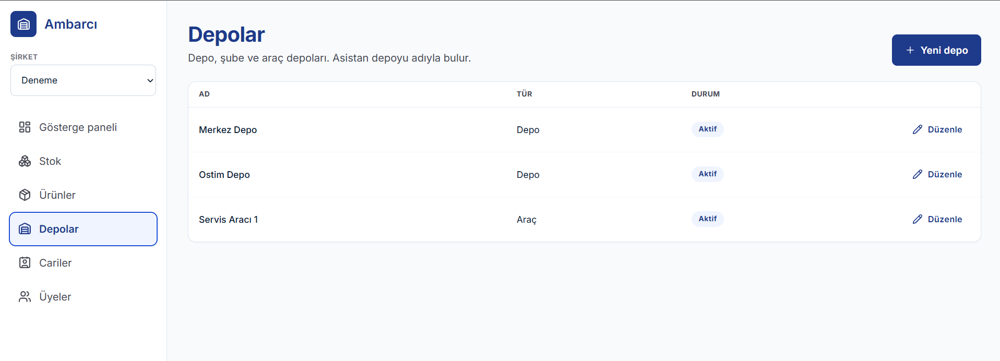
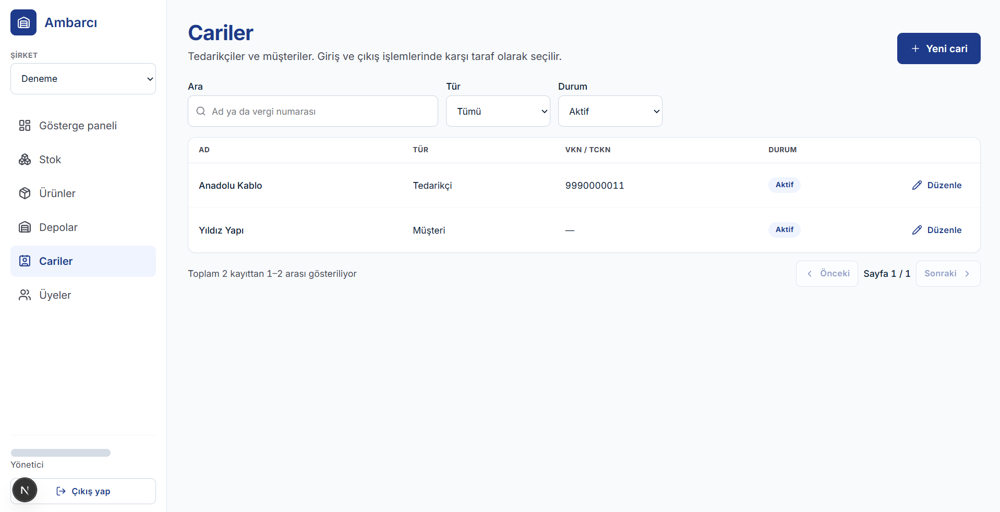
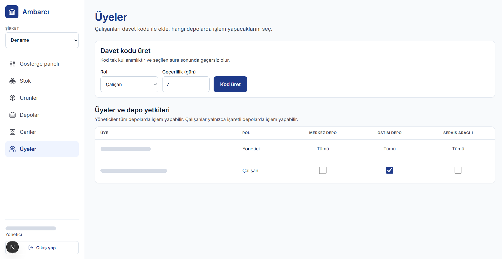
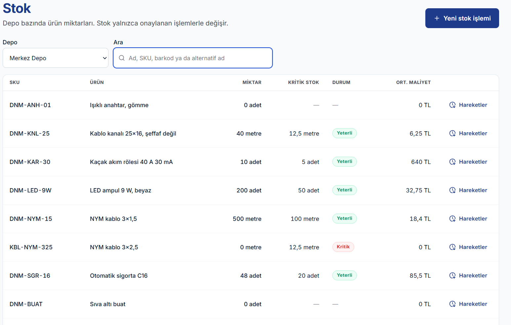
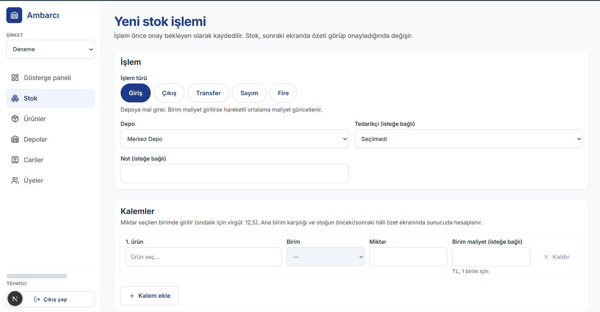
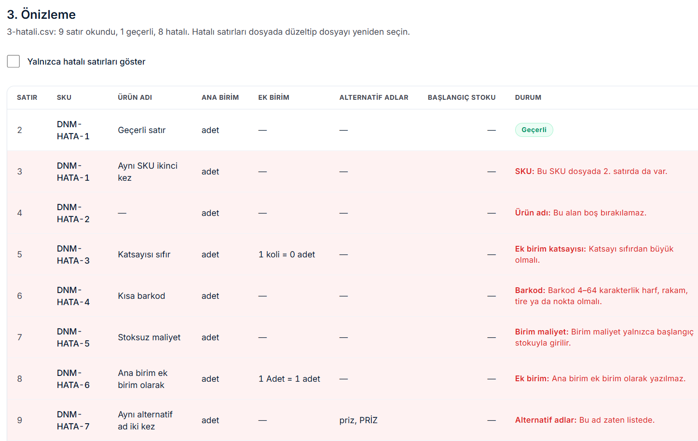
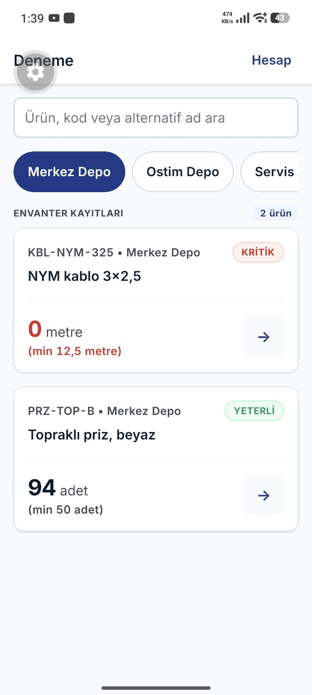
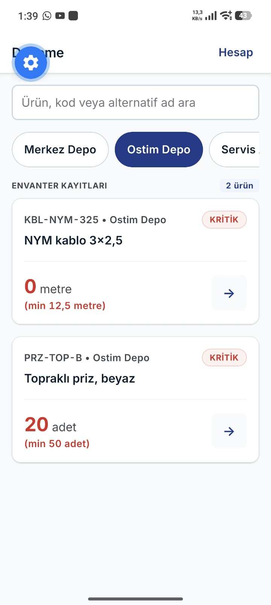

# Ambarcı — 3. Hafta Raporu: Manuel stok

| | |
| --- | --- |
| Öğrenci | Yunus Emre ATMAZ |
| Öğrenci no | 221450018 |
| Danışman | Ali Osman Çıbıkdiken |
| Ders | Senior Design Project |
| Hafta | 3. hafta (23–25 Ekim 2026; işlere 22 Ekim gecesi başlandı) |
| Proje | Ambarcı — Yapay Zekâ Destekli Saha Stok Asistanı |

## Proje bağlantıları

| | |
| --- | --- |
| GitHub deposu | [github.com/yunopo42/AmbarciApp](https://github.com/yunopo42/AmbarciApp) |
| 3. hafta sonu kod durumu (etiket) | [hafta-3](https://github.com/yunopo42/AmbarciApp/tree/hafta-3) |
| Commit geçmişi | [github.com/yunopo42/AmbarciApp/commits/main](https://github.com/yunopo42/AmbarciApp/commits/main) |
| 3. hafta issue'ları | [Hafta 3 milestone'u](https://github.com/yunopo42/AmbarciApp/milestone/3?closed=1) · [Pull requests](https://github.com/yunopo42/AmbarciApp/pulls?q=is%3Apr) |
| Web paneli (Vercel) | [ambarci-app.vercel.app](https://ambarci-app.vercel.app) |
| API sağlık kontrolü ve belgesi (Render) | [/v1/health](https://ambarci-api.onrender.com/v1/health) · [Swagger](https://ambarci-api.onrender.com/docs) |
| Stok işlemleri ve onay transaction'ı | [docs/stok-islemleri.md](https://github.com/yunopo42/AmbarciApp/blob/main/docs/stok-islemleri.md) |
| Katalog, depo yönetimi ve içe aktarma | [docs/katalog.md](https://github.com/yunopo42/AmbarciApp/blob/main/docs/katalog.md) |
| Veritabanı ve gecikme ölçümü | [docs/veritabani.md](https://github.com/yunopo42/AmbarciApp/blob/main/docs/veritabani.md) |
| Tasarım değerleri | [docs/tasarim.md](https://github.com/yunopo42/AmbarciApp/blob/main/docs/tasarim.md) |
| 8 haftalık plan | [docs/plan.md](https://github.com/yunopo42/AmbarciApp/blob/main/docs/plan.md) |
| Rapor ve belgeler (Drive) | [Proje klasörü](https://drive.google.com/drive/folders/1ON1zxHnz4k0fIdIXaCvwqlk0g4buD0_n?usp=sharing) |

API ücretsiz planda çalıştığı için 15 dakika istek almazsa uyur; ilk açılışta yaklaşık bir dakika beklemek gerekebilir. Bölüm 3'teki **Kod** bağlantıları `hafta-3` etiketini açar; kod sonraki haftalarda değişse de bu haftanın sonundaki hâli görünür.

## 1. Özet

Bu haftanın hedefi stoğun elle yönetilmesiydi: stok defteri tabloları, stoğu değiştiren onay transaction'ı, hareketli ortalama maliyet, eşzamanlılık testleri, katalog yönetimi, web'de stok işlem fişleri, mobilde stok listesi ve Excel/CSV ile ürün içe aktarma. Haftaya açılan sekiz işin sekizi de tamamlandı (#32–#39). Plana iki iş eklendi: bölgeler arası gecikme ölçümü ve Next.js'teki kritik güvenlik açığının kapatılması (#45). Bu haftanın kapısı yoktu. Stok yalnızca onayla değişiyor: iki kişi aynı anda son ürünü çıkarmaya çalıştığında stok eksiye düşmüyor, aynı onay iki kez gönderildiğinde stok bir kez değişiyor, çok kalemli bir işlemde tek kalem başarısız olursa hiçbir şey yazılmıyor. Bunlar gerçek veritabanında, yarışı her çalıştırmada gerçekten oluşturan testlerle doğrulandı. Ekrandan açılan fiş de içe aktarmanın başlangıç stoku da aynı onaydan geçiyor. Onay transaction'ının süresi ölçüldü; ölçümle bulunan bir sürücü ayarıyla yarıya indi, Render'da 1 kalemli onay medyan 269 ms sürüyor.

## 2. Bu hafta yapılanlar

| İş | Durum | Not |
| --- | --- | --- |
| Hareket, işlem, sayım, denetim ve outbox tabloları; açılış stokları | Tamamlandı | [#32](https://github.com/yunopo42/AmbarciApp/issues/32), [PR #40](https://github.com/yunopo42/AmbarciApp/pull/40); 6 tablo (toplam 16), demo verisinin açılış stokları onaylanan açılış işlemleriyle |
| Stok transaction'ı: giriş, çıkış, transfer, sayım, fire ve hareketli ortalama maliyet | Tamamlandı | [#33](https://github.com/yunopo42/AmbarciApp/issues/33), [PR #41](https://github.com/yunopo42/AmbarciApp/pull/41); ondalık hesaplar SQL'de ([ADR-003](https://github.com/yunopo42/AmbarciApp/blob/main/docs/kararlar/ADR-003-ondalik-hesap-sql.md)) |
| Eşzamanlı çıkış ve rollback testleri; bölgeler arası gecikme ölçümü | Tamamlandı | [#34](https://github.com/yunopo42/AmbarciApp/issues/34), [PR #42](https://github.com/yunopo42/AmbarciApp/pull/42), [PR #43](https://github.com/yunopo42/AmbarciApp/pull/43); onay süresi yaklaşık yarıya indi, Supabase İrlanda'da kaldı |
| OpenAPI istemcisi (`packages/api-client`) ve TanStack Query | Tamamlandı | [#35](https://github.com/yunopo42/AmbarciApp/issues/35), [PR #44](https://github.com/yunopo42/AmbarciApp/pull/44); [ADR-005](https://github.com/yunopo42/AmbarciApp/blob/main/docs/kararlar/ADR-005-openapi-istemcisi.md) |
| Güvenlik güncellemesi: Next.js, NestJS, multer (planda yoktu) | Tamamlandı | [#45](https://github.com/yunopo42/AmbarciApp/issues/45), [PR #46](https://github.com/yunopo42/AmbarciApp/pull/46); `pnpm audit` kritik 2 → 0 |
| Ürün, birim, alternatif ad, depo ve cari yönetimi (API ve web) | Tamamlandı | [#36](https://github.com/yunopo42/AmbarciApp/issues/36), [PR #47](https://github.com/yunopo42/AmbarciApp/pull/47) (API), [PR #48](https://github.com/yunopo42/AmbarciApp/pull/48) (web); tasarım değerleri, shadcn/ui ve TanStack Table bu işte geldi |
| Web'de stok işlem fişleri; depo bazında stok ve hareket geçmişi | Tamamlandı | [#37](https://github.com/yunopo42/AmbarciApp/issues/37), [PR #49](https://github.com/yunopo42/AmbarciApp/pull/49) |
| Mobilde stok listesi ve ürün detayı | Tamamlandı | [#38](https://github.com/yunopo42/AmbarciApp/issues/38), [PR #51](https://github.com/yunopo42/AmbarciApp/pull/51); Android development build'de denendi |
| Excel/CSV ile ürün içe aktarma; onay bekleyen işlemler listesi | Tamamlandı | [#39](https://github.com/yunopo42/AmbarciApp/issues/39), [PR #52](https://github.com/yunopo42/AmbarciApp/pull/52); [ADR-004](https://github.com/yunopo42/AmbarciApp/blob/main/docs/kararlar/ADR-004-excel-csv-ice-aktarma.md) |

## 3. Teknik açıklama

### 3.1 Stok defteri tabloları

**Ne yapıldı:** Altı tablo eklendi: işlem (`operations`), işlem kalemi, stok hareketi (`inventory_movements`), sayım sonucu, denetim kaydı (`audit_logs`) ve outbox (`outbox_events`). Her işlem önce "onay bekliyor" durumunda açılıyor; stok yalnızca onayla değişiyor. Hareket tablosunda veritabanı kısıtları var: hareketin türüyle miktarın işareti uyuşmak zorunda (giriş +, çıkış −), sonraki stok eksi olamaz, bir kalem bir depodaki stoğu en fazla bir kez değiştirebilir (`unique (işlem, kalem, depo)`). Outbox tablosu istemcilere tamamen kapalı. Demo verisinin açılış stokları da ayrı bir yolla yazılmadı: her depo için bir açılış işlemi açılıp aynı onaydan geçiriliyor.

**Neden önemli:** Uygulamada bir hata olsa bile aynı işlem ikinci kez uygulanamıyor ve stok eksiye düşemiyor. Stok her zaman hareketlerin toplamına eşit; testte bu eşitlik ayrıca kontrol ediliyor. Açılış stoğunun da onaydan geçmesi, "stok yalnızca onayla değişir" kuralının istisnasız kalmasını sağlıyor.

**Ne öğrenildi:** drizzle-kit, migration'ı yazarken bir benzersizlik kısıtını ona dayanan yabancı anahtardan sonraya koymuştu; migration bu hâliyle çalışmazdı. Satır elle öne alındı. Migration canlı veritabanına uygulanmadan önce, sonunda geri alınan bir transaction'da denendi.

**Kod:** [packages/db/schema](https://github.com/yunopo42/AmbarciApp/tree/hafta-3/packages/db/schema) (tablolar) · [0003_operations_and_movements.sql](https://github.com/yunopo42/AmbarciApp/blob/hafta-3/packages/db/migrations/0003_operations_and_movements.sql) · [0004_outbox_grants.sql](https://github.com/yunopo42/AmbarciApp/blob/hafta-3/packages/db/migrations/0004_outbox_grants.sql) · [seed-opening-stock.ts](https://github.com/yunopo42/AmbarciApp/blob/hafta-3/apps/api/src/scripts/seed-opening-stock.ts) (açılış stokları)

### 3.2 Onay transaction'ı ve hareketli ortalama maliyet

**Ne yapıldı:** `POST /v1/operations/{id}/confirm` stoğu değiştiren tek uç noktası. Her şey tek transaction'da, şu sırayla oluyor:
1. İşlem satırı `FOR UPDATE` ile kilitlenir.
2. Durum, sürüm ve tekrar eden istek kontrol edilir.
3. Depo yetkisi ve kalemler kilit altında yeniden okunur; kalemler ana birime çevrilir.
4. Stok satırları ürün, sonra depo kimliği sırasıyla kilitlenir; hareketler ve maliyet yazılır.
5. İşlem "uygulandı" yapılır; denetim ve outbox kaydı yazılır.

Hareketli ortalama maliyet SQL'de, kolonla aynı `NUMERIC` tipinde hesaplanıyor. Transfer edilen mal hedef depoya, çıktığı deponun ortalama maliyetiyle giriyor. Sayımda fark, onay anında kilitli satırdan okunan stoğa göre hesaplanıyor.

**Neden önemli:** Mimarinin temel kuralı: asistan stoğa yazamaz, stok yalnızca kullanıcının onayıyla değişir. Stok satırlarının hep aynı sırayla kilitlenmesi kilitlenmeyi (deadlock) önlüyor. Ağ koptuğunda tekrar gönderilen onay, istemcinin ürettiği `Idempotency-Key` sayesinde stoğu ikinci kez değiştirmiyor; ilk cevap tekrar dönüyor. Her modül yalnızca kendi tablosuna yazıyor; transaction nesnesi modüllerin servislerine aktarılıyor.

**Ne öğrenildi:** PostgreSQL'de `UPDATE … SET ortalama = f(miktar), miktar = miktar + x` ifadesinin sağ tarafındaki `miktar`, satırın güncellemeden önceki değeridir. Ortalama formülü bu yüzden eski stokla doğru hesaplanıyor. Kayan nokta ondalık sayıyı tam tutamadığı için uygulamaya ondalık kütüphanesi eklenmedi; hesap, değerin zaten kilitli olduğu satırda SQL'de yapılıyor (ADR-003). `INSERT … SELECT` ifadelerinde parametrelerin tipi (`::uuid`, `::smallint`) açıkça yazılmak zorunda kaldı.

**Kod:** [operations.service.ts](https://github.com/yunopo42/AmbarciApp/blob/hafta-3/apps/api/src/modules/operations/operations.service.ts) (onay adımları) · [apply-stock.service.ts](https://github.com/yunopo42/AmbarciApp/blob/hafta-3/apps/api/src/modules/inventory/apply-stock.service.ts) (kilit sırası ve kalemlerin uygulanması) · [stock-ledger.repository.ts](https://github.com/yunopo42/AmbarciApp/blob/hafta-3/apps/api/src/modules/inventory/stock-ledger.repository.ts) (maliyet ve sayım SQL'i)

### 3.3 Eşzamanlılık testleri ve onay süresi ölçümü

**Ne yapıldı:** Yarış koşullarını rastlantıya bırakmamak için testler satırı önce kendi transaction'ında kilitliyor. Ardından iki onay isteğini gönderiyor ve ikisinin de kilidi beklediğini PostgreSQL'in `pg_stat_activity` görünümünde görmeden kilidi bırakmıyor. Böylece istekler her çalıştırmada gerçekten aynı anda aynı satıra yarışıyor. Yedi senaryo yazıldı (bölüm 4.1). Ayrıca onay transaction'ının süresi ve transaction başına sorgu sayısı ölçüldü: yerelde (Türkiye → İrlanda) ve Render'dan (Frankfurt → İrlanda), her senaryo 20 tekrar.

**Neden önemli:** Onay transaction'ı stok satırlarının kilidini COMMIT'e kadar tutuyor. API Frankfurt'ta, veritabanı İrlanda'da olduğu için her sorgunun gidiş-dönüşü kilidin tutulduğu süreye ekleniyor. Bu ölçüm, Supabase projesinin Frankfurt'a taşınması gerekip gerekmediğini gösterdi.

**Ne öğrenildi:** İlk ölçümde her sorgu beklenenin iki katı sürdü. Nedeni, Drizzle'ın kullandığı postgres.js sürücüsünün sorguları "hazırlanmamış" göndermesiydi: sürücü önce parametre tiplerini soruyor, cevabı bekliyor, sonra sorguyu çalıştırıyordu. Sorgular hazırlanmış ifade olarak gönderilince süre yaklaşık yarıya indi (bölüm 4.2). Ölçüm basit bir modele oturuyor: transaction süresi ≈ sorgu sayısı × gidiş-dönüş süresi. Render'da 1 kalemli onay 269 ms sürdüğü için proje İrlanda'da kaldı. Supabase'de bölge sonradan değiştirilemiyor; taşımak yeni proje ve bütün anahtarların değişmesi demekti. Kısıt: hazırlanmış ifadeler Supabase'in transaction pooler'ında çalışmadığı için bağlantı session pooler'dan yapılıyor.

**Kod:** [concurrency.db.spec.ts](https://github.com/yunopo42/AmbarciApp/blob/hafta-3/apps/api/test-db/concurrency.db.spec.ts) (eşzamanlılık ve rollback testleri) · [stock-fixture.ts](https://github.com/yunopo42/AmbarciApp/blob/hafta-3/apps/api/test-db/support/stock-fixture.ts) (`raceWhileLocked`) · [client.ts](https://github.com/yunopo42/AmbarciApp/blob/hafta-3/packages/db/src/client.ts) (hazırlanmış ifadeler) · [eval/gecikme](https://github.com/yunopo42/AmbarciApp/tree/hafta-3/eval/gecikme) (ham ölçümler)

### 3.4 Tipli API istemcisi ve güvenlik güncellemesi

**Ne yapıldı:** API'nin OpenAPI belgesinden istemci tipleri üretiliyor (`pnpm gen:api`); web ve mobil aynı tipli istemciyi kullanıyor. Bir uç değişip istemci yeniden üretilmezse CI duruyor. Web'de ve mobilde her aktif şirket için ayrı bir sorgu önbelleği kuruluyor. Bu hafta `pnpm audit`, Next.js 16.4.0'da iki kritik uzaktan kod çalıştırma açığı gösterdi. Ayrı bir işte Next.js 16.4.3'e, NestJS 12.2.0'a ve düzeltilmiş `multer` sürümüne geçildi.

**Neden önemli:** İstek ve cevap tipleri API'den geldiği için web'de ve mobilde yanlış bir alan adı derleme hatası veriyor, çalışma anında ortaya çıkmıyor. Şirket başına ayrı önbellek, bir şirketin verisinin şirket değiştirilince ötekinin ekranında görünmesini yapı gereği imkânsız kılıyor. Güvenlik açığı yayındaki web panelini etkiliyordu.

**Ne öğrenildi:** Sorgu anahtarları istek başlıklarını içermediği için tek önbellekte iki şirketin cevabı karışabilirdi; ayrı önbellek bunu çözdü. TanStack Query sarmalayıcısı pakete değil uygulamaya kuruldu: pakete girseydi uygulamada iki ayrı React Query kopyası olurdu ve sorgular sağlayıcıyı bulamazdı. Nest paketlerinin sürümleri birbirine bağlı: `platform-express` 12.2.0, `core` 12.2'yi istediği için bütün Nest paketleri birlikte güncellendi. `multer`'ın düzeltilmiş sürümü pnpm `overrides` ile zorlandı; gerekçesi dosyada yorum olarak yazılı. Güncellemeden sonra `pnpm audit` sonucu: kritik 2 → 0, yüksek 5 → 2. Kalan bildirimler yalnızca geliştirme araçlarında (Expo CLI, drizzle-kit, Nest şablon aracı); yayındaki uygulamalara girmiyor.

**Kod:** [packages/api-client](https://github.com/yunopo42/AmbarciApp/tree/hafta-3/packages/api-client) · [api-provider.tsx](https://github.com/yunopo42/AmbarciApp/blob/hafta-3/apps/web/components/api-provider.tsx) (şirket başına önbellek) · [pnpm-workspace.yaml](https://github.com/yunopo42/AmbarciApp/blob/hafta-3/pnpm-workspace.yaml) (`overrides`)

### 3.5 Katalog ve depo yönetimi

**Ne yapıldı:** API'ye ürün (ek birimleri ve sahada kullanılan adlarıyla), depo ve cari yönetimi eklendi. Kurallar:
- Kayıt silinmez, pasife alınır.
- İşlemde kullanılmış bir birim silinemez.
- Hareketi olan ürünün ana birimi değiştirilemez.

Web'de ürünler, depolar ve cariler ekranları yazıldı: arama, süzgeç ve sayfalama sunucuda yapılıyor. Değiştirme düğmeleri yalnızca yöneticiye görünüyor; asıl yetki API'de. Bu işle birlikte `docs/tasarim.md`'deki renk, yazı, boşluk, köşe ve gölge değerleri Tailwind'e alındı. Tailwind'in hazır renk ve yazı ölçekleri kapatıldı; mevcut bütün ekranlar shadcn/ui kalıbındaki ortak bileşenlere geçirildi. Tablolar TanStack Table ile.

**Neden önemli:** Asistan 4. haftada ürünü katalogdan bulacak; alternatif adlar ("üçlü priz") bunun için. Aynı SKU'yu iki kişi aynı anda eklemeye çalışırsa ikincisini veritabanının benzersizlik kısıtı reddediyor ve API anlamlı bir `409` dönüyor. Uygulamada önceden "var mı" diye sormak bu yarışı kapatmazdı. Tasarım değerleri tek yerde olduğu için bileşene tasarım dışı bir renk yazılırsa hiçbir stil üretilmiyor.

**Ne öğrenildi:** PostgreSQL'in `ILIKE` araması büyük "I"yı "i"ye çeviriyor, oysa Türkçede küçüğü "ı". Bu yüzden "YANGIN" araması "yangın"ı bulmuyordu. Arama metni ve kolon aynı biçime getirildi (I, İ, ı, i → i); "yangin" de bulunuyor. Formlar gönderilmeden önce tarayıcıda, API'nin kullandığı Zod şemasının aynısıyla kontrol ediliyor; şema iki yerde yazılmıyor. TanStack Table'ın bu hafta kullanılan 9. sürümünde API değişmişti (`useTable`, `tableFeatures`); kullanım paketle gelen belgeden doğrulandı.

**Kod:** [catalog modülü](https://github.com/yunopo42/AmbarciApp/tree/hafta-3/apps/api/src/modules/catalog) · [search.ts](https://github.com/yunopo42/AmbarciApp/blob/hafta-3/apps/api/src/common/search.ts) (Türkçe arama) · [globals.css](https://github.com/yunopo42/AmbarciApp/blob/hafta-3/apps/web/app/globals.css) (tasarım değerleri) · [components/ui](https://github.com/yunopo42/AmbarciApp/tree/hafta-3/apps/web/components/ui) (ortak bileşenler) · [product-form.tsx](https://github.com/yunopo42/AmbarciApp/blob/hafta-3/apps/web/components/product-form.tsx) (ürün formu)

### 3.6 Web'de stok işlem fişleri

**Ne yapıldı:** Web'den beş işlem türü (giriş, çıkış, transfer, sayım, fire) çok kalemli bir fişle açılıyor: ürün arama penceresi, birim seçimi ("1 koli = 12 adet"), girişte birim maliyet ve tedarikçi, çıkışta müşteri. Kaydedilen işlem onay bekliyor ve bir özet ekranı açılıyor. Özette her kalemin ana birim karşılığı ("3 koli = 36 adet") ve stoğun önceki ve sonraki hâli ("120 → 84 adet") sunucuda hesaplanıyor. Stoğu yetmeyen kalem "Yetersiz stok" diye işaretleniyor. Ayrıca depo bazında stok listesi (kritik eşiğin altındakiler rozetle) ve ürünün hareket geçmişi eklendi. Çalışan yalnızca yetkili olduğu depoları seçebiliyor ve görebiliyor.

**Neden önemli:** Bu, 5. haftadaki asistan işlem kartının da kullanacağı onay akışı: öneri → özet → onay. Özet sayfası açılınca bir `Idempotency-Key` üretiliyor ve o sayfadaki bütün onay denemeleri aynı anahtarla gidiyor. Çift tıklamada ikinci istek gitse bile stok bir kez değişiyor. Özet kilit almıyor; onay anında stok kilit altında yeniden okunuyor. Arada başka bir işlem onaylandıysa onay `409` ile reddediliyor ve hata ilgili kalemde gösteriliyor.

**Ne öğrenildi:** Aynı üründen iki çıkış kalemi olduğunda ikinci kalemin "önce"si birincinin "sonra"sı olmalı. Bu, SQL'de pencere fonksiyonuyla (`sum … over (partition by depo, ürün order by sıra)`) hesaplanıyor; onay da kalemleri aynı sırayla uyguluyor. Stok listesi hem ürün hem stok bilgisini istediği için, modül sınırını bozmamak ve iki modül arasında döngü kurmamak üzere ikisinin servislerini kullanan ayrı bir modülde yazıldı. Yeni test dosyası eklenince gerçek veritabanı testleri Supabase'in oturum havuzundaki 15 istemci sınırını aştı; test dosyaları artık sırayla çalışıyor.

**Kod:** [operation-form.tsx](https://github.com/yunopo42/AmbarciApp/blob/hafta-3/apps/web/components/operation-form.tsx) (fiş formu) · [operation-review.tsx](https://github.com/yunopo42/AmbarciApp/blob/hafta-3/apps/web/components/operation-review.tsx) (özet ve onay) · [stock-preview.ts](https://github.com/yunopo42/AmbarciApp/blob/hafta-3/apps/api/src/modules/inventory/stock-preview.ts) ve [stock-ledger.repository.ts](https://github.com/yunopo42/AmbarciApp/blob/hafta-3/apps/api/src/modules/inventory/stock-ledger.repository.ts) (önce → sonra hesabı) · [stock modülü](https://github.com/yunopo42/AmbarciApp/tree/hafta-3/apps/api/src/modules/stock) (stok listesi ve hareket geçmişi)

### 3.7 Mobilde stok listesi ve ürün detayı

**Ne yapıldı:** Mobil uygulama ilk kez API'ye bağlandı: tipli istemci, TanStack Query ve şirket bağlamı web'dekiyle aynı mantıkla kuruldu (tek şirket varsa kendiliğinden seçiliyor; şirket başına ayrı önbellek). Stok listesinde depo çipleri, ad, SKU ya da alternatif adla arama, kaydırdıkça sonraki sayfa ve "KRİTİK"/"YETERLİ" rozeti var. Ürün detayında depolara göre stok ve toplam, birimler, alternatif adlar ve son 10 hareket görünüyor. Bunun için API'ye ürünün depolara göre stoğunu veren bir uç eklendi; çalışan yalnızca yetkili olduğu depoları görüyor. Tasarım değerleri mobilde tek bir tema dosyasında (`src/theme.ts`); Inter yazı tipi yüklendi; dokunma hedefleri en az 48 px. Android development build'de telefonda denendi.

**Neden önemli:** 4. haftanın kapısı telefondan canlı stok sorgusu. Mobilde şirket bağlamı ve tipli istemci artık hazır; ürünün depolara göre stoğunu veren uç, asistanın "stok sorgusu" aracının da kullanacağı veri.

**Ne öğrenildi:** React Native'de özel yazı tipinde `fontWeight` Android'de çalışmıyor; ağırlık başına ayrı dosya yükleniyor ve yalnızca kullanılan dört ağırlık pakete giriyor. Tasarımdaki harf aralığı em cinsinden; React Native nokta istediği için boyutla çarpılarak yazıldı. React Native'in `textTransform`'u Türkçe "i"yi "İ" yapmadığı için büyük harfli etiketler metnin kendisinde büyük yazılıyor ("KRİTİK"). Telefon bilgisayardaki `localhost`'a ulaşamadığı için API adresi ayrı bir ortam değişkeniyle veriliyor (`EXPO_PUBLIC_API_URL`). Ondalık biçimlendirme ve Türkçe etiketler web'den ortak pakete taşındı; mobil kopyalamadan kullanıyor.

**Kod:** [theme.ts](https://github.com/yunopo42/AmbarciApp/blob/hafta-3/apps/mobile/src/theme.ts) (tasarım değerleri) · [organization-provider.tsx](https://github.com/yunopo42/AmbarciApp/blob/hafta-3/apps/mobile/src/api/organization-provider.tsx) (şirket bağlamı) · [index.tsx](https://github.com/yunopo42/AmbarciApp/blob/hafta-3/apps/mobile/src/app/index.tsx) (stok listesi) · [[productId].tsx](https://github.com/yunopo42/AmbarciApp/blob/hafta-3/apps/mobile/src/app/products/%5BproductId%5D.tsx) (ürün detayı)

### 3.8 Excel/CSV ile ürün içe aktarma ve onay bekleyen işlemler

**Ne yapıldı:** Ürünler Excel (.xlsx) ya da CSV dosyasından içe aktarılıyor. Dosya tarayıcıda okunuyor; Türkçe Excel'in "CSV olarak kaydet" çıktısı (`;` ayraçlı, Windows-1254 kodlu) da doğru okunuyor. Kaydetmeden önce her satır, API'nin kullandığı şemayla doğrulanıyor ve hatalar satır numarası ve sütun adıyla gösteriliyor; istenirse hatalı satırlar atlanıp yalnızca geçerliler aktarılıyor. API en fazla 1.000 satır alıyor, şirkette zaten kullanılan SKU ve barkodları satır numarasıyla bildiriyor ve gönderilen satırları tek transaction'da yazıyor. Başlangıç stoku stoğa doğrudan yazılmıyor; seçilen depo için onay bekleyen açılış işlemleri açılıyor. İçe aktarmanın açtığı ya da ekrandan açılıp onaylanmadan bırakılan işlemler Stok sayfasındaki "Onay bekleyen işlemler" listesinden özetine dönüyor.

**Neden önemli:** Kurulumda yüzlerce ürünü tek tek girmek gerçekçi değil. İçe aktarma da "stok yalnızca onayla değişir" kuralına uyuyor: başlangıç stoku, ekrandaki fiş gibi onaydan geçiyor. Dosya tarayıcıda okunduğu için kötü niyetli ya da bozuk bir dosya Render'daki API'yi etkileyemiyor ([ADR-004](https://github.com/yunopo42/AmbarciApp/blob/main/docs/kararlar/ADR-004-excel-csv-ice-aktarma.md)).

**Ne öğrenildi:** Render'dan veritabanına her sorgu ~22 ms sürdüğü için 1.000 ürünü tek tek eklemek ~3.000 sorgu olurdu; ürünler, birimler ve adlar toplu `INSERT` ile birkaç sorguda yazılıyor. Express'in varsayılan 100 KB'lık JSON gövde sınırı 1.000 satıra yetmedi; 2 MB'a çıkarıldı. Excel'deki sayılar ham metin olarak okunuyor (`parseNumber`), tarayıcıda da JS sayısına çevrilmiyor. Deneme dosyalarıyla yapılan kontrolde bir hata bulundu: papaparse'ın ayraç tahmini, ürün adlarındaki ve ondalıklardaki virgüller yüzünden Türkçe Excel dosyasında virgülü seçiyordu. Ayraç artık başlık satırından bulunuyor. Yeni üründen açılış işlemi ürünlerle aynı transaction'da açılıyor; bunun için işlem açma, açık bir transaction'da çalışabilecek biçimde ayrıldı.

**Kod:** [product-import-file.ts](https://github.com/yunopo42/AmbarciApp/blob/hafta-3/apps/web/lib/product-import-file.ts) (dosya okuma) · [product-import.tsx](https://github.com/yunopo42/AmbarciApp/blob/hafta-3/apps/web/components/product-import.tsx) (önizleme) · [product-import modülü](https://github.com/yunopo42/AmbarciApp/tree/hafta-3/apps/api/src/modules/product-import) · [product-import.ts](https://github.com/yunopo42/AmbarciApp/blob/hafta-3/packages/shared/src/product-import.ts) (ortak şema ve tekrar kontrolü) · [pending-operations.tsx](https://github.com/yunopo42/AmbarciApp/blob/hafta-3/apps/web/components/pending-operations.tsx) (onay bekleyen işlemler)

## 4. Görseller

### 4.1 Test sonuçları

| Test | Ortam | Sonuç |
| --- | --- | --- |
| API testleri (kurallar, şemalar, rol ve depo yetkisi, Idempotency-Key zorunluluğu, içe aktarma şeması) | CI, veritabanı olmadan | 82 / 82 geçti (2. haftada 41) |
| API istemcisi testleri | CI | 4 / 4 geçti |
| RLS izolasyonu ve seed | Gerçek Supabase veritabanı (`pnpm db:test`) | 43 / 43 geçti |
| Stok işlemleri, eşzamanlılık, katalog, stok okuma ve önizleme, içe aktarma, işlem listesi, şirket izolasyonu | Gerçek Supabase veritabanı (`pnpm db:test`) | 47 / 47 geçti |

*25 Ekim 2026. Gerçek veritabanı testleri kendi verisini oluşturup sonunda siliyor.*

| Eşzamanlılık testinin doğruladığı | Sonuç |
| --- | --- |
| 10 adet stoktan iki ayrı 7 adetlik çıkış aynı anda | Biri uygulandı, öteki "stok yetersiz" (mevcut: 3); stok 3, tek çıkış hareketi |
| Ters sırayla kilitleyen iki ham transaction | PostgreSQL birini kilitlenme (`40P01`) hatasıyla geri aldı: korunduğumuz tehlikenin gösterimi |
| Kalemleri ters sırada olan iki işlem aynı anda | İkisi de tamamlandı; kilitler aynı sırayla alındığı için döngü oluşmadı |
| Aynı işleme aynı anda iki onay, aynı anahtar | İkisi de aynı cevabı aldı; stok bir kez değişti; 1 hareket, 1 denetim, 1 outbox kaydı |
| Aynı işleme aynı anda iki onay, farklı anahtar | Biri uygulandı, öteki "zaten onaylanmış"; stok bir kez değişti |
| Üç kalemli transfer, 2. kalem yetmiyor | Hiçbir şey yazılmadı: kaynak stok ve maliyet aynı, hedefte açılan stok satırları da geri alındı |
| İki kalemli giriş, son adımda hata | Yazılmış stok, maliyet ve hareketler geri alındı: transaction sınırı bütün adımları kapsıyor |

### 4.2 Onay süresi ölçümü

| Yerel (Türkiye → İrlanda), 20 tekrar | Sorgu | Önce: medyan | Sonra: medyan | Fark |
| --- | --- | --- | --- | --- |
| 1 kalem giriş | 12 | 1.794 ms | 991 ms | −%45 |
| 5 kalem giriş | 16 | 2.447 ms | 1.335 ms | −%45 |
| 1 kalem transfer | 13 | 1.950 ms | 1.077 ms | −%45 |

*"Önce": sorgular hazırlanmamış; "sonra": hazırlanmış ifadelerle. Yalın gidiş-dönüş medyanı 80–81 ms. Ham sonuçlar: `eval/gecikme/yerel-hazirlanmamis-2026-10-24.json`, `eval/gecikme/yerel-2026-10-24.json`.*

| Render (Frankfurt → İrlanda), 20 tekrar | Sorgu | Transaction: medyan / p95 | Sorgu başına |
| --- | --- | --- | --- |
| 1 kalem giriş | 12 | 269 / 276 ms | 22 ms |
| 5 kalem giriş | 16 | 363 / 411 ms | 23 ms |
| 1 kalem transfer | 13 | 294 / 364 ms | 23 ms |

*24 Ekim 2026, `eval/gecikme/render-2026-10-24.json`. Süre, sunucudaki transaction süresidir (`Server-Timing` başlığı). Render'da hazırlanmamış sorgulu eski sürüm ölçülmedi.*

### 4.3 Web ekranları

Görüntüler yerel geliştirme ortamında, deneme amaçlı bir şirketle alındı; e-posta adresleri gizlendi. Sol alttaki yuvarlak "N", Next.js'in geliştirme göstergesidir; uygulamanın parçası değildir.

*Gösterge paneli: tasarım değerleri ve ortak bileşenlerle yenilenen web paneli. Solda şirket seçimi ve menü, ortada ana bölümlere kısayollar.*

*Ürünler: ana birim, ek birimler ("1 koli = 50 adet"), barkod ve kritik stok; sahada kullanılan alternatif adlar ürün adının altında. Arama ad, SKU, barkod ve alternatif adda yapılır; arama, süzgeç ve sayfalama sunucuda.*

*Depolar: depo, şube ve araç depoları. Asistan 4. haftadan itibaren depoyu adıyla bulacak.*

*Cariler: tedarikçiler ve müşteriler; türe ve duruma göre süzgeç, sunucuda sayfalama.*

*Üyeler: davet kodu ve depo yetkileri. Çalışan yalnızca işaretli depolarda işlem yapabilir ve yalnızca bu depoların stoğunu görür.*

*Stok sayfası: depo bazında miktar, kritik eşik, "Kritik"/"Yeterli" rozeti ve ortalama maliyet; her satırdan ürünün hareket geçmişine gidilir. Onay bekleyen işlem varsa listenin üstünde ayrıca gösterilir.*

*Yeni stok işlemi: beş işlem türü, depo, cari, not ve kalemler (ürün, birim, miktar, girişte birim maliyet). Kaydedilen işlem onay bekler; stok, sonraki ekranda özet görülüp onaylanınca değişir.*

*Excel/CSV içe aktarma önizlemesi (`3-hatali.csv` deneme dosyası): her satır kaydetmeden önce API'nin şemasıyla doğrulanır; hatalar satır numarası ve sütun adıyla gösterilir. Dosyada tekrar eden SKU, boş ad, sıfır katsayı, kısa barkod, stoksuz maliyet, ek birim olarak yazılmış ana birim ve tekrar eden alternatif ad yakalandı.*

### 4.4 Mobil ekranlar

| Merkez Depo | Ostim Depo |
| --- | --- |
|  |  |

*Android development build'de stok listesi: depo çipleri, arama, ürün kodu ve depo, "KRİTİK"/"YETERLİ" rozeti, kritik eşik. Aynı ürün Merkez'de 94 adetle yeterli, Ostim'de 20 adetle kritik. Sol üstteki dişli, development build'in geliştirici aracı düğmesidir; uygulamanın parçası değildir.*

### 4.5 Bu hafta eklenen API uçları

| Uç nokta | Ne yapar |
| --- | --- |
| `POST /v1/operations` | Stok işlemini onay bekleyen olarak açar; stok değişmez |
| `GET /v1/operations` | Onay bekleyen işlemler (varsayılan), en yeni önce; çalışan yalnızca yetkili depolarındakileri görür |
| `GET /v1/operations/{id}`, `GET /v1/operations/{id}/preview` | İşlem; onay ekranının özeti (önce → sonra) |
| `POST /v1/operations/{id}/confirm` | Onay: stoğu tek transaction'da değiştiren tek yol (`Idempotency-Key` zorunlu) |
| `POST /v1/operations/{id}/cancel` | Onay bekleyen işlemi iptal eder |
| `GET, POST /v1/products`, `GET, PUT /v1/products/{id}` | Ürün, ek birimler ve alternatif adlar |
| `POST /v1/products/import` | Excel/CSV'den en fazla 1.000 ürün; başlangıç stoku onay bekleyen açılış işlemi olarak |
| `GET /v1/products/{id}/stock` | Ürünün depolara göre stoğu ve toplamı |
| `GET /v1/products/{id}/movements` | Ürünün hareket geçmişi |
| `GET, POST /v1/parties`, `GET, PUT /v1/parties/{id}` | Cariler (tedarikçi, müşteri) |
| `POST /v1/warehouses`, `PUT /v1/warehouses/{id}` | Depo ekleme ve düzenleme (listeleme 2. haftadan) |
| `GET /v1/warehouses/{id}/stock` | Depo bazında stok |

*Değiştiren uçlar katalogda yalnızca yöneticiye açık; stok işlemlerinde çalışan yalnızca yetkili olduğu depolarda işlem yapabilir. Tam liste: [Swagger](https://ambarci-api.onrender.com/docs).*

## 5. Tamamlanan görevler

- [x] Hareket, işlem, sayım, denetim ve outbox tabloları; demo verisine açılış stokları — [#32](https://github.com/yunopo42/AmbarciApp/issues/32), [aa7d619](https://github.com/yunopo42/AmbarciApp/commit/aa7d619)
- [x] Stok transaction'ı: giriş, çıkış, transfer, sayım, fire ve hareketli ortalama maliyet — [#33](https://github.com/yunopo42/AmbarciApp/issues/33), [4297568](https://github.com/yunopo42/AmbarciApp/commit/4297568)
- [x] Eşzamanlı çıkış ve rollback testleri; bölgeler arası gecikme ölçümü — [#34](https://github.com/yunopo42/AmbarciApp/issues/34), [75e7dec](https://github.com/yunopo42/AmbarciApp/commit/75e7dec), [5c56cca](https://github.com/yunopo42/AmbarciApp/commit/5c56cca)
- [x] OpenAPI istemcisi ve TanStack Query — [#35](https://github.com/yunopo42/AmbarciApp/issues/35), [e5694ef](https://github.com/yunopo42/AmbarciApp/commit/e5694ef), [13d5094](https://github.com/yunopo42/AmbarciApp/commit/13d5094)
- [x] Güvenlik güncellemesi: Next.js 16.4.3, NestJS 12.2.0, multer — [#45](https://github.com/yunopo42/AmbarciApp/issues/45), [a89c840](https://github.com/yunopo42/AmbarciApp/commit/a89c840)
- [x] Ürün, birim, alternatif ad, depo ve cari yönetimi (API ve web) — [#36](https://github.com/yunopo42/AmbarciApp/issues/36), [1e6a85c](https://github.com/yunopo42/AmbarciApp/commit/1e6a85c), [55eef68](https://github.com/yunopo42/AmbarciApp/commit/55eef68)
- [x] Web'de stok işlem fişleri; depo bazında stok ve hareket geçmişi — [#37](https://github.com/yunopo42/AmbarciApp/issues/37), [056755c](https://github.com/yunopo42/AmbarciApp/commit/056755c)
- [x] Mobilde stok listesi ve ürün detayı — [#38](https://github.com/yunopo42/AmbarciApp/issues/38), [33787dd](https://github.com/yunopo42/AmbarciApp/commit/33787dd)
- [x] Excel/CSV ile ürün içe aktarma; onay bekleyen işlemler listesi — [#39](https://github.com/yunopo42/AmbarciApp/issues/39), [311f2bd](https://github.com/yunopo42/AmbarciApp/commit/311f2bd)

## 6. Karşılaşılan sorunlar ve çözümler

| Sorun | Çözüm / durum |
| --- | --- |
| drizzle-kit, 3. haftanın migration'ında benzersizlik kısıtını ona dayanan yabancı anahtardan sonra yazdı | Satır elle öne alındı. Migration önce sonunda geri alınan bir transaction'da denendi, sonra uygulandı |
| Kullanılan ağ, veritabanı portlarını (5432 ve 6543) engelledi; gerçek veritabanı testleri bağlanamadı | Başka bir ağdan çalışıldı. Testler ve migration o ağda yapıldı |
| Onay transaction'ı ölçümde beklenenin iki katı sürdü | Neden sürücünün hazırlanmamış sorguları (bölüm 3.3). Hazırlanmış ifadelerle süre ~%45 kısaldı |
| Render ölçüm betiği ortak paketleri derlemeden API'yi derliyordu; eski paket koduyla çalışabiliyordu | Kökteki ölçüm betikleri artık önce ortak paketleri derliyor |
| API istemcisi PR'ında commit'e yalnızca bir dosya silme girdi, CI düştü: `git add` listesindeki bir yol daha önce git'ten silinmişti ve tek eşleşmeyen yol bütün eklemeyi iptal etti | Eksik dosyalar düzeltme commit'iyle eklendi. Sonraki PR'larda `git add` listesi önce `--dry-run` ile doğrulanıyor |
| `pnpm audit`, yayındaki Next.js sürümünde iki kritik uzaktan kod çalıştırma açığı gösterdi | Ayrı bir işte (#45) güncellendi; kritik 2 → 0. Kalan bildirimler yalnızca geliştirme araçlarında |
| NestJS güncellemesinde `platform-express` 12.2.0, `core` 12.2'yi istedi | Bütün Nest paketleri 12.2.0'a birlikte çekildi |
| PostgreSQL `ILIKE` Türkçe I/ı'yı ayırıyor; "YANGIN" araması "yangın"ı bulmuyordu | Arama metni ve kolon aynı biçime getiriliyor (`search.ts`); test ediliyor |
| Yeni test dosyasıyla gerçek veritabanı testleri Supabase oturum havuzunun 15 istemci sınırını aştı | Test dosyaları sırayla çalışıyor (`fileParallelism: false`); süre ~4 dakika |
| İçe aktarmanın deneme dosyalarıyla yapılan kontrolde Türkçe Excel CSV'sinin bütün satırları boş okundu: papaparse ayraç olarak virgülü tahmin ediyordu | Ayraç başlık satırından bulunuyor (başlıklarda virgül ya da noktalı virgül geçmez); ADR-004'e yazıldı |
| İçe aktarmada açılış işlemini yeni ürünlerle aynı transaction'a alırken yetki kontrolü transaction'ın içine kaydı; CI testleri yetkisiz istekte 403 yerine 500 aldı (transaction açılmaya çalışılıyordu) | Yetki transaction'dan önce denetleniyor; yetkisiz istek veritabanında transaction açtırmıyor |
| İçe aktarılan ürünler stok listesinde 0 ve "KRİTİK" görünüyordu; açılış işlemi onaylanmadan sayfadan çıkılınca işleme dönmenin yolu yoktu | Stok değişmemişti (veritabanında doğrulandı). Onay bekleyen işlemler listesi eklendi (`GET /v1/operations`, Stok sayfası) |
| Supabase güvenlik denetiminde "sızdırılmış şifre kontrolü kapalı" uyarısı sürüyor (Pro plan özelliği) | Telafi: Supabase Auth'ta en az şifre uzunluğunun 8'e çıkarılması; web kayıt formu zaten en az 8 karakter istiyor. "outbox tablosunda politika yok" bilgisi bilinçli: tablo istemcilere kapalı |

## 7. Sonraki hafta planı

**Hafta 4 — Asistan altyapısı (26 Ekim – 1 Kasım). Kapı: telefondan canlı stok sorgusu.** 29 Ekim resmi tatili bu haftada; bir günlük tampon var.

1. Sohbet ve mesaj tabloları, ajan döngüsü ve araç kayıt defteri. Mesaj başına en fazla 5 araç turu; asistanın stok yazan aracı yok.
2. Okuma araçları: ürün arama (yazım hatalarına dayanıklı, `pg_trgm`), stok sorgusu (bu hafta yazılan ürünün depolara göre stoğu ucunu kullanacak), son hareketler.
3. Akışlı cevap (SSE); web ve mobilde sohbet ekranı.
4. `ai_runs` kayıtları: model, prompt sürümü, token, süre ve maliyet.
5. Kapı denemesi: telefonda yazarak ya da konuşarak sorulan stok sorusuna canlı veriyle cevap.

## 8. Kaynaklar

- [Ambarcı — Stok işlemleri ve onay transaction'ı](https://github.com/yunopo42/AmbarciApp/blob/main/docs/stok-islemleri.md)
- [Ambarcı — Katalog, depo yönetimi ve içe aktarma](https://github.com/yunopo42/AmbarciApp/blob/main/docs/katalog.md)
- [Ambarcı — Veritabanı ve bölgeler arası gecikme](https://github.com/yunopo42/AmbarciApp/blob/main/docs/veritabani.md)
- [Ambarcı — ADR-003: Ondalık hesaplar PostgreSQL'de](https://github.com/yunopo42/AmbarciApp/blob/main/docs/kararlar/ADR-003-ondalik-hesap-sql.md)
- [Ambarcı — ADR-004: Excel/CSV içe aktarma](https://github.com/yunopo42/AmbarciApp/blob/main/docs/kararlar/ADR-004-excel-csv-ice-aktarma.md)
- [Ambarcı — ADR-005: OpenAPI istemcisi](https://github.com/yunopo42/AmbarciApp/blob/main/docs/kararlar/ADR-005-openapi-istemcisi.md)
- [Ambarcı — Tasarım değerleri](https://github.com/yunopo42/AmbarciApp/blob/main/docs/tasarim.md)
- [PostgreSQL — Explicit Locking (`SELECT … FOR UPDATE`, deadlock)](https://www.postgresql.org/docs/current/explicit-locking.html)
- [PostgreSQL — Window Functions](https://www.postgresql.org/docs/current/tutorial-window.html)
- [Supabase — Connecting to Postgres (session ve transaction pooler)](https://supabase.com/docs/guides/database/connecting-to-postgres)
- [postgres.js — prepared statements](https://github.com/porsager/postgres)
- [IETF — The Idempotency-Key HTTP Header Field (taslak)](https://datatracker.ietf.org/doc/draft-ietf-httpapi-idempotency-key-header/)
- [Transactional outbox pattern](https://microservices.io/patterns/data/transactional-outbox.html)
- [openapi-typescript ve openapi-fetch](https://openapi-ts.dev/)
- [TanStack Table](https://tanstack.com/table/latest)
- [shadcn/ui](https://ui.shadcn.com/)
- [read-excel-file](https://gitlab.com/catamphetamine/read-excel-file)
- [Papa Parse](https://www.papaparse.com/)
- [Expo — Fonts](https://docs.expo.dev/develop/user-interface/fonts/)
- [GitHub Advisory — Next.js GHSA-2464-fhr4-w9xw](https://github.com/advisories/GHSA-2464-fhr4-w9xw), [GHSA-673q-mjm6-r5xr](https://github.com/advisories/GHSA-673q-mjm6-r5xr)
