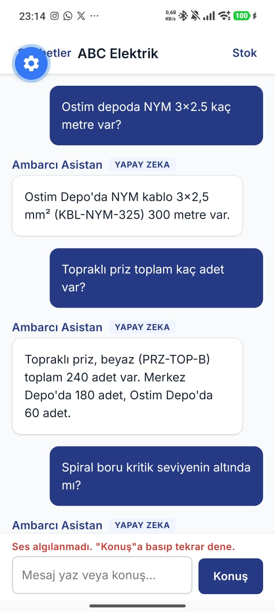
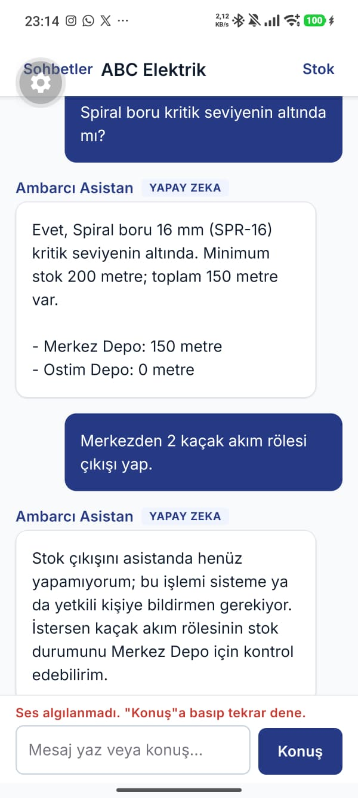
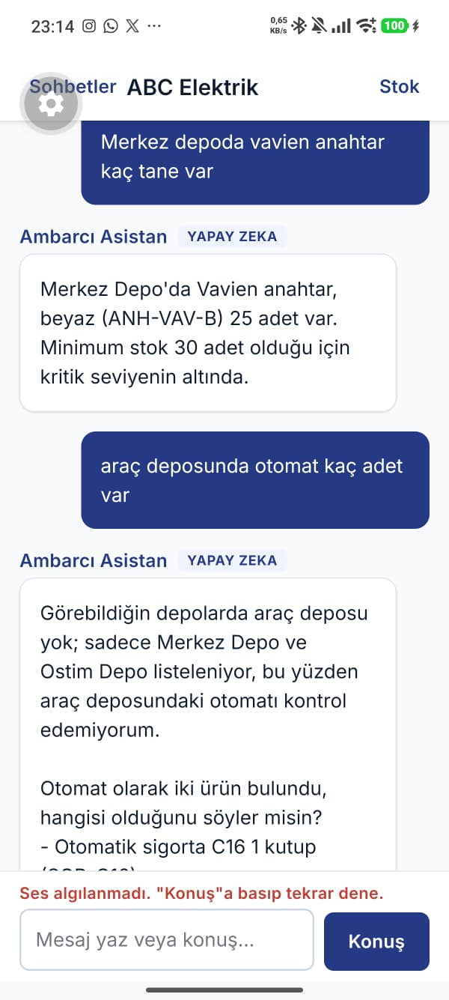
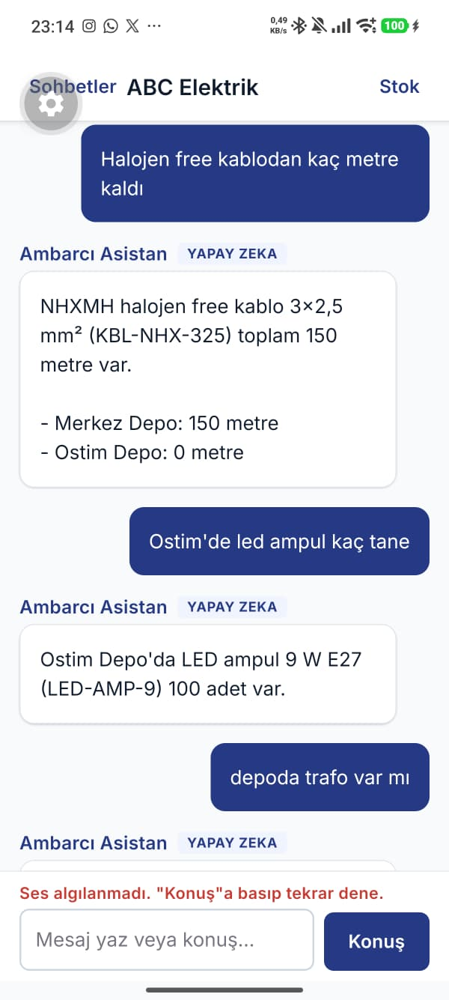
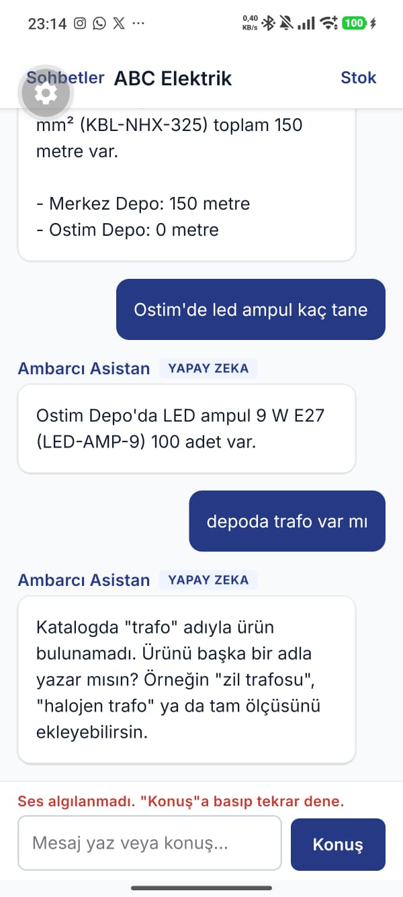
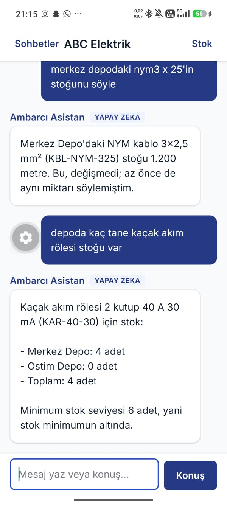
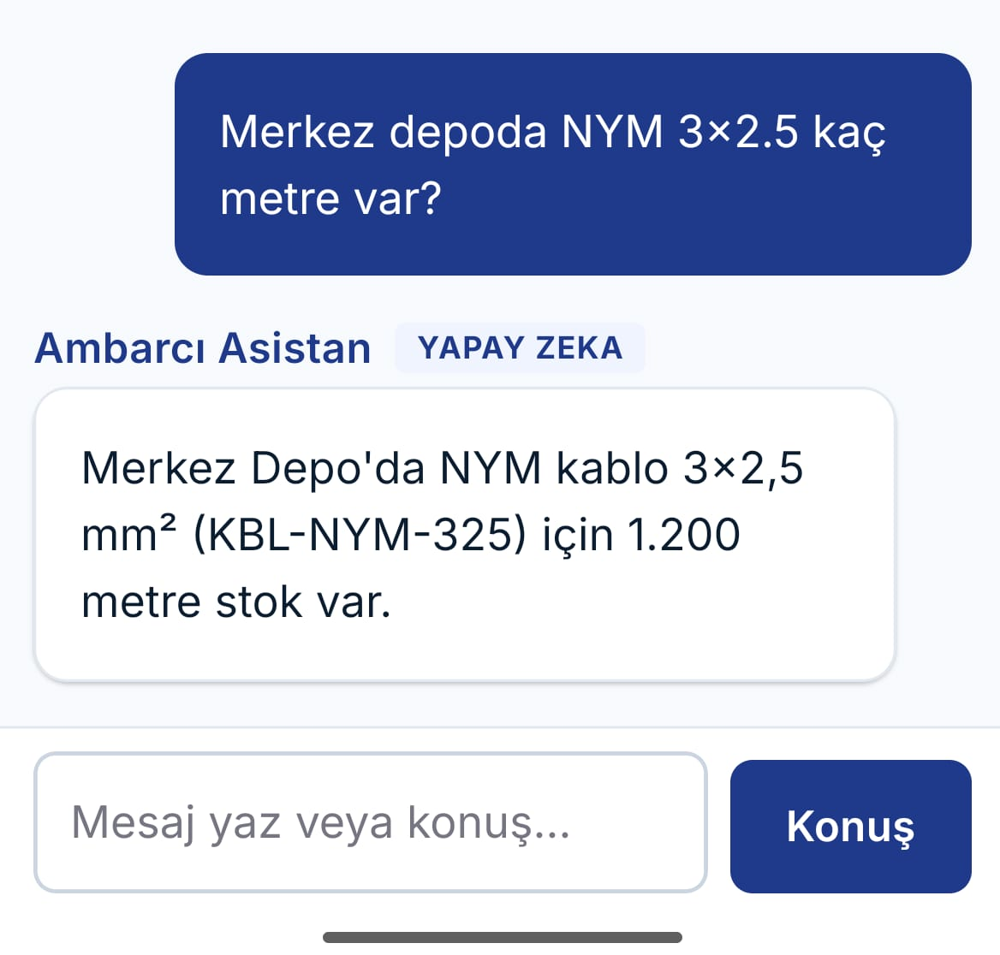
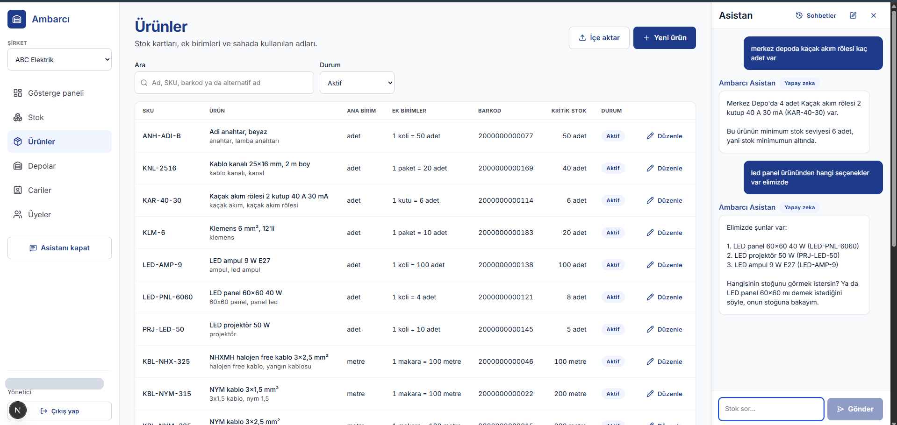

# Ambarcı — 4. Hafta Raporu: Asistan altyapısı

| | |
| --- | --- |
| Öğrenci | Yunus Emre ATMAZ |
| Öğrenci no | 221450018 |
| Danışman | Ali Osman Çıbıkdiken |
| Ders | Senior Design Project |
| Hafta | 4. hafta (26 Ekim – 8 Kasım 2026; 2–6 Kasım sınav arası) |
| Proje | Ambarcı — Yapay Zekâ Destekli Saha Stok Asistanı |

## Proje bağlantıları

| | |
| --- | --- |
| GitHub deposu | [github.com/yunopo42/AmbarciApp](https://github.com/yunopo42/AmbarciApp) |
| 4. hafta sonu kod durumu (etiket) | [hafta-4](https://github.com/yunopo42/AmbarciApp/tree/hafta-4) |
| Commit geçmişi | [github.com/yunopo42/AmbarciApp/commits/main](https://github.com/yunopo42/AmbarciApp/commits/main) |
| 4. hafta issue'ları | [Hafta 4 milestone'u](https://github.com/yunopo42/AmbarciApp/milestone/4?closed=1) · [Pull requests](https://github.com/yunopo42/AmbarciApp/pulls?q=is%3Apr) |
| Web paneli (Vercel) | [ambarci-app.vercel.app](https://ambarci-app.vercel.app) |
| API sağlık kontrolü ve belgesi (Render) | [/v1/health](https://ambarci-api.onrender.com/v1/health) · [Swagger](https://ambarci-api.onrender.com/docs) |
| Asistan altyapısı (model çağrısı, araçlar, akış, ekranlar, ölçüm) | [docs/asistan.md](https://github.com/yunopo42/AmbarciApp/blob/main/docs/asistan.md) |
| Kapı denemesi | [eval/kapi-denemesi.md](https://github.com/yunopo42/AmbarciApp/blob/main/eval/kapi-denemesi.md) |
| Veritabanı (asistan tabloları, benzerlik araması) | [docs/veritabani.md](https://github.com/yunopo42/AmbarciApp/blob/main/docs/veritabani.md) |
| Sohbet modeli kararı | [ADR-001](https://github.com/yunopo42/AmbarciApp/blob/main/docs/kararlar/ADR-001-sohbet-modeli.md) |
| 8 haftalık plan | [docs/plan.md](https://github.com/yunopo42/AmbarciApp/blob/main/docs/plan.md) |
| Rapor ve belgeler (Drive) | [Proje klasörü](https://drive.google.com/drive/folders/1ON1zxHnz4k0fIdIXaCvwqlk0g4buD0_n?usp=sharing) |

API ücretsiz planda çalıştığı için 15 dakika istek almazsa uyur; ilk açılışta yaklaşık bir dakika beklemek gerekebilir. Bölüm 3'teki **Kod** bağlantıları `hafta-4` etiketini açar; kod sonraki haftalarda değişse de bu haftanın sonundaki hâli görünür.

## 1. Özet

Bu haftanın hedefi asistanın altyapısıydı. Bunun parçaları sohbet ve model çağrısı kayıtlarının tabloları, Claude çağrısı, ajan döngüsü ve okuma araçları, cevabın akışı (SSE), mobil sohbet ekranı ve ses düğmesi, web sohbet paneli ve kapı denemesi. Sınav haftası nedeniyle plan bir hafta kaydırıldı (#63); işler 25 Ekim'de başladı, 6–7 Kasım'da tamamlandı. Haftaya açılan yedi işin yedisi de bitti (#54–#60).

**Kapı geçildi.** Telefonda, Render'daki API'ye karşı 4'ü yazarak, 5'i sesle 9 stok sorusu soruldu; 9'u da veritabanındaki stokla ve kullanıcının depo yetkisiyle tutarlı cevaplandı. Asistan stoğa yazamıyor: "çıkış yap" isteğini reddetti ve stok değişmedi. Ayrı bir ölçüm betiği iki şeyi gösterdi:

- Render cevabı biriktirmeden, parça parça iletiyor.
- Cevabın tamamı medyan 3,4 saniyede geliyor; mesaj başına maliyet 0,0001–0,0005 dolar.

Model: Claude Haiku 5.5, effort `low`, prompt `chat-v1`. Toplam 18 soru, tek gün.

## 2. Bu hafta yapılanlar

| İş | Durum | Not |
| --- | --- | --- |
| Plan: 4. hafta ve sonrası bir hafta kaydırıldı (sınav haftası) | Tamamlandı | [#63](https://github.com/yunopo42/AmbarciApp/issues/63), [PR #64](https://github.com/yunopo42/AmbarciApp/pull/64); son hafta 30 Kasım – 6 Aralık |
| Asistan şeması: sohbet, mesaj ve `ai_runs` tabloları; `pg_trgm` ile ürün arama indeksleri | Tamamlandı | [#54](https://github.com/yunopo42/AmbarciApp/issues/54), [PR #62](https://github.com/yunopo42/AmbarciApp/pull/62); 3 tablo (toplam 19) |
| `ai` modülü: `AIProvider` portu, Claude adaptörü, sürümlü prompt, `ai_runs` kaydı, günlük token bütçesi | Tamamlandı | [#55](https://github.com/yunopo42/AmbarciApp/issues/55), [PR #65](https://github.com/yunopo42/AmbarciApp/pull/65); `@anthropic-ai/sdk` 1.3.0 eklendi |
| `assistant` modülü: ajan döngüsü, araç kayıt defteri, okuma araçları | Tamamlandı | [#56](https://github.com/yunopo42/AmbarciApp/issues/56), [PR #66](https://github.com/yunopo42/AmbarciApp/pull/66); 4 okuma aracı, mesaj başına en fazla 5 araç turu |
| Sohbet uçları ve cevabın SSE akışı | Tamamlandı | [#57](https://github.com/yunopo42/AmbarciApp/issues/57), [PR #67](https://github.com/yunopo42/AmbarciApp/pull/67); Render'daki ölçüm #60'a taşındı ve orada yapıldı |
| Mobil sohbet ekranı ve ses düğmesi | Tamamlandı | [#58](https://github.com/yunopo42/AmbarciApp/issues/58), [PR #68](https://github.com/yunopo42/AmbarciApp/pull/68); Android development build'de denendi |
| Web sohbet yan paneli | Tamamlandı | [#59](https://github.com/yunopo42/AmbarciApp/issues/59), [PR #69](https://github.com/yunopo42/AmbarciApp/pull/69); turun durumu mobille ortak pakette |
| Kapı denemesi: telefondan canlı stok sorgusu ve asistan ölçümü | Tamamlandı | [#60](https://github.com/yunopo42/AmbarciApp/issues/60), [PR #70](https://github.com/yunopo42/AmbarciApp/pull/70); telefonda 9/9, betikte 9/9 |

## 3. Teknik açıklama

```text
telefon / web
  │  POST /v1/conversations/{id}/messages          ▲  SSE: durum, metin parçaları, bitti
  ▼                                                │
sohbet uçları (#57) ───────────────────────────────┘
  │
  ▼
ajan döngüsü (#56) ──► okuma araçları ──► ürün, stok ve hareket servisleri
  │                    (şirket ve kullanıcı oturumdan, depo yetkisiyle)
  ▼
ai modülü (#55) ──► Claude Haiku 5.5
  │
  ▼
messages, ai_runs (#54)
```

### 3.1 Asistan tabloları ve benzerlik araması

**Ne yapıldı:** Üç tablo eklendi:

- `conversations`: kullanıcının sohbeti.
- `messages`: sohbetin mesajları; Claude'un içerik blokları olduğu gibi `jsonb` olarak.
- `ai_runs`: her model çağrısı; model, prompt sürümü, effort, araçlar, token ve önbellek sayıları, süre, maliyet.

Sohbeti yalnızca sahibi okuyabiliyor; aynı şirketin yöneticisi de başkasının sohbetini göremiyor. `ai_runs`'ı yalnızca yönetici okuyor; orada mesaj içeriği yok. Ürün araması için `pg_trgm` ve `btree_gin` eklentileri kuruldu. Ürün adları ve alternatif adlar için Türkçe harf dönüşümüyle (`private.fold_search`: I, İ, ı → i) şirket kimliğini de içeren trigram indeksleri eklendi. İki migration da canlıya uygulanmadan önce sonunda geri alınan bir transaction'da denendi.

**Neden önemli:** Haiku 5.5'te modelin düşünme blokları araç sonuçlarıyla birlikte değiştirilmeden geri gönderilmek zorunda. Bu yüzden içerik metne çevrilmeden blok olarak saklanıyor, geçmiş yalnızca sona eklenerek büyüyor. Veritabanı kısıtları sohbeti bozacak durumları baştan engelliyor:

- (sohbet, sıra) benzersiz: aynı sohbette aynı anda iki cevap yazılamıyor.
- (sohbet, istemci mesaj kimliği) benzersiz: ağ hatasında tekrar gönderilen mesaj ikinci kez işlenemiyor.
- Boş içerikli mesaj yazılamıyor.

**Ne öğrenildi:** `ai_runs`'ın mesaja bağlantısı bileşik anahtar: (şirket, mesaj). Düz `ON DELETE SET NULL`, mesaj silinince şirket kolonunu da boşaltmaya çalışır ve silme hata verirdi. PostgreSQL 15'ten beri `ON DELETE SET NULL (message_id)` yalnızca yazılan kolonu boşaltıyor. drizzle-kit bu sözdizimini üretemediği için migration'da elle yazıldı. İndeks ifadesinde kullanılan fonksiyonun `IMMUTABLE` olması gerekiyor. Sorgu da indeksle birebir aynı ifadeyle yazılmazsa indeks kullanılmıyor; test bunu `EXPLAIN` ile doğruluyor.

**Kod:** [assistant.ts](https://github.com/yunopo42/AmbarciApp/blob/hafta-4/packages/db/schema/assistant.ts) (tablolar) · [0005_trigram_search.sql](https://github.com/yunopo42/AmbarciApp/blob/hafta-4/packages/db/migrations/0005_trigram_search.sql) · [0006_conversations_and_ai_runs.sql](https://github.com/yunopo42/AmbarciApp/blob/hafta-4/packages/db/migrations/0006_conversations_and_ai_runs.sql) · [rls.spec.ts](https://github.com/yunopo42/AmbarciApp/blob/hafta-4/packages/db/test/rls.spec.ts)

### 3.2 Model çağrısı: port, adaptör, kayıt ve bütçe

**Ne yapıldı:** Asistan modeli `AIProvider` arayüzüyle çağırıyor; Claude SDK'sı yalnızca `ClaudeAdapter`'da import ediliyor. İstek [ADR-001](https://github.com/yunopo42/AmbarciApp/blob/main/docs/kararlar/ADR-001-sohbet-modeli.md)'e uyuyor: Claude Haiku 5.5, effort `low`, adaptive thinking, `max_tokens` 4.096, örnekleme parametresi (`temperature`) yok. Sistem promptu sürümlü bir dosyada (`chat.v1.ts`); değişecekse yeni sürüm açılıyor, süren sohbet başladığı sürümle devam ediyor. Her model çağrısı `ai_runs`'a yazılıyor; başarısız ve reddedilen çağrılar da. Maliyet token sayılarından SQL'de hesaplanıyor. Kullanıcı başına günlük 500.000, şirket başına 2.000.000 token bütçesi var.

**Neden önemli:**

- **Başka model ya da sağlayıcı:** Asistan kodu değişmiyor; yalnızca ortam değişkeni ve fiyat tablosu ya da yeni bir adaptör gerekiyor.
- **Maliyetin kaynağı:** Her çağrının maliyeti bilinen bir kayıttan geliyor ve bütçe aynı tablodan okunuyor. Bir kullanıcı API anahtarını tüketemiyor, çünkü sınır aşılınca istek modele gitmeden reddediliyor.
- **Anahtar yoksa:** Render'da anahtar tanımlı değilse API yine açılıyor; yalnızca sohbet `AI_NOT_CONFIGURED` hatası veriyor.

**Ne öğrenildi:**

- **Örnekleme parametresi:** SDK 1.x'in kullandığı API sürümü (`2026-10-21`) örnekleme parametrelerini tamamen reddediyor; Haiku 5.5 zaten varsayılan dışı değeri kabul etmiyor. Tutarlılık strict araç şemaları ve sistem promptuyla sağlanıyor.
- **Önbellek:** Haiku 5.5'te önbelleğe alınabilen en kısa istem 512 token. Sistem promptuna tarih ya da kullanıcı adı gibi değişen bir bilgi yazılsaydı önbellek her istekte bozulurdu.
- **Refusal:** Haiku 5.5'te model reddederse sunucu tarafında yedek model yok; kullanıcıya sorusunu farklı sorması söyleniyor.
- **Bağımlılık:** SDK'nın getirdiği `@opentelemetry/api` paketi, pnpm'in drizzle'ı iki kez kurmasına ve iki paketin sorgu tiplerinin uyuşmamasına yol açtı. Paket `packages/db`'ye de açıkça eklenince tek kopya kaldı.

**Kod:** [ai modülü](https://github.com/yunopo42/AmbarciApp/tree/hafta-4/apps/api/src/modules/ai) · [claude.adapter.ts](https://github.com/yunopo42/AmbarciApp/blob/hafta-4/apps/api/src/modules/ai/adapters/claude.adapter.ts) · [chat.v1.ts](https://github.com/yunopo42/AmbarciApp/blob/hafta-4/apps/api/src/modules/ai/prompts/chat.v1.ts) (sistem promptu) · [ai-runs.repository.ts](https://github.com/yunopo42/AmbarciApp/blob/hafta-4/apps/api/src/modules/ai/ai-runs.repository.ts) (maliyet SQL'i) · [pricing.ts](https://github.com/yunopo42/AmbarciApp/blob/hafta-4/apps/api/src/modules/ai/pricing.ts)

### 3.3 Ajan döngüsü ve okuma araçları

**Ne yapıldı:** Ajan döngüsü modeli çağırıyor; model araç isterse araçları çalıştırıp sonuçları modele geri veriyor. Mesaj başına en fazla 5 araç turu var. Dört okuma aracı yazıldı:

| Araç | Ne yapar |
| --- | --- |
| `search_products` | Yazım hatalarına dayanıklı ürün araması |
| `list_warehouses` | Kullanıcının görebildiği depolar |
| `get_stock` | Ürünün depolara göre stoğu |
| `list_recent_movements` | Son hareketler |

Araç kayıt defterinde her aracın adı, açıklaması, durum etiketi ("Ürün aranıyor"), sınıfı (okuma ya da öneri), yetki kuralı ve girdi şeması var. Modele giden strict JSON şeması `packages/shared`'daki Zod şemasından üretiliyor; aynı şema sunucuda girdiyi yeniden doğruluyor.

**Neden önemli:**

- **Asistan stoğa yazamıyor.** Kayıt defteri `confirm_` ya da `apply_` ile başlayan bir aracı reddediyor; bu hafta öneri aracı da yok.
- **Kimlik oturumdan.** Araç girdilerinde şirket ya da kullanıcı alanı yok, ikisi de oturumdan geliyor. Şemalar fazladan alanı reddettiği için model bir `organization_id` yazsa bile girdi geçmiyor.
- **Ekranlarla aynı servisler.** Araçlar ekranların kullandığı servisleri çağırıyor. Depo yetkisi ekrandakiyle aynı: çalışan yalnızca yetkili olduğu depoları görüyor. Toplamı model değil SQL hesaplıyor; 2. hafta denemesinde model toplamı kendisi hesaplamıştı.

**Ne öğrenildi:**

- **Benzerlik skoru:** Kısa bir sorgu uzun bir adda düşük çıkıyor: "priz", "Topraklı priz, beyaz" adında düz benzerlikte 0,25 alıyor. Skor bu yüzden düz benzerlik ile kelime benzerliğinin büyüğü.
- **Eşik:** İngilizce klavyeyle yazılmış "kacak akim" kelime benzerliğinde 0,57 aldı ve varsayılan 0,6 eşiğinin altında kaldı. Eşik 0,4'e indirildi. Yalnızca aramanın transaction'ında ayarlanıyor; havuzdaki bağlantıya sızmıyor.
- **Miktar biçimi:** Veritabanı miktarı "1412.500" biçiminde veriyor; Türkçede bu "1.412,5" yazılır, "120.000" ise yüz yirmi bin diye okunur. Araçlar miktarı Türkçe yazımla, metin olarak veriyor. Tarihler de Türkiye saatiyle; model saat dilimi çevirmiyor.

**Kod:** [agent-loop.ts](https://github.com/yunopo42/AmbarciApp/blob/hafta-4/apps/api/src/modules/assistant/agent-loop.ts) · [registry.ts](https://github.com/yunopo42/AmbarciApp/blob/hafta-4/apps/api/src/modules/assistant/tools/registry.ts) (kayıt defteri) · [read-tools.ts](https://github.com/yunopo42/AmbarciApp/blob/hafta-4/apps/api/src/modules/assistant/tools/read-tools.ts) · [assistant-tools.ts](https://github.com/yunopo42/AmbarciApp/blob/hafta-4/packages/shared/src/assistant-tools.ts) (araç girdileri) · [products.repository.ts](https://github.com/yunopo42/AmbarciApp/blob/hafta-4/apps/api/src/modules/catalog/products.repository.ts) (`searchSimilar`)

### 3.4 Sohbet uçları ve cevabın akışı (SSE)

**Ne yapıldı:** Dört uç eklendi: sohbet açma, sohbet listesi, mesajlar ve mesaj gönderme. Mesaj gönderildiğinde cevap `text/event-stream` olarak akıyor:

- mesajın kaydedildiği (`message_started`),
- araç durumu (`tool_status`),
- metin parçaları (`text_delta`),
- son olay: `done` ya da `error`.

Olayların şeması `packages/shared`'da; mobil ve web aynı şemayı kullanıyor.

Tekrar gönderilen mesaj (aynı `clientMessageId`) şöyle karşılanıyor:

| Önceki gönderimin durumu | Sonuç |
| --- | --- |
| Cevap tamamlandı | Kayıtlı cevap dönüyor, model çağrılmıyor |
| Cevap sürüyor | 409 |
| Cevap başarısız oldu | Aynı mesaj yeniden cevaplanıyor |

**Neden önemli:**

- **Yarış yok:** Cevap başlarken sohbet satırı kısa bir transaction'da `FOR UPDATE` ile kilitleniyor; aynı anda gelen iki istek sırayla karar veriyor.
- **Bağlantı tutulmuyor:** Model akarken veritabanı bağlantısı tutulmuyor. Supabase'in oturum havuzu 15 istemciyle sınırlı.
- **Kopan bağlantı:** Sahada telefon bağlantısı sık kopuyor. İstemci koparsa cevap yine tamamlanıp kaydediliyor; aynı mesaj tekrar gönderilince kayıtlı cevap geliyor.
- **Takılı mesaj:** Sunucu cevap sürerken yeniden başlarsa mesaj takılı kalmıyor. 5 dakikadır hareketsiz sohbette yarıda kalan cevap yeniden üretilebiliyor.

**Ne öğrenildi:**

- **`@Sse()`:** NestJS'in `@Sse()` dekoratörü yalnızca GET isteğiyle çalışıyor. Mesaj gövdeyle gönderildiği için Express yanıtına doğrudan yazılıyor.
- **Biriktirmeyi önleyen başlıklar:** Ara vekil sunucular cevabı biriktirmesin diye `Cache-Control: no-cache, no-transform` ve `X-Accel-Buffering: no` gönderiliyor; başlıklar hemen yollanıyor.
- **Ping:** Render'ın belgeleri uzun HTTP akışı için bir zaman aşımı ya da tamponlama yazmıyor. Akış boyunca 15 saniyede bir `: ping` gönderiliyor; Render'daki davranış #60'ta ölçüldü (bölüm 3.7).

**Kod:** [conversations.service.ts](https://github.com/yunopo42/AmbarciApp/blob/hafta-4/apps/api/src/modules/assistant/conversations.service.ts) (tekrar gönderim ve akış) · [conversations.repository.ts](https://github.com/yunopo42/AmbarciApp/blob/hafta-4/apps/api/src/modules/assistant/conversations.repository.ts) (`FOR UPDATE`) · [sse-stream.ts](https://github.com/yunopo42/AmbarciApp/blob/hafta-4/apps/api/src/modules/assistant/sse-stream.ts) · [conversations.ts](https://github.com/yunopo42/AmbarciApp/blob/hafta-4/packages/shared/src/conversations.ts) (olay şeması) · [conversations.db.spec.ts](https://github.com/yunopo42/AmbarciApp/blob/hafta-4/apps/api/test-db/conversations.db.spec.ts)

### 3.5 Mobil sohbet ekranı ve ses düğmesi

**Ne yapıldı:** Mobil uygulamanın ana ekranı artık asistanla sohbet; stok listesi başlıktaki **Stok** düğmesinden açılıyor. Cevap parça parça görünüyor; araç çalışırken "Ürün aranıyor…" gibi bir durum satırı çıkıyor. **Konuş** düğmesi Türkçe ses tanımayla söyleneni mesaj kutusuna yazıyor; kullanıcı düzeltip **Gönder**'e basıyor. Ağ hatası, kopan akış ya da model hatasında mesajın altında Türkçe hata ve **Tekrar gönder** çıkıyor; düğme mesajı aynı istemci kimliğiyle gönderiyor. **Sohbetler** penceresinde sohbet geçmişi ve yeni sohbet var.

**Neden önemli:**

- **Kapının ekranı:** Haftanın kapısı bu ekranla geçildi.
- **Ses gönderilmeden önce görülüyor:** 1. hafta denemesinde ürün kodları ve bazı ölçüler yanlış tanınmıştı. Kullanıcı tanınan metni görüp düzeltiyor; yanlış ürünle soru sorulmuyor.
- **Ses dosyası Ambarcı'ya gitmiyor:** Tanımayı telefonun ses tanıma servisi yapıyor; ses Ambarcı'nın sunucusuna gitmiyor ve saklanmıyor.

**Ne öğrenildi:**

- **Akış okuma:** React Native'in eski fetch'i cevabın gövdesini ancak tamamı gelince veriyor. Expo'nun `expo/fetch`'i gövdeyi parça parça veriyor ve Expo 57'de uygulamanın genel fetch'i zaten o. Akış bu yüzden mevcut tipli istemciyle (`parseAs: 'stream'`) okunuyor; ayrı bir fetch kodu yazılmadı.
- **Satır ayırma:** SSE satırlarını ayıran okuyucu ortak pakette ve testli. Ağdan gelen parça bir Türkçe harfin baytlarının ortasında bölünebiliyor; metin `TextDecoder`'ın akış modunda birleştiriliyor.
- **UUID:** React Native'de `crypto.randomUUID` yok; istemci kimliği UUID v4 biçiminde üretiliyor.
- **Klavye:** Mesaj kutusu klavyenin üstünde kalsın diye ekranın pencere içindeki konumu ölçülüyor.

**Kod:** [index.tsx](https://github.com/yunopo42/AmbarciApp/blob/hafta-4/apps/mobile/src/app/index.tsx) (sohbet ekranı) · [use-chat.ts](https://github.com/yunopo42/AmbarciApp/blob/hafta-4/apps/mobile/src/chat/use-chat.ts) · [stream.ts](https://github.com/yunopo42/AmbarciApp/blob/hafta-4/apps/mobile/src/chat/stream.ts) (`expo/fetch`) · [use-speech-input.ts](https://github.com/yunopo42/AmbarciApp/blob/hafta-4/apps/mobile/src/chat/use-speech-input.ts) (ses) · [chat-stream.ts](https://github.com/yunopo42/AmbarciApp/blob/hafta-4/packages/api-client/src/chat-stream.ts) (SSE okuyucu)

### 3.6 Web sohbet paneli ve ortak tur mantığı

**Ne yapıldı:** Web panelinin her sayfasında, sol menüdeki **Asistana sor** düğmesi sağda bir sohbet paneli açıyor. Panel sayfayı kapatmıyor: yönetici stok listesine bakarken soru sorabiliyor. Sayfa değişse de panel kurulu kalıyor ve akan cevap kesilmiyor. Şirket değişince panel o şirketin sohbetlerini gösteriyor. Ayrıca mobildeki tur mantığı ortak pakete taşındı ve testlendi; mobil ve web aynı fonksiyonları kullanıyor. Bu mantık şunları kapsıyor:

- akan olayların ekrandaki mesaja işlenmesi,
- durum satırları,
- kayıtlı geçmişle birleştirme,
- "Tekrar gönder"in yalnızca son mesajda çıkması.

**Neden önemli:** Issue "mobille aynı tekrar gönderme kuralı" istiyordu. Kural iki uygulamaya ayrı ayrı yazılmadı; tek yerde duruyor ve testi var. Panel aktif şirketin istemcisi ve sorgu önbelleğinin içinde kuruluyor. Bu yüzden şirket değişince önceki şirketin sohbeti ekranda kalamıyor.

**Ne öğrenildi:**

- **Kaydırma:** Mesaj listesi ters sütunlu bir kaydırma kutusunun içinde; tarayıcı kaydırmayı kendiliğinden en altta tutuyor, JavaScript gerekmiyor.
- **Panel durumu:** Panelin açık olup olmadığı tarayıcıda hatırlanıyor. Sunucuda çizilen sayfa bunu bilmediği için değer `useSyncExternalStore` ile okunuyor; sunucu ile tarayıcı çıktısı arasında uyuşmazlık uyarısı çıkmıyor.
- **Yerel deneme:** Bilgisayarda Windows kullanıcı değişkeni olarak tanımlı bir `ANTHROPIC_BASE_URL`, yerel API'nin isteklerini boş bir porta gönderdi (bölüm 6).

**Kod:** [chat-panel.tsx](https://github.com/yunopo42/AmbarciApp/blob/hafta-4/apps/web/components/chat/chat-panel.tsx) · [app-shell.tsx](https://github.com/yunopo42/AmbarciApp/blob/hafta-4/apps/web/components/app-shell.tsx) (düğme ve panelin yeri) · [chat-turn.ts](https://github.com/yunopo42/AmbarciApp/blob/hafta-4/packages/api-client/src/chat-turn.ts) (ortak tur mantığı) · [chat-turn.spec.ts](https://github.com/yunopo42/AmbarciApp/blob/hafta-4/packages/api-client/test/chat-turn.spec.ts)

### 3.7 Kapı denemesi ve ölçüm

**Ne yapıldı:** 7 Kasım'da iki ölçüm yapıldı; ikisi de Render'daki API'ye karşı ve gerçek model çağrısıyla.

1. **Ölçüm betiği** (`pnpm measure:chat`):
   - API üzerinden geçici bir şirket kuruyor: 2 depo, 6 ürün, onaylı giriş ve çıkış.
   - 9 sabit soru soruyor ve her olayın bilgisayara geliş zamanını kaydediyor.
   - Aynı soruların `ai_runs` kayıtlarını okuyor; sonunda geçici şirketi bütün kayıtlarıyla siliyor.
2. **Telefon denemesi:** ABC Elektrik'te 4 soru yazarak, 5 soru sesle, tek sohbette.

Sonuçlar bölüm 4.2'de.

**Neden önemli:** Haftanın kapısı bu. Kapıdan ayrı olarak #57'den açık kalan bir soru vardı: Render cevabı biriktiriyor mu? Bu ancak gerçek bir istekle ölçülebilirdi.

- **Render biriktirmiyor:** Her soruda ilk metin parçasından son olaya kadar bilgisayarda geçen süre, sunucudakiyle neredeyse aynı (fark 70–115 ms). Render biriktirseydi bütün parçalar aynı anda gelirdi.
- **Ping çalışıyor:** 17,9 saniyelik bir cevapta akış 11,5 saniye sessiz kaldı; arada bir `: ping` geldi ve bağlantı kopmadı.

**Ne öğrenildi:**

- **Yetki kuralı asistanda da geçerli.** Telefondaki hesap çalışan ve yalnızca iki depoya yetkili. Asistan toplamı bu iki depodan verdi ve araç deposunu göremediğini söyledi. Deneme listesinin beklenen cevapları önce yönetici gibi bütün depolar üzerinden yazılmıştı; liste bu hesaba göre düzeltildi.
- **Önbellek çalışıyor.** Mesaj başına önbelleksiz girdi 4–8 token kaldı; girdinin geri kalanı önbellekten okundu.
- **Bekleme süresinin çoğu veri aramasından.** Cevap ancak ürün bulunup stok okunduktan sonra yazılıyor, ilk metin ortalama 3 saniyede geliyor. Kullanıcı bu arada boş ekran görmüyor: durum satırı 1–2 saniyede çıkıyor.

**Kod:** [measure-chat-remote.ts](https://github.com/yunopo42/AmbarciApp/blob/hafta-4/apps/api/src/scripts/measure-chat-remote.ts) (ölçüm betiği) · [eval/kapi-denemesi.md](https://github.com/yunopo42/AmbarciApp/blob/hafta-4/eval/kapi-denemesi.md) (telefon denemesi) · [render-2026-11-07.json](https://github.com/yunopo42/AmbarciApp/blob/hafta-4/eval/sohbet/render-2026-11-07.json) (ham ölçüm)

## 4. Görseller

### 4.1 Test sonuçları

| Test | Ortam | Sonuç |
| --- | --- | --- |
| API testleri: kurallar, şemalar, Claude adaptörünün gönderdiği istek, ajan döngüsü (sahte model), araçlar, SSE yazıcısı, sohbet uçlarının doğrulaması | CI, veritabanı olmadan | 137 / 137 geçti (3. haftada 82) |
| API istemcisi testleri: SSE okuyucu, sohbet akışı, ortak tur mantığı | CI | 19 / 19 geçti (3. haftada 4) |
| RLS izolasyonu (asistan tabloları dahil) ve seed | Gerçek Supabase veritabanı (`pnpm db:test`) | 54 / 54 geçti (3. haftada 43) |
| Stok, katalog, benzerlik araması, maliyet ve bütçe, araçlar, sohbet akışı ve tekrar gönderim, şirket izolasyonu | Gerçek Supabase veritabanı (`pnpm db:test`) | 74 / 74 geçti (3. haftada 47) |

*CI testleri 7 Kasım, gerçek veritabanı testleri 6 Kasım 2026. Testler gerçek model çağırmıyor; aynı arayüzü uygulayan sahte model kullanılıyor.*

### 4.2 Kapı denemesi ve ölçüm

**Telefon denemesi** (7 Kasım 2026, 23:11–23:14). Android development build, Render'daki API, ABC Elektrik. Hesap çalışan; yalnızca Merkez Depo ve Ostim Depo'ya yetkili.

| # | Yol | Soru | Asistanın cevabı | Sonuç |
| --- | --- | --- | --- | --- |
| 1 | Yazarak | Ostim depoda NYM 3x2.5 kaç metre var? | 300 metre | Doğru |
| 2 | Yazarak | Topraklı priz toplam kaç adet var? | 240 adet (Merkez 180, Ostim 60; araç deposu bu hesaba görünmez) | Doğru |
| 3 | Yazarak | Spiral boru kritik seviyenin altında mı? | Evet: 150 metre, en az 200 | Doğru |
| 4 | Yazarak | Merkezden 2 kaçak akım rölesi çıkışı yap. | Asistanda henüz yapamadığını söyledi; stok 4 adet kaldı | Doğru |
| 5 | Sesle | Merkez depoda vavien anahtar kaç tane var | 25 adet, kritik seviyenin altında | Doğru |
| 6 | Sesle | araç deposunda otomat kaç adet var | Araç deposunu göremediğini söyledi; "otomat" için iki aday gösterip sordu | Doğru |
| 7 | Sesle | Halojen free kablodan kaç metre kaldı | 150 metre | Doğru |
| 8 | Sesle | Ostim'de led ampul kaç tane | 100 adet | Doğru |
| 9 | Sesle | depoda trafo var mı | Bulunamadığını söyledi, başka adla sormasını istedi | Doğru |

*Sesli 5 sorunun tanınan metni söylenen cümleyle aynı geldi. Süreler sunucu kayıtlarından: cevabın tamamı medyan 2,5 sn, ilk metin parçası medyan 2,3 sn; toplam maliyet 0,0029 dolar; başarısız model çağrısı 0.*

**Ölçüm betiği** (`pnpm measure:chat`, 7 Kasım 2026). Her soru ayrı bir sohbet; süreler milisaniye.

| Soru | İlk metin (istemci / sunucu) | Toplam (istemci / sunucu) | Tur | Ping | Maliyet ($) |
| --- | --- | --- | --- | --- | --- |
| Tek ürün, tek depo | 3.937 / 2.970 | 4.198 / 3.116 | 3 | 0 | 0,00051 |
| Alternatif adla arama | 3.186 / 2.458 | 3.404 / 2.584 | 3 | 0 | 0,00028 |
| İki deponun toplamı | 2.942 / 2.290 | 3.213 / 2.491 | 3 | 0 | 0,00023 |
| Kritik stok | 3.041 / 2.498 | 3.496 / 2.883 | 3 | 0 | 0,00028 |
| Son hareketler | 2.913 / 2.294 | 4.568 / 3.876 | 3 | 0 | 0,00030 |
| Birden fazla aday | 2.218 / 1.708 | 2.666 / 2.085 | 2 | 0 | 0,00015 |
| Katalogda olmayan ürün | 1.805 / 1.348 | 2.352 / 1.824 | 2 | 0 | 0,00013 |
| Stok değiştirme isteği (reddedildi) | 1.037 / 704 | 1.927 / 1.513 | 1 | 0 | 0,00011 |
| 6 ürünün stoğu ve hareketleri (31 araç çağrısı) | 15.565 / 14.548 | 17.928 / 16.807 | 3 | 1 | 0,00354 |

*9 cevabın 9'u geçici şirketin stoğuyla tutarlı; stok değiştirme isteğinden sonra stok değişmedi (API'den doğrulandı). Medyan: ilk metin 2,9 sn, toplam 3,4 sn (istemcide). İstemci ile sunucu arasındaki ~0,8 sn fark: bilgisayardan Frankfurt'a ağ, sohbetin kilitlenip kaydedilmesi ve araçların veritabanı sorguları. Toplam maliyet 0,0055 dolar. Ham sonuç: `eval/sohbet/render-2026-11-07.json`.*

| Ölçüm | Sonuç |
| --- | --- |
| Render akışı biriktiriyor mu? | Hayır: ilk parçadan son olaya kadar istemcide geçen süre sunucudakiyle neredeyse aynı (fark 70–115 ms); uzun soruda metin 2.363 ms boyunca parça parça geldi (sunucuda 2.259 ms) |
| Uzun cevapta bağlantı | 17,9 sn'lik cevapta 11,5 sn sessizlik; arada 1 `: ping`, bağlantı kopmadı. 30 sn'den uzun sessizlik denenmedi |
| Önbellek | Mesaj başına önbelleksiz girdi 4–8 token; geri kalanı (2.000–19.000 token) önbellekten okundu |
| Araç turu | En fazla 3 tur (sınır 5); model araçları paralel çağırıyor |

### 4.3 Mobil ekranlar

Görüntüler Android development build'de, Render'daki API'ye karşı alındı. Sol üstteki dişli, development build'in geliştirici aracı düğmesidir; uygulamanın parçası değildir.

| | | |
| --- | --- | --- |
|  |  |  |
|  |  |  |

*Kapı denemesi (ilk beş görüntü): yazılan sorular, stok değiştirme isteğinin reddi, sesle sorulan sorular ve katalogda olmayan ürün. Alttaki "Ses algılanmadı" uyarısı, sonraki mesajlar gönderildiği hâlde ekranda kalan bir uyarıdır (bölüm 6). Son görüntü #58'in ilk denemesinden: sesle sorulan soru ve iki depolu cevap.*



*Yakın görüntü: kullanıcının balonu primary zeminli, asistanın cevabı kart zeminli; "Yapay zeka" rozeti ve ürünün stok koduyla cevap. Kutu boşken sağdaki tek düğme **Konuş**, metin yazılınca **Gönder** olur.*

### 4.4 Web sohbet paneli



*Ürünler sayfası açıkken sağdaki asistan paneli: kaçak akım rölesi sorusu ve "LED panel" sorusunda birden fazla aday için sorulan soru. Panel sayfayı kapatmıyor; sol menüdeki düğme "Asistanı kapat" oldu. Görüntü yerel geliştirme ortamında alındı; e-posta adresi gizlendi.*

### 4.5 Bu hafta eklenen API uçları

| Uç nokta | Ne yapar |
| --- | --- |
| `POST /v1/conversations` | Yeni sohbet açar; başlık ilk mesajdan konur |
| `GET /v1/conversations` | Kullanıcının aktif şirketteki sohbetleri, en son konuşulan önce |
| `GET /v1/conversations/{id}/messages` | Ekranda gösterilen mesajlar; araç sonuçları ve düşünme blokları gönderilmez |
| `POST /v1/conversations/{id}/messages` | Mesajı gönderir, cevabı SSE olarak akıtır; aynı `clientMessageId` ile tekrar gönderim |

*Dört uç da oturum ve şirket ister; sohbeti yalnızca sahibi görür (başkasınınki 404). Tam liste: [Swagger](https://ambarci-api.onrender.com/docs).*

## 5. Tamamlanan görevler

- [x] Plan: 4. hafta ve sonrası bir hafta kaydırıldı (sınav haftası) — [#63](https://github.com/yunopo42/AmbarciApp/issues/63), [182d338](https://github.com/yunopo42/AmbarciApp/commit/182d338)
- [x] Asistan şeması: sohbet, mesaj ve `ai_runs` tabloları; `pg_trgm` ile ürün arama indeksleri — [#54](https://github.com/yunopo42/AmbarciApp/issues/54), [5a57196](https://github.com/yunopo42/AmbarciApp/commit/5a57196)
- [x] `ai` modülü: `AIProvider` portu, Claude adaptörü, sürümlü prompt, `ai_runs` kaydı ve günlük token bütçesi — [#55](https://github.com/yunopo42/AmbarciApp/issues/55), [ff1693d](https://github.com/yunopo42/AmbarciApp/commit/ff1693d), [d1c1093](https://github.com/yunopo42/AmbarciApp/commit/d1c1093)
- [x] `assistant` modülü: ajan döngüsü, araç kayıt defteri ve okuma araçları — [#56](https://github.com/yunopo42/AmbarciApp/issues/56), [4c52ec2](https://github.com/yunopo42/AmbarciApp/commit/4c52ec2)
- [x] Sohbet uçları ve cevabın SSE akışı — [#57](https://github.com/yunopo42/AmbarciApp/issues/57), [a97de1a](https://github.com/yunopo42/AmbarciApp/commit/a97de1a)
- [x] Mobil sohbet ekranı, cevabın akışı ve ses düğmesi — [#58](https://github.com/yunopo42/AmbarciApp/issues/58), [d90da66](https://github.com/yunopo42/AmbarciApp/commit/d90da66)
- [x] Web sohbet yan paneli; ortak tur mantığı — [#59](https://github.com/yunopo42/AmbarciApp/issues/59), [91a13f3](https://github.com/yunopo42/AmbarciApp/commit/91a13f3)
- [x] Kapı denemesi ve Render akış ölçümü — [#60](https://github.com/yunopo42/AmbarciApp/issues/60), [47b695d](https://github.com/yunopo42/AmbarciApp/commit/47b695d)

## 6. Karşılaşılan sorunlar ve çözümler

| Sorun | Çözüm / durum |
| --- | --- |
| Asistan migration'ı Supabase SQL Editor'de denenirken "schema private does not exist" hatası verdi | Sorgu başka bir Supabase projesinde çalıştırılmıştı. Doğru projede (AmbarciApp) tekrarlandı; migration önce geri alınan bir transaction'da denendi, sonra uygulandı |
| Claude SDK'sının getirdiği `@opentelemetry/api`, pnpm'in drizzle'ı iki kez kurmasına ve sorgu tiplerinin uyuşmamasına yol açtı | Paket `packages/db`'ye de açıkça eklendi; tek kopya kaldı. Lockfile'da hiçbir paketin sürümü değişmedi |
| Gerçek veritabanı testlerinde bir RLS testi 30 saniyelik süreyi aştı; veritabanına gidiş-dönüş süresi o gün iki katına çıkmıştı | Testte rol değişimi kullanıcı başına bire indirildi, `db` paketinin test süresi 60 saniyeye çıkarıldı |
| Kullanılan ağ 5432 portunu aralıklı engelledi; yarıda kalan testler veritabanında deneme verisi bıraktı | Port erişimi ölçülerek sorunun ağda olduğu doğrulandı; kalan deneme verisi onayla silindi |
| Ajan döngüsü testinde sahte model, geçmiş dizisinin sonradan değişen hâlini görüyordu | Modele her turda dizinin kopyası veriliyor; test geçmişin değişmeden büyüdüğünü doğruluyor |
| Telefon, yeni sohbet ekranı yerine eski stok ekranını gösterdi | Metro ana klasörden (`main`'in koduyla) çalışıyordu. Birleşmemiş mobil iş denenirken Metro worktree'den başlatılıyor |
| Web panelinin yerel denemesinde asistan "Claude API'ye ulaşılamadı" dedi | Windows kullanıcı değişkeni `ANTHROPIC_BASE_URL`, SDK'yı `127.0.0.1:1337`'ye yönlendiriyordu. Terminalde değişken kaldırılınca çalıştı; Render'da bu değişken yok. Adresin kodda sabitlenmesi ayrı iş olarak önerildi |
| Kapı denemesi listesinde iki sorunun beklenen cevabı asistanın cevabından farklıydı | Beklenenler yönetici gibi bütün depolar üzerinden yazılmıştı; telefondaki hesap çalışan. Asistan doğru davranmıştı; liste bu hesaba göre düzeltildi |
| Model bazı cevaplarda Markdown kalın yazı (`**…**`) kullanıyor; ekranda yıldızlar görünüyor | Sınırlama olarak yazıldı. Görünümde düzeltme ayrı iş olarak önerildi; prompt değişikliği (`chat-v2`) 6. haftadaki değerlendirmeyle |
| "Ses algılanmadı" uyarısı sonraki mesajlar gönderildiği hâlde ekranda kalıyor | Mesaj gönderilince ya da kutuya yazılınca temizlenmesi ayrı iş olarak önerildi |
| Çalışana verilen "toplam" yalnızca görebildiği depoların toplamı; cevap bunu söylemiyor | Prompta "görebildiğin depolarda" ifadesi 6. haftada eklenecek |
| 3. haftadaki "sızdırılmış şifre kontrolü kapalı" uyarısının telafisi (en kısa şifre 8) yapılmamıştı | Supabase Auth'ta en kısa şifre 8'e çıkarıldı; web kayıt formu zaten en az 8 karakter istiyor |

## 7. Sonraki hafta planı

**Hafta 5 — Öneri ve onay (9–15 Kasım). Kapı: Onay stoğu tam bir kez değiştirir.**

Onay uç noktası, `Idempotency-Key`, outbox ve denetim kaydı 3. haftada yazıldı; bu hafta asistanın önerisi bu onaya bağlanacak.

1. Öneri araçları: giriş, çıkış, transfer, sayım, fire. Araçlar yalnızca onay bekleyen bir işlem açacak, stoğa yazmayacak.
2. İşlem kartı (mobil ve web): ürün, miktar (girilen birim ve ana birim), depo, cari, stoğun önceki ve sonraki hâli; "Onayla", "Düzenle", "İptal". Onay, asistandan değil kartın kendisinden onay uç noktasına gidecek.
3. Ters kayıtla geri alma: kullanıcı kendi işlemini 15 dakika içinde, yönetici sonra da geri alabilecek.
4. Tekrar ve eşzamanlılık testleri: aynı öneri iki kez onaylanamaz; eşzamanlı onaylarda stok bir kez değişir.
5. Küçük düzeltmeler: Claude SDK'sının adresinin kodda sabitlenmesi; sohbet ekranında ses uyarısının temizlenmesi ve kalın yazının gösterilmesi.

## 8. Kaynaklar

- [Ambarcı — Asistan altyapısı](https://github.com/yunopo42/AmbarciApp/blob/main/docs/asistan.md)
- [Ambarcı — Kapı denemesi](https://github.com/yunopo42/AmbarciApp/blob/main/eval/kapi-denemesi.md)
- [Ambarcı — Veritabanı: asistan tabloları ve benzerlik araması](https://github.com/yunopo42/AmbarciApp/blob/main/docs/veritabani.md)
- [Ambarcı — ADR-001: Sohbet modeli](https://github.com/yunopo42/AmbarciApp/blob/main/docs/kararlar/ADR-001-sohbet-modeli.md)
- [Anthropic — Tool use](https://platform.claude.com/docs/en/agents-and-tools/tool-use/overview)
- [Anthropic — Streaming messages](https://platform.claude.com/docs/en/build-with-claude/streaming)
- [Anthropic — Prompt caching](https://platform.claude.com/docs/en/build-with-claude/prompt-caching)
- [Anthropic — Adaptive thinking](https://platform.claude.com/docs/en/build-with-claude/adaptive-thinking) · [Effort](https://platform.claude.com/docs/en/build-with-claude/effort)
- [Anthropic — Pricing](https://platform.claude.com/docs/en/about-claude/pricing)
- [Anthropic TypeScript SDK](https://github.com/anthropics/anthropic-sdk-typescript)
- [WHATWG HTML — Server-sent events](https://html.spec.whatwg.org/multipage/server-sent-events.html)
- [MDN — Using server-sent events](https://developer.mozilla.org/en-US/docs/Web/API/Server-sent_events/Using_server-sent_events)
- [Render — Free instance types](https://render.com/docs/free) · [WebSockets](https://render.com/docs/websocket)
- [Expo — `expo/fetch`](https://docs.expo.dev/versions/latest/sdk/expo/)
- [expo-speech-recognition](https://github.com/jamsch/expo-speech-recognition)
- [PostgreSQL — pg_trgm](https://www.postgresql.org/docs/current/pgtrgm.html) · [btree_gin](https://www.postgresql.org/docs/current/btree-gin.html)
- [PostgreSQL — CREATE TABLE (`ON DELETE SET NULL (kolon)`)](https://www.postgresql.org/docs/current/sql-createtable.html)
- [openapi-fetch — `parseAs`](https://openapi-ts.dev/openapi-fetch/api)
- [React — useSyncExternalStore](https://react.dev/reference/react/useSyncExternalStore)
