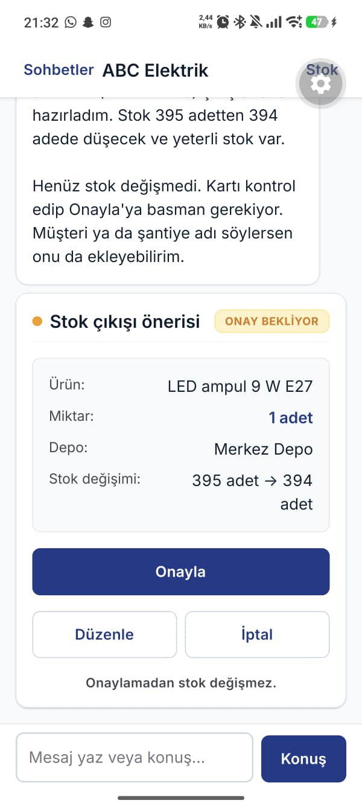
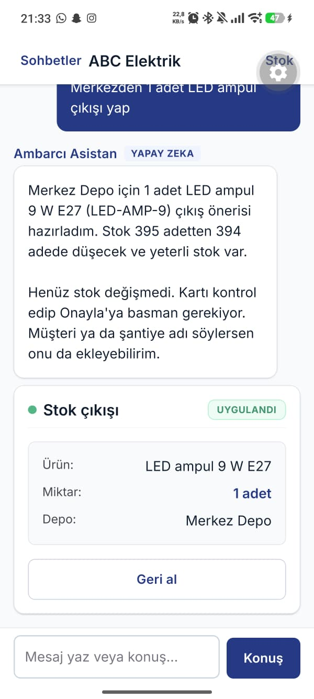
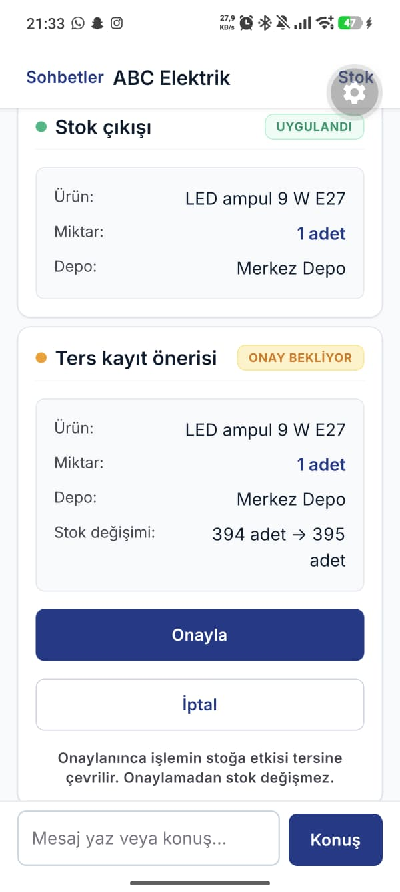
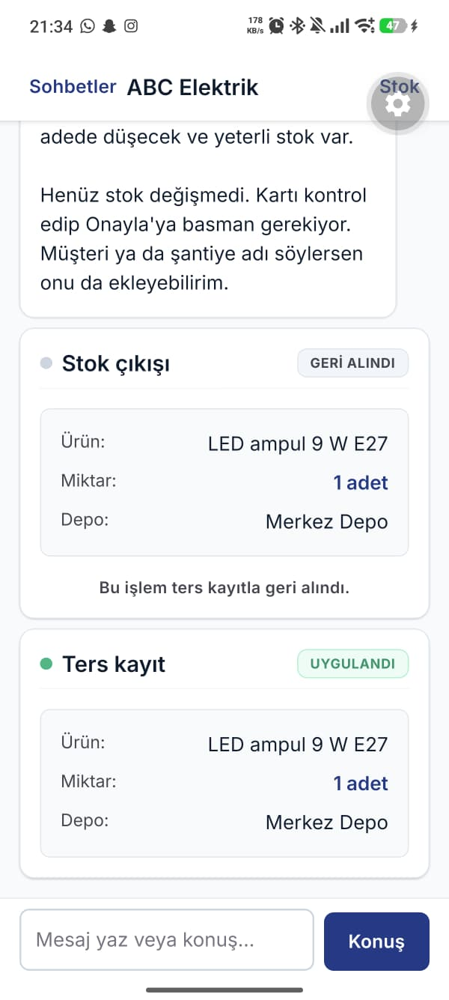
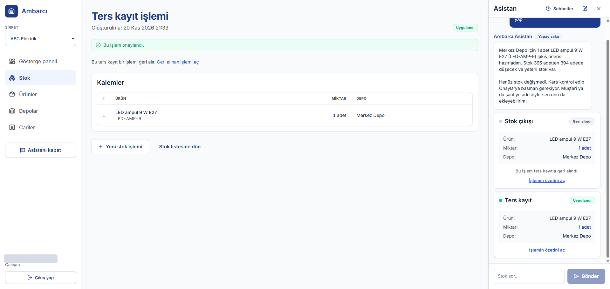
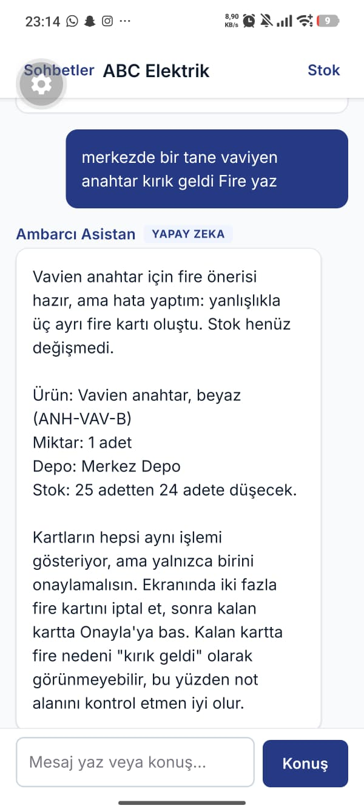
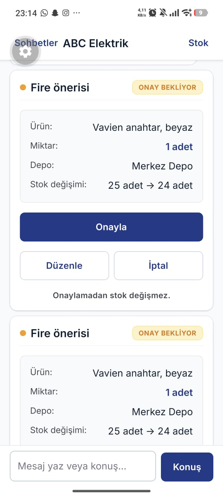
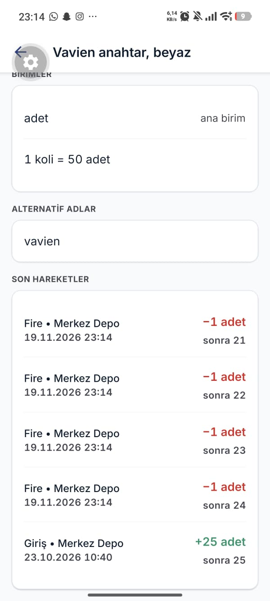

# Ambarcı — 5. Hafta Raporu: Öneri ve onay

| | |
| --- | --- |
| Öğrenci | Yunus Emre ATMAZ |
| Öğrenci no | 221450018 |
| Danışman | Ali Osman Çıbıkdiken |
| Ders | Senior Design Project |
| Hafta | 5. hafta (9–20 Kasım 2026) |
| Proje | Ambarcı — Yapay Zekâ Destekli Saha Stok Asistanı |

## Proje bağlantıları

| | |
| --- | --- |
| GitHub deposu | [github.com/yunopo42/AmbarciApp](https://github.com/yunopo42/AmbarciApp) |
| 5. hafta sonu kod durumu (etiket) | [hafta-5](https://github.com/yunopo42/AmbarciApp/tree/hafta-5) |
| Commit geçmişi | [github.com/yunopo42/AmbarciApp/commits/main](https://github.com/yunopo42/AmbarciApp/commits/main) |
| 5. hafta issue'ları | [Hafta 5 milestone'u](https://github.com/yunopo42/AmbarciApp/milestone/5?closed=1) · [Pull requests](https://github.com/yunopo42/AmbarciApp/pulls?q=is%3Apr) |
| Web paneli (Vercel) | [ambarci-app.vercel.app](https://ambarci-app.vercel.app) |
| API sağlık kontrolü ve belgesi (Render) | [/v1/health](https://ambarci-api.onrender.com/v1/health) · [Swagger](https://ambarci-api.onrender.com/docs) |
| Öneri araçları, işlem kartı, kapı denemesi | [docs/asistan.md](https://github.com/yunopo42/AmbarciApp/blob/main/docs/asistan.md) |
| Onay, süre aşımı ve ters kayıt | [docs/stok-islemleri.md](https://github.com/yunopo42/AmbarciApp/blob/main/docs/stok-islemleri.md) |
| Kapı denemesi (telefon) | [eval/kapi-denemesi-hafta-5.md](https://github.com/yunopo42/AmbarciApp/blob/main/eval/kapi-denemesi-hafta-5.md) |
| 8 haftalık plan | [docs/plan.md](https://github.com/yunopo42/AmbarciApp/blob/main/docs/plan.md) |
| Rapor ve belgeler (Drive) | [Proje klasörü](https://drive.google.com/drive/folders/1ON1zxHnz4k0fIdIXaCvwqlk0g4buD0_n?usp=sharing) |

API ücretsiz planda çalıştığı için 15 dakika istek almazsa uyur; ilk açılışta yaklaşık bir dakika beklemek gerekebilir. Bölüm 3'teki **Kod** bağlantıları `hafta-5` etiketini açar; kod sonraki haftalarda değişse de bu haftanın sonundaki hâli görünür.

## 1. Özet

Bu haftanın hedefi asistanın önerisini onaya bağlamaktı. Kullanıcı sohbette "Merkezden 2 koli priz çıkışı yap" der. Asistan stoğa dokunmadan onay bekleyen bir işlem açar, işlem sohbette kart olarak görünür ve stok yalnızca kartın **Onayla** düğmesiyle değişir. Uygulanmış işlem de silinmeden, ters kayıtla geri alınabiliyor. İşler 15 Kasım'a yetişmedi; hafta kapısıyla birlikte 20 Kasım'da tamamlandı (plan değişikliği: [#84](https://github.com/yunopo42/AmbarciApp/issues/84)). Haftaya açılan sekiz işin sekizi ve araya giren bir güvenlik güncellemesi bitti.

**Kapı geçildi: onay stoğu tam bir kez değiştiriyor.** Kapı iki yoldan doğrulandı:

- **Gerçek veritabanı testleri** (sahte model): aynı anahtarla tekrar, çift dokunma, iki cihazdan onay, onay ile iptalin ve düzenlemenin yarışı, süresi dolmuş öneri. Hepsinde stok bir kez değişti.
- **Telefon denemesi** (gerçek model, Render'daki API, 12 adım): Onaylanan her kart stoğu bir kez değiştirdi. İlk geçişte 12 adımın 10'u doğruydu. Yanlış iki adım kartın kuralından değil modelin davranışından çıktı: aynı öneriyi tekrar açması ve kartın onaylandığını bilmemesi. İkisi de sunucuda düzeltildi ve tekrarlarında doğruydu.

Model: Claude Haiku 5.5, effort `low`, prompt `chat-v2`. Denemenin 26 mesajında modelin toplam süresi medyan 5,5 saniye, mesaj başına ortalama maliyet 0,0011 dolar.

## 2. Bu hafta yapılanlar

| İş | Durum | Not |
| --- | --- | --- |
| Claude API adresinin kodda sabitlenmesi, bağlantı hatasının nedeninin loglanması | Tamamlandı | [#72](https://github.com/yunopo42/AmbarciApp/issues/72), [PR #81](https://github.com/yunopo42/AmbarciApp/pull/81); 4. hafta denemesindeki ortam değişkeni sorunu |
| Sohbet görünümü: ses uyarısının temizlenmesi, kalın yazının gösterilmesi | Tamamlandı | [#73](https://github.com/yunopo42/AmbarciApp/issues/73), [PR #82](https://github.com/yunopo42/AmbarciApp/pull/82); mobil ve web |
| Öneri araçları (giriş, çıkış, transfer, sayım, fire) ve `chat-v2` | Tamamlandı | [#74](https://github.com/yunopo42/AmbarciApp/issues/74), [PR #83](https://github.com/yunopo42/AmbarciApp/pull/83); 5 öneri aracı, cari araması; migration 0007 |
| Sohbette işlem kartı için API: kart olayı, geçmişte kart, 30 dakikalık süre | Tamamlandı | [#75](https://github.com/yunopo42/AmbarciApp/issues/75), [PR #88](https://github.com/yunopo42/AmbarciApp/pull/88) |
| Mobil: sohbette işlem kartı | Tamamlandı | [#76](https://github.com/yunopo42/AmbarciApp/issues/76), [PR #89](https://github.com/yunopo42/AmbarciApp/pull/89); Android development build'de denendi |
| Web: sohbet panelinde işlem kartı | Tamamlandı | [#77](https://github.com/yunopo42/AmbarciApp/issues/77), [PR #90](https://github.com/yunopo42/AmbarciApp/pull/90); özet sayfasıyla ortak onay mantığı |
| Next.js 16.4.5 güvenlik güncellemesi | Tamamlandı | [#91](https://github.com/yunopo42/AmbarciApp/issues/91), [PR #92](https://github.com/yunopo42/AmbarciApp/pull/92); planda yoktu, `next build` güvenlik uyarısıyla durdu |
| Kapı: tekrar ve eşzamanlılık testleri, telefon denemesi | Tamamlandı | [#79](https://github.com/yunopo42/AmbarciApp/issues/79), [PR #93](https://github.com/yunopo42/AmbarciApp/pull/93), [PR #94](https://github.com/yunopo42/AmbarciApp/pull/94); denemede bulunan iki hatanın düzeltmesi dahil |
| Ters kayıtla geri alma | Tamamlandı | [#78](https://github.com/yunopo42/AmbarciApp/issues/78), [PR #95](https://github.com/yunopo42/AmbarciApp/pull/95); migration 0008; mobil ve web'de "Geri al" |
| Plan değişikliği ve bu rapor | Tamamlandı | [#84](https://github.com/yunopo42/AmbarciApp/issues/84), [#80](https://github.com/yunopo42/AmbarciApp/issues/80) |

## 3. Teknik açıklama

```text
kullanıcı: "Merkezden 2 koli priz çıkışı yap"
  │
  ▼
ajan döngüsü ──► öneri aracı (propose_stock_out) ──► işlem: ONAY BEKLİYOR   (stok değişmez)
  │
  ▼  SSE: operation_card
kart (mobil / web): ürün, miktar, depo, stok önce → sonra; Onayla · Düzenle · İptal
  │  Onayla + Idempotency-Key                       ▲ Düzenle: "3 koli olsun" → aynı işlem, sürüm +1
  ▼
POST /v1/operations/{id}/confirm ──► tek transaction: işlem kilidi, stok kilitleri,
  │                                   hareket, ortalama maliyet, denetim, outbox
  ▼  Geri al
POST /v1/operations/{id}/reverse ──► ters kayıt: ONAY BEKLİYOR ──► aynı onay ucu
```

### 3.1 Öneri araçları ve `chat-v2`

**Ne yapıldı:** Asistana beş öneri aracı eklendi: `propose_stock_in`, `propose_stock_out`, `propose_transfer`, `propose_count`, `propose_waste`. Tedarikçi ya da müşteriyi bulmak için bir okuma aracı da var: `search_parties`. Öneri aracı işlemi 3. haftanın işlem servisiyle, **onay bekleyen** olarak açıyor. İşlem `source_message_id` ile cevaplanan kullanıcı mesajına bağlanıyor (migration 0007). Kullanıcı "3 koli olsun" derse model aynı aracı önerinin `operation_id`'siyle çağırıyor: yeni kart açılmıyor, işlem düzenleniyor ve sürümü artıyor. Araç sonucu, kartta görünecek bilgiyi modele de veriyor: Türkçe yazılmış miktarlar, ana birim karşılığı, stoğun önce → sonra hâli. Yeni sohbetler `chat-v2` ile başlıyor; prompt "işlem yapıldı deme, kullanıcıya kartta Onayla'ya basmasını söyle", "birden çok aday varsa önce sor", "Markdown kullanma" gibi kurallar içeriyor.

**Neden önemli:**

- **Asistan stoğa yazamıyor** (mimari değişmez 1 ve 2). Kayıt defterinde onaylayan ya da uygulayan araç yok; öneri araçları işlemi yalnızca onay bekleyen olarak açıyor. Gerçek veritabanı testi öneriden sonra stok, hareket ve outbox sayılarının değişmediğini doğruluyor.
- **Ekrandaki kurallar araçta da geçerli.** Araç girdisi, ekrandaki fiş formunun kullandığı işlem şemasına çevrilip aynı servisten geçiyor: ürün, birim, depo, cari ve depo yetkisi aynı kodla denetleniyor. Asistan ekranın yapamayacağı bir işlem açamıyor.
- **Prompt sürümü araç listesini de taşıyor.** Süren bir sohbetin araç listesi değişirse geri gönderilen düşünme blokları geçersiz olur. 4. haftada başlamış sohbetler `chat-v1` ve dört okuma aracıyla sürüyor; öneri araçları yalnızca yeni sohbetlerde.

**Ne öğrenildi:**

- **Eksi stok:** Yetmeyen stokta önizleme "sonra" için eksi bir değer hesaplıyordu. Yerel denemede model bunu olduğu gibi aktardı: "Onaylanırsa stok −5 adet olur." Araç artık eksi değer vermiyor; eldeki ve gereken miktarı veriyor. Modele de önerinin bu hâliyle onaylanamayacağını söylüyor.
- **Birim:** Model "2 koli" için miktarı kendisi çevirmiyor; `quantity: "2"`, `unit: "koli"` veriyor. Çevrim ekrandakiyle aynı yerde, SQL'de yapılıyor.
- **Hata mesajı:** Bulunamayan birimde genel bir hata modele yetmedi; mesaj artık ürünün birimlerini de söylüyor ("1 koli = 100 metre"). Model kullanıcıya doğru birimi soruyor.

**Kod:** [propose-tools.ts](https://github.com/yunopo42/AmbarciApp/blob/hafta-5/apps/api/src/modules/assistant/tools/propose-tools.ts) · [assistant-tools.ts](https://github.com/yunopo42/AmbarciApp/blob/hafta-5/packages/shared/src/assistant-tools.ts) (araç girdileri) · [chat.v2.ts](https://github.com/yunopo42/AmbarciApp/blob/hafta-5/apps/api/src/modules/ai/prompts/chat.v2.ts) (prompt) · [0007_operation_source_message.sql](https://github.com/yunopo42/AmbarciApp/blob/hafta-5/packages/db/migrations/0007_operation_source_message.sql) · [propose-tools.db.spec.ts](https://github.com/yunopo42/AmbarciApp/blob/hafta-5/apps/api/test-db/propose-tools.db.spec.ts)

### 3.2 Sohbette işlem kartı: akış, geçmiş ve süre aşımı

**Ne yapıldı:** Öneri aracı bir işlem açınca akışa `operation_card` olayı ekleniyor; olay yalnızca işlemin kimliğini ve sürümünü taşıyor. Kart işlemin güncel hâlini her zaman önizleme ucundan okuyor. Sohbet yeniden açıldığında mesajlar ucu her turun kartlarını cevabın altında döndürüyor. Sohbetten açılan öneri, son değişikliğinden **30 dakika** sonra onaylanamıyor.

**Neden önemli:**

- **Her ekranda doğru durum:** Akışta ve geçmişte işlemin kopyası değil kimliği gidiyor. Başka cihazdan onaylanan, iptal edilen ya da süresi dolan öneri her ekranda doğru görünüyor.
- **Eski kart onaylanmıyor:** Öneride gösterilen "önce → sonra" zamanla eskir. Kullanıcı yarım saat önce açılmış bir kartı onaylamaya çalışırsa onay `409 OPERATION_EXPIRED` alıyor, stok değişmiyor.

**Ne öğrenildi:**

- **Zamanlanmış iş olmadan süre:** Süre aşımını işleyecek worker henüz yok (7. hafta). "Süresi doldu mu" sorusunun tek tanımı bir SQL ifadesi ve saat veritabanının saati. Okumada öneri hemen `EXPIRED` görünüyor ama okuma veritabanına yazmıyor. Kalıcı geçiş, işlemi değiştirmeye çalışan ilk istekte, kilit altında yazılıyor.
- **Hata transaction'dan sonra:** Süre aşımı hatası transaction'ın içinden fırlatılsaydı `EXPIRED` geçişi de geri alınırdı. Geçiş yazılıp transaction tamamlanıyor, 409 ondan sonra dönüyor.

**Kod:** [conversations.service.ts](https://github.com/yunopo42/AmbarciApp/blob/hafta-5/apps/api/src/modules/assistant/conversations.service.ts) (kartların yeri) · [operations.repository.ts](https://github.com/yunopo42/AmbarciApp/blob/hafta-5/apps/api/src/modules/operations/operations.repository.ts) (süre ifadesi) · [operation-cards.db.spec.ts](https://github.com/yunopo42/AmbarciApp/blob/hafta-5/apps/api/test-db/operation-cards.db.spec.ts)

### 3.3 Mobil ve web işlem kartı

**Ne yapıldı:** Kart mobilde ve web sohbet panelinde aynı. Gösterdikleri:

- tür ve durum rozeti;
- ürün, girilen miktar ve ana birim karşılığı ("2 koli (40 adet)"), depo, cari;
- stoğun önce → sonra hâli; stok yetmiyorsa kırmızı bir açıklama;
- **Onayla**, **Düzenle**, **İptal**.

**Düzenle** mesaj kutusuna odaklanıyor: düzeltme sohbetle yapılıyor. Kartın ne göstereceği ve hangi düğmenin açık olduğu ortak pakette tek bir fonksiyonda (`operationCardView`); iki uygulama da onu kullanıyor. Web'de onay mantığı, 3. haftadaki işlem özet sayfasıyla ortak bir hook'a taşındı.

**Neden önemli:**

- **Onay asistandan geçmiyor.** Kart onay ucuna doğrudan gidiyor (mimari değişmez 2); asistanın bir onay aracı yok.
- **Çift dokunma ve kopan bağlantı stoğu iki kez değiştiremiyor.** Onay anahtarı kartta, o sürümün ilk onay denemesinde bir kez üretiliyor. Aynı sürümün bütün denemeleri (çift dokunma, ağ hatasından sonra tekrar) aynı anahtarla gidiyor ve API ikinci isteği tanıyor. Öneri düzenlenip sürüm değişince yeni anahtar üretiliyor.

**Ne öğrenildi:**

- **Hangi hata kartı yenilemeli:** "Sürüm değişti", "başka cihazdan onaylanmış", "süresi doldu" ve "stok yetmiyor" kartı yeniden okutuyor. Ağ hatası okutmuyor; eldeki hâl kalıyor ve tekrar denemek güvenli. Bu kural da ortak pakette ve testli.
- **Mobilde test yok:** Mobil pakette test altyapısı olmadığı için kartın kuralları ortak pakette test ediliyor; ekranlar telefonda denendi.
- **Kaydırma:** Web panelinde kart eklenince ters sütunlu kaydırma kutusu küçülüyor ve son mesaj görünmüyordu. İç kutunun küçülmesi kapatılınca düzeldi.

**Kod:** [operation-card.ts](https://github.com/yunopo42/AmbarciApp/blob/hafta-5/packages/api-client/src/operation-card.ts) (ortak kart mantığı) · [mobil kart](https://github.com/yunopo42/AmbarciApp/blob/hafta-5/apps/mobile/src/chat/operation-card.tsx) · [web kartı](https://github.com/yunopo42/AmbarciApp/blob/hafta-5/apps/web/components/chat/operation-card.tsx) · [use-operation-actions.ts](https://github.com/yunopo42/AmbarciApp/blob/hafta-5/apps/web/components/use-operation-actions.ts) (web'de ortak onay) · [operation-card.spec.ts](https://github.com/yunopo42/AmbarciApp/blob/hafta-5/packages/api-client/test/operation-card.spec.ts)

### 3.4 Ters kayıtla geri alma

**Ne yapıldı:** Onaylanmış işlem silinmiyor ve değiştirilmiyor (mimari değişmez 7). Geri alma, işleme bağlı yeni bir ters kayıt (`REVERSAL`). Ters kayıt da onaydan geçiyor:

1. **Geri al** (`POST /v1/operations/{id}/reverse`) stoğa dokunmadan ters kalemli, onay bekleyen bir ters kayıt açıyor.
2. Kullanıcı ters kaydın "önce → sonra"sını görüp onaylıyor.
3. Onay transaction'ında geri alınan hareketler tersten ve aynı birim maliyetle yazılıyor; işlem `APPLIED → REVERSED` oluyor; denetim ve outbox kaydı da aynı transaction'da.

Kurallar istekte ve onayda, işlem kilitliyken denetleniyor:

- İşlemi açan kullanıcı uygulandıktan sonraki **15 dakika** içinde, yönetici her zaman geri alabilir.
- Açılış stoğunu yalnızca yönetici geri alabilir; ters kayıt geri alınamaz.
- Bir işlem bir kez geri alınabilir.
- Stoğu eksiye düşürecek ters kayıt `409 INSUFFICIENT_STOCK` alıyor; hiçbir şey yazılmıyor.

**Neden önemli:**

- **Aynı kod, aynı güvenceler:** Geri alma da onay ucundan geçtiği için `Idempotency-Key`, kilit sırası, önizleme ve yetersiz stok kontrolü yeni kod yazılmadan geliyor.
- **İz kaybolmuyor:** Hareket geçmişinde hem yanlış işlem hem ters kaydı kalıyor; denetimde ikisi de görünüyor.

**Ne öğrenildi:**

- **Ortalama maliyet kuralı** işin başında kararlaştırıldı: ters kayıt geri alınan hareketin maliyetini kullanıyor ve stok değerini tam o kadar geri çeviriyor. Yanlış maliyetle girilmiş bir alış geri alınınca ortalama eski değerine dönüyor; testte 27,5 TL'den 5 TL'ye döndü. Diğer seçenekte (geri giden mal normal çıkış gibi düşer) yanlış maliyet ortalamada kalırdı.
- **Kısmi benzersiz indeks:** 3. haftada "bir işlem bir kez geri alınır" kuralı tam tekillik kısıtıydı. Bu, iptal edilen ters kaydı da sayıyordu; işlem bir daha geri alınamazdı. Kısıt, yalnızca onay bekleyen ve uygulanmış ters kayıtları sayan kısmi bir indekse çevrildi (migration 0008). Migration canlıya uygulanmadan önce sonunda geri alınan bir transaction'da denendi.
- **Kilit sırası:** Onay önce ters kaydı, sonra geri alınan işlemi kilitliyor. Geri alma isteği ise ters kaydı yalnızca süresi dolmuşsa kilitliyor; süresi dolmuş ters kaydın onayı da ikinci kilide gelmeden dönüyor. Böylece istek ile onay birbirinin tuttuğu kilidi bekleyemiyor.

**Kod:** [operations.service.ts](https://github.com/yunopo42/AmbarciApp/blob/hafta-5/apps/api/src/modules/operations/operations.service.ts) (`requestReversal`, `applyReversal`, `reversalDenial`) · [stock-ledger.repository.ts](https://github.com/yunopo42/AmbarciApp/blob/hafta-5/apps/api/src/modules/inventory/stock-ledger.repository.ts) (`decreaseAtCost`) · [0008_reversal_partial_unique.sql](https://github.com/yunopo42/AmbarciApp/blob/hafta-5/packages/db/migrations/0008_reversal_partial_unique.sql) · [reversal.db.spec.ts](https://github.com/yunopo42/AmbarciApp/blob/hafta-5/apps/api/test-db/reversal.db.spec.ts)

### 3.5 Kapı: tekrar ve eşzamanlılık testleri, telefon denemesi

**Ne yapıldı:** Kapı ("onay stoğu tam bir kez değiştirir") iki yoldan sınandı.

1. **Gerçek veritabanı testi** (`proposal-gate.db.spec.ts`). Öneriler gerçek sohbet akışından açılıyor (Claude yerine sahte model); onay ve iptal kartın yaptığı gibi HTTP'den gidiyor. Yarışlar 3. haftanın yöntemiyle kuruluyor: test satırı kendi transaction'ında kilitliyor, iki isteğin de kilidi beklediğini PostgreSQL'de görünce bırakıyor. Sonuçlar bölüm 4.1'de.
2. **Telefon denemesi** ([eval/kapi-denemesi-hafta-5.md](https://github.com/yunopo42/AmbarciApp/blob/hafta-5/eval/kapi-denemesi-hafta-5.md)): 12 adım. Beş işlem türü, sohbetle düzenleme, çift dokunma, bağlantı kesikken onay, iki cihaz, iptal, yetersiz stok ve geçmiş. Sonuçlar bölüm 4.2'de.

Telefon denemesinde iki hata bulundu ve sunucuda düzeltildi:

- **Aynı öneri dört kez açıldı (6. adım).** "Merkezde 1 vavien anahtar kırık geldi, fire yaz" mesajında model fire aracını dört turda aynı girdiyle çağırdı. Dört kart açıldı ve dördü de onaylanabildi. Her kart yalnızca bir kez uygulandı, yani kartın kuralı tuttu; ama kullanıcının tek isteği stoğu dört kez düşürdü. Düzeltme: aynı mesajdan, aynı türde ve aynı kalemlerle onay bekleyen bir öneri varsa yenisi açılmıyor, o dönüyor. Aynı mesajın istekleri bir kilitle sıraya giriyor; modelin aynı turdaki paralel iki çağrısı da tek öneri açıyor.
- **Model kartın onaylandığını bilmiyordu (9. adım).** Model bir önerinin durumunu yalnızca öneriyi açtığı andaki araç sonucundan biliyordu ("Onay bekliyor"). Kart sohbetin dışında onaylandığı için bunu öğrenemedi; yeni bir çıkış isteğine "kart zaten hazır" deyip öneri açmadı. Düzeltme: her yeni kullanıcı mesajına sunucu, sohbetteki önerilerin şu anki durumunu bir not olarak ekliyor ("Çıkış, Uygulandı"). Not mesajla birlikte saklanıyor; ekranda görünmüyor.

**Neden önemli:** Bu haftanın kapısı. Otomatik test kuralların her yarışta tuttuğunu gösteriyor; telefon denemesi kullanıcının gördüğü akışı ve gerçek modeli sınıyor. Denemede bulunan iki hata, kuralın kendisinden değil modelin davranışından çıktı. Bu yüzden düzeltmeler prompta değil sunucuya yazıldı: prompt modeli yönlendirir ama garanti vermez.

**Ne öğrenildi:**

- **Modelin kendi hatası:** Model 6. adımda hatasını kendisi de fark etti ("yanlışlıkla üç ayrı fire kartı oluştu"; aslında dört). Kayıtlar, fire nedenini ("kırık geldi") nota yazmaya çalıştığını ama yazamadığını gösteriyor. Sohbetten açılan 22 önerinin hiçbirinde not yok; isteğe bağlı başka bir alan olan cari ise dolu. Neden henüz bilinmiyor; gerçek modelle ölçülecek (7. hafta).
- **Yayın anı:** Düzeltmeden sonraki ilk denemede (6b) yine iki kart açıldı. İstek, yeni sürümün "yayında" yazısından 18 saniye sonra geldi; eski sunucunun mu yenisinin mi cevapladığı kesinleştirilemedi. Modelin o çağrı düzeni gerçek veritabanı testine eklendi ve yeni kodda tek öneri kaldı; yayın kesinleştikten sonraki denemede (6c) tek kart açıldı.
- **Günlük kullanım sınırı:** Deneme ilk gün 16 mesajda "kullanım sınırınıza ulaştınız" uyarısıyla durdu. Sınır kullanıcı başına günde 500.000 token ve önbellekten okunan tokenları da tam sayıyor. O gün harcanan 522.399 tokenın %88'i önbellek okumasıydı; günün maliyeti yalnızca 0,016 dolardı. Sınırın maliyete göre sayılması ayrı bir iş olarak önerildi.

**Kod:** [proposal-gate.db.spec.ts](https://github.com/yunopo42/AmbarciApp/blob/hafta-5/apps/api/test-db/proposal-gate.db.spec.ts) (kapı testi) · [operations.service.ts](https://github.com/yunopo42/AmbarciApp/blob/hafta-5/apps/api/src/modules/operations/operations.service.ts) (`proposeFromChat`: aynı öneri bir kez) · [proposal-status-note.ts](https://github.com/yunopo42/AmbarciApp/blob/hafta-5/apps/api/src/modules/assistant/proposal-status-note.ts) (durum notu) · [kapi-denemesi-hafta-5.md](https://github.com/yunopo42/AmbarciApp/blob/hafta-5/eval/kapi-denemesi-hafta-5.md)

### 3.6 Küçük düzeltmeler

**Ne yapıldı:**

- **Claude API adresi kodda sabit (#72).** Adaptör SDK'ya `https://api.anthropic.com` adresini açıkça veriyor. Bağlantı hatasında mesaj hedef sunucuyu ve altta yatan nedeni yazıyor; API anahtarı mesajdan siliniyor.
- **Sohbet görünümü (#73).** "Ses algılanmadı" uyarısı yeni denemede, yazmaya başlayınca ya da mesaj gönderilince kalkıyor. Modelin kalın yazısı (`**…**`) mobilde ve web'de kalın gösteriliyor; Markdown kütüphanesi eklenmedi.
- **Next.js 16.4.5 (#91).** `next build`, kurulu 16.4.3'ün güvenlik açıklarından etkilendiğini söyleyerek durdu. Next.js'in 3 Kasım'da yayımladığı yedi orta seviye duyurunun düzeltmesi 16.4.5'te; yalnızca sürüm güncellendi.

**Neden önemli:** 4. hafta raporunda sorun olarak yazılan üç madde (ortam değişkeni, ekranda kalan uyarı, görünen yıldızlar) kapandı. Vercel'de de aynı `next build` çalıştığı için güvenlik güncellemesi yapılmasaydı web paneli yayına çıkamayabilirdi.

**Ne öğrenildi:** Derleme çıktısı, ajana belli bir komutu (`next upgrade`) çalıştırmasını söylüyordu. Komut çalıştırılmadı; araç çıktısındaki talimat veri olarak ele alındı. Güncellemenin gerekip gerekmediği Next.js'in güvenlik duyurularından doğrulandı.

**Kod:** [claude.adapter.ts](https://github.com/yunopo42/AmbarciApp/blob/hafta-5/apps/api/src/modules/ai/adapters/claude.adapter.ts) · [bold-text.ts](https://github.com/yunopo42/AmbarciApp/blob/hafta-5/packages/api-client/src/bold-text.ts) · [apps/web/package.json](https://github.com/yunopo42/AmbarciApp/blob/hafta-5/apps/web/package.json)

## 4. Görseller

### 4.1 Test sonuçları

| Test | Ortam | Sonuç |
| --- | --- | --- |
| API testleri: kurallar, şemalar, Claude adaptörü, ajan döngüsü (sahte model), öneri araçları, kart ve süre kuralları, ters kayıt kuralları, uçların doğrulaması | CI, veritabanı olmadan | 172 / 172 geçti (4. haftada 137) |
| API istemcisi testleri: kart görünümü ve hataları, kalın yazı, tur mantığı, SSE okuyucu | CI | 40 / 40 geçti (4. haftada 19) |
| RLS izolasyonu ve seed | Gerçek Supabase veritabanı (`pnpm db:test`) | 54 / 54 geçti (bu hafta yeni tablo eklenmedi; 4. haftada da 54) |
| Stok, öneri araçları, işlem kartı ve süre aşımı, kapı (tekrar ve eşzamanlılık), ters kayıt, sohbet akışı, şirket izolasyonu | Gerçek Supabase veritabanı (`pnpm db:test`) | 112 / 112 geçti (4. haftada 74) |

*Bütün testler 20 Kasım 2026'da çalıştırıldı. Testler gerçek model çağırmıyor; aynı arayüzü uygulayan sahte model kullanılıyor.*

Kapının gerçek veritabanı testleri:

| Senaryo | Beklenen ve doğrulanan |
| --- | --- |
| Ağ hatasında aynı anahtarla tekrar | İkisi de 200 ve aynı cevap; stok bir kez değişti |
| Çift dokunma: aynı kart, aynı anahtar, aynı anda | İkisi de 200 ve aynı cevap; 1 hareket, 1 denetim, 1 outbox kaydı |
| İki cihaz: aynı kart, farklı anahtar, aynı anda | Biri 200, öteki 409 `OPERATION_ALREADY_APPLIED`; stok bir kez değişti |
| Onay ile iptal aynı anda | Yalnızca biri oldu; öteki 409 `OPERATION_NOT_PENDING`; stok en fazla bir kez değişti |
| Sohbette düzenleme ile eski kartın onayı aynı anda | Tek sonuç: eski sürüm uygulandıysa düzenleme reddedildi; düzenleme önce olduysa eski kart 409 `OPERATION_VERSION_MISMATCH` aldı |
| Süresi dolmuş öneriye aynı anda iki onay | Hiçbiri uygulanmadı; süre aşımı bir kez yazıldı |
| Model aynı öneriyi bir turda tekrar tekrar ve paralel çağırıyor | Tek öneri, tek kart; onayla stok bir kez değişti |
| Aynı turda aynı öneri hem yeniden açılıyor hem düzenleniyor | Yine tek öneri |
| Aynı mesajdan aynı öneri aynı anda iki kez | Biri açtı, öteki onu aldı; farklı kalemli öneri ayrı açıldı |
| Kart sohbet dışında onaylandı, aynı sohbette yeni mesaj | Modele giden istekte "Uygulandı" notu var; not ekranda görünmüyor |

Ters kaydın gerçek veritabanı testleri:

| Senaryo | Beklenen ve doğrulanan |
| --- | --- |
| Yanlış maliyetle girilmiş alışın geri alınması | Stok 20 → 10, ortalama 27,5 → 5 TL (girişten önceki değer); işlem `REVERSED`, denetim ve outbox |
| Çıkışın geri alınması | Mal çıktığı maliyetle (5 TL) geri girdi; ortalama (12 × 7,5 + 4 × 5) ÷ 16 = 6,875 |
| Transferin ve sayım farkının geri alınması | Transferde mal hedef depodan çıkıp kaynağa döndü; sayımda fark (sayılan miktar değil) geri alındı |
| Stoğu eksiye düşürecek ters kayıt | 409 `INSUFFICIENT_STOCK`; stok, işlemin durumu, hareket, denetim, outbox değişmedi |
| İkinci kez geri alma; iptalden sonra yeniden | Uygulanmış ters kayıttan sonra 409; iptal edilen ters kayıttan sonra yeniden geri alınabildi |
| Aynı ters kayda aynı anda iki onay | Biri 200, öteki 409; stok bir kez değişti |
| 15 dakika kuralı | Süre içinde açan çalışan geri aldı; süre geçince çalışan reddedildi, yönetici geri aldı; kural onayda yeniden denetlendi |

### 4.2 Kapı denemesi (telefon)

19–20 Kasım 2026. Android development build, Render'daki API, ABC Elektrik. Hesap çalışan; yalnızca Merkez Depo ve Ostim Depo'ya yetkili. Stok her adımda veritabanından doğrulandı.

| # | Ne sınandı | Sonuç |
| --- | --- | --- |
| 1 | Giriş, birim çevrimi (2 koli = 40 adet) | Doğru |
| 2 | Çıkış ve cari | Doğru |
| 3 | Sohbetle düzenleme ("3 adet olsun"): yeni kart açılmadı, sürüm 2 | Doğru |
| 4 | Transfer (iki depo, iki hareket) | Doğru |
| 5 | Sayım (fark −2) | Doğru |
| 6 | Fire | **Yanlış:** aynı öneri dört kez açıldı (bölüm 3.5). Düzeltmeden sonra yeni sohbette doğru (6c); not açık bulgu |
| 7 | Çift dokunma | Doğru: tek hareket |
| 8 | Bağlantı kesikken onay ve tekrar | Doğru: tek hareket |
| 9 | İki cihaz (telefon ve web) | **Yanlış:** model kartın onaylandığını bilmedi (bölüm 3.5). Düzeltmeden sonra doğru (9b): web'de "başka bir cihazdan onaylanmış" uyarısı, tek hareket |
| 10 | İptal | Doğru: hareket yok |
| 11 | Yetersiz stok: "Stok yetmiyor: 53 adet var, 2.000 adet gerekiyor"; Onayla yok; asistan eksi miktar söylemedi | Doğru |
| 12 | Geçmiş: kartlar son hâlleriyle | Doğru |

*İlk geçişte 12 adımın 10'u doğru; iki yanlış adım düzeltmeden sonra doğru. Onaylanan her kartın kalem başına tek hareketi (transferde iki) ve tek denetim kaydı var.*

| Ölçüm (`ai_runs`, `chat-v2`, 26 mesaj) | Sonuç |
| --- | --- |
| Mesaj başına model çağrısı | Ortalama 2,9, en çok 6 |
| Modelin toplam süresi (araçların süresi hariç) | Medyan 5,5 sn, p90 10,8 sn |
| Mesaj başına token ve maliyet | Ortalama 30.000 token, 0,0011 dolar; 26 mesajın toplamı 0,028 dolar |
| Model hatası | Yok |

*26 mesaj, denemenin tekrarları ve ara mesajları dahil (19 Kasım 21.00 – 20 Kasım 10.28). Süre, mesajın model çağrılarının sunucudaki toplamıdır; araçların ve ağın süresi dahil değil. Tokenların çoğu önbellekten okunuyor.*

**Ters kaydın telefon ve web denemesi** (20 Kasım, 11.35–11.45, Render'daki yeni sürüm). Kayıtlar veritabanından:

| Deneme | Sonuç |
| --- | --- |
| Çalışan kendi çıkışını (1 adet LED ampul) **Geri al** ile geri aldı ve ters kaydı onayladı | Ters kayıt uygulandı (1 hareket), çıkış "Geri alındı"; stok eski hâline döndü |
| Ters kayıt açıldı, sonra kartta **İptal** | Ters kayıt iptal edildi, hareket yok; işlem uygulanmış kaldı |
| Yönetici, çalışanın sohbetten açtığı bir çıkışı geri aldı | Ters kayıt uygulandı (1 hareket) |
| Giriş (10 adet), ardından 25 adetlik çıkış; sonra girişin geri alınması | Ters kayıtta "Stok yetmiyor: 3 adet var, 10 adet gerekiyor", **Onayla** yok; iptal edildi, hareket yok |
| Aynı örnekte önce çıkışın geri alınması | Ters kayıt uygulandı; stok 3 → 28, ortalama maliyet değişmedi (44 TL) |

*15 dakikadan eski işlemde **Geri al** düğmesinin görünmemesi kullanıcının gözlemine dayanıyor (iz bırakmıyor). İptal edilen ters kayıttan sonra aynı işlemin yeniden geri alınması telefonda denenmedi; gerçek veritabanı testinde sınandı (bölüm 4.1).*

### 4.3 İşlem kartı ve geri alma (mobil)

Görüntüler 20 Kasım'da, Android development build'de, Render'daki API'ye karşı, çalışan hesabıyla alındı. Sağ üstteki dişli development build'in geliştirici aracı düğmesidir; uygulamanın parçası değildir.

| | | | |
| --- | --- | --- | --- |
|  |  |  |  |

*Soldan sağa:*

1. *"Merkezden 1 adet LED ampul çıkışı yap" mesajına asistanın açtığı öneri: ürün, miktar, depo, stok 395 → 394; Onayla, Düzenle, İptal. Asistan "henüz stok değişmedi" diyor.*
2. *Onaydan sonra kart "Uygulandı" ve altında **Geri al**.*
3. *Geri al, kartın altında onay bekleyen bir ters kayıt açtı: stok 394 → 395.*
4. *Ters kayıt onaylandı: çıkış "Geri alındı", ters kayıt "Uygulandı"; stok eski hâline döndü.*

### 4.4 Ters kayıt (web)



*Web panelinde aynı ters kaydın özet sayfası: "Bu ters kayıt bir işlemi geri alır" ve geri alınan işleme bağlantı. Sağdaki sohbet panelinde aynı sohbetin kartları: çıkış "Geri alındı", altında ters kayıt "Uygulandı". Mobil ve web kartı aynı ortak mantığı kullanıyor. E-posta adresi gizlendi.*

### 4.5 Kapı denemesinde bulunan hata: aynı öneri dört kez

| | | |
| --- | --- | --- |
|  |  |  |

*19 Kasım, düzeltmeden önce. Solda asistan hatasını kendisi söylüyor ("yanlışlıkla üç ayrı fire kartı oluştu"; aslında dört). Ortada aynı fire önerisinin kartları. Sağda ürün detayındaki hareketler: dört kart da onaylandı ve stok 25'ten 21'e düştü. Her kart bir kez uygulandı; sorun, aynı isteğin dört öneri olarak açılmasıydı. Sol üstteki dişli, development build'in geliştirici aracı düğmesidir.*

### 4.6 Bu hafta eklenen ve değişen API uçları

| Uç nokta ya da olay | Ne yapar |
| --- | --- |
| `operation_card` (SSE olayı) | Öneri aracı işlem açınca ya da düzenleyince: işlemin kimliği ve sürümü |
| `GET /v1/conversations/{id}/messages` | Her mesajın altında, o turun kartları (`operationIds`) |
| `GET /v1/operations/{id}/preview` | Yeni: son onay anı (`expiresAt`), işlemin ters kaydı, kullanıcının şimdi geri alıp alamayacağı (`canReverse`) |
| `POST /v1/operations/{id}/confirm` | Yeni hata: `409 OPERATION_EXPIRED` (30 dakika); ters kaydı da onaylar |
| `POST /v1/operations/{id}/reverse` | Uygulanmış işlem için onay bekleyen ters kayıt açar (201); bekleyen ters kaydı varsa onu döner (200) |

*Tam liste: [Swagger](https://ambarci-api.onrender.com/docs).*

## 5. Tamamlanan görevler

- [x] Claude API adresinin kodda sabitlenmesi ve bağlantı hatasının nedeni — [#72](https://github.com/yunopo42/AmbarciApp/issues/72), [903e655](https://github.com/yunopo42/AmbarciApp/commit/903e655)
- [x] Sohbet görünümü: ses uyarısının temizlenmesi ve kalın yazı — [#73](https://github.com/yunopo42/AmbarciApp/issues/73), [2f691a2](https://github.com/yunopo42/AmbarciApp/commit/2f691a2)
- [x] Öneri araçları (giriş, çıkış, transfer, sayım, fire) ve `chat-v2` — [#74](https://github.com/yunopo42/AmbarciApp/issues/74), [8fe429b](https://github.com/yunopo42/AmbarciApp/commit/8fe429b)
- [x] Sohbette işlem kartı için API, geçmişte kart ve 30 dakikalık süre — [#75](https://github.com/yunopo42/AmbarciApp/issues/75), [cd0e340](https://github.com/yunopo42/AmbarciApp/commit/cd0e340)
- [x] Mobil: sohbette işlem kartı — [#76](https://github.com/yunopo42/AmbarciApp/issues/76), [0e6739f](https://github.com/yunopo42/AmbarciApp/commit/0e6739f)
- [x] Web: sohbet panelinde işlem kartı — [#77](https://github.com/yunopo42/AmbarciApp/issues/77), [637c973](https://github.com/yunopo42/AmbarciApp/commit/637c973)
- [x] Next.js 16.4.5 güvenlik güncellemesi — [#91](https://github.com/yunopo42/AmbarciApp/issues/91), [6a94358](https://github.com/yunopo42/AmbarciApp/commit/6a94358)
- [x] Kapı denemesi: tekrar ve eşzamanlılık testleri, telefon denemesi ve iki düzeltme — [#79](https://github.com/yunopo42/AmbarciApp/issues/79), [23a6ce8](https://github.com/yunopo42/AmbarciApp/commit/23a6ce8), [9a3b6fe](https://github.com/yunopo42/AmbarciApp/commit/9a3b6fe)
- [x] Ters kayıtla geri alma — [#78](https://github.com/yunopo42/AmbarciApp/issues/78), [c0b97f0](https://github.com/yunopo42/AmbarciApp/commit/c0b97f0)
- [x] Plan değişikliği ve 5. hafta raporu — [#84](https://github.com/yunopo42/AmbarciApp/issues/84), [#80](https://github.com/yunopo42/AmbarciApp/issues/80)
- [ ] Sohbetten geri alma (`propose_reversal`, `chat-v3`) — 7. haftaya alındı; ters kaydın kendisi ekranda tamamlandı, issue'da "öncelik düşük" olarak işaretliydi

## 6. Karşılaşılan sorunlar ve çözümler

| Sorun | Çözüm / durum |
| --- | --- |
| 5. haftanın işleri 15 Kasım'a yetişmedi | Hafta 20 Kasım'da kapısıyla tamamlandı; 6. hafta 21–22 Kasım'a sıkıştırıldı, push bildirimleri 7. haftaya alındı ([#84](https://github.com/yunopo42/AmbarciApp/issues/84)) |
| Claude Console'daki API anahtarının süresi 19 Kasım'da doldu | Yeni anahtar oluşturuldu; Render'daki ortam değişkeni ve yerel `.env` güncellendi, sohbetten bir soruyla doğrulandı |
| Telefon denemesinde model aynı öneriyi dört kez açtı | Sunucuda düzeltildi: aynı mesajdan aynı öneri bir kez açılıyor (bölüm 3.5) |
| Model, sohbet dışında onaylanan kartları hâlâ bekliyor sandı | Sunucuda düzeltildi: her yeni mesaja önerilerin durumu not olarak ekleniyor (bölüm 3.5) |
| Fire nedeni ("kırık geldi") nota yazılmıyor; model notu eklemeye çalışıp öneriyi yeniden düzenliyor | Açık bulgu. Stoğu ve kapıyı etkilemiyor; gerçek modelle ölçülüp 7. haftada sohbetten geri almayla (`chat-v3`) birlikte ele alınacak |
| Deneme, günlük kullanım sınırına takıldı (16 mesaj) | Sınır gece sıfırlanınca ertesi sabah devam edildi. Sınırın önbellek okumasını tam saymayacak şekilde maliyete göre sayılması ayrı iş olarak önerildi |
| Düzeltmeden sonraki ilk denemede yine iki kart açıldı | İstek, yeni sürümün yayına çıkmasından 18 saniye sonra geldi; hangi sunucunun cevapladığı kesinleştirilemedi. Çağrı düzeni testle kuruldu, yeni kodda tek öneri kaldı; yayın kesinleştikten sonra tek kart açıldı. Denemeye başlamadan önce Render'da "Deploy live" kontrol ediliyor |
| `next build` güvenlik uyarısıyla durdu | Next.js 16.4.5'e güncellendi (#91). Çıktının önerdiği komut çalıştırılmadı; duyurulardan doğrulandı |
| Ev ağı Supabase'in veritabanı portlarını (5432, 6543) engelliyor | Gerçek veritabanı testleri telefonun mobil erişim noktasından çalıştırıldı |
| Mobil erişim noktası test sırasında DNS'i düşürdü; üç test yarıda kaldı ve deneme verisi bıraktı | Testler yeniden çalıştırıldı (15/15); kalan deneme verisi onayla SQL Editor'den silindi, sıfır kayıt kaldığı doğrulandı |
| Web sohbet panelinde kart eklenince son mesaj görünmüyordu | Ters sütunlu kaydırma kutusunun iç kutusunun küçülmesi kapatıldı (#77) |
| Ağ değişince telefon Metro'ya bağlanamadı | Metro, bilgisayarın yeni adresiyle (`REACT_NATIVE_PACKAGER_HOSTNAME`) yeniden başlatıldı |

## 7. Sonraki hafta planı

**Hafta 6 — Ölçüm ve onay kuyruğu (21–22 Kasım). Kapı yok.** Rapor 22 Kasım pazar günü gönderilecek ([#96](https://github.com/yunopo42/AmbarciApp/issues/96)).

1. Değerlendirme kümesi: 100 etiketli mesaj (60 geliştirme, 40 test) ve `pnpm eval` betiği ([#85](https://github.com/yunopo42/AmbarciApp/issues/85)).
2. Haiku–Sonnet kıyası, prompt iyileştirme ve test kümesinin dondurulması ([#86](https://github.com/yunopo42/AmbarciApp/issues/86)).
3. Web onay kuyruğu ve gösterge paneli ([#87](https://github.com/yunopo42/AmbarciApp/issues/87)).

Push bildirimleri (önce outbox'ı okuyan worker, cihaz token'ları ve EAS ayarı gerekiyor), sohbetten geri alma (`chat-v3`) ve fire notu sorunu 7. haftaya alındı.

## 8. Kaynaklar

- [Ambarcı — Asistan: öneri araçları, işlem kartı, kapı denemesi](https://github.com/yunopo42/AmbarciApp/blob/main/docs/asistan.md)
- [Ambarcı — Stok işlemleri: onay, süre aşımı, ters kayıt](https://github.com/yunopo42/AmbarciApp/blob/main/docs/stok-islemleri.md)
- [Ambarcı — 5. hafta kapı denemesi](https://github.com/yunopo42/AmbarciApp/blob/main/eval/kapi-denemesi-hafta-5.md)
- [Anthropic — Tool use](https://platform.claude.com/docs/en/agents-and-tools/tool-use/overview)
- [Anthropic — Structured outputs (strict tool use)](https://platform.claude.com/docs/en/build-with-claude/structured-outputs)
- [Anthropic — Prompt caching](https://platform.claude.com/docs/en/build-with-claude/prompt-caching)
- [IETF — The Idempotency-Key HTTP Header Field (taslak)](https://datatracker.ietf.org/doc/draft-ietf-httpapi-idempotency-key-header/)
- [PostgreSQL — Explicit locking (satır kilitleri, advisory kilitler)](https://www.postgresql.org/docs/current/explicit-locking.html)
- [PostgreSQL — Partial indexes](https://www.postgresql.org/docs/current/indexes-partial.html)
- [PostgreSQL — Advisory lock functions](https://www.postgresql.org/docs/current/functions-admin.html#FUNCTIONS-ADVISORY-LOCKS)
- [TanStack Query — Query invalidation](https://tanstack.com/query/latest/docs/framework/react/guides/query-invalidation)
- [Render — Zero-downtime deploys](https://render.com/docs/deploys#zero-downtime-deploys)
- [Next.js — Security advisories](https://github.com/vercel/next.js/security/advisories)
